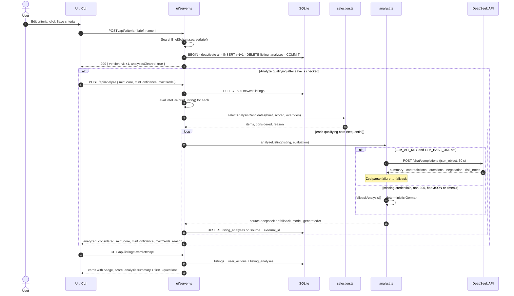

# Analysis (Laya & DeepSeek)

Analysis is the **explanation layer**. It runs *after* the deterministic score and verdict, it never changes either, and it degrades to a working local fallback rather than failing.

```text
FETCH → REFINE → DECIDE → LEARN
                   │
                   ├── rules decide      (score, verdict — always deterministic)
                   └── analysis explains (Laya triage → DeepSeek/fallback)
```

:::info Hard boundary
Rules own all vetoes. DeepSeek does **not** extract fields, does not rank, does not veto, and cannot change a badge. If every model disappeared, scores and verdicts would be byte-identical.
:::

## 1. Pipeline

| Stage | File | Responsibility |
|---|---|---|
| Selection | `src/intelligence/selection.ts` | Which cards deserve a call (thresholds, not top-N) |
| Laya (System 1) | `src/intelligence/laya.ts` | Fast classifier: family fit, risk, next action, deal |
| DeepSeek (analysis) | `src/intelligence/analyst.ts` | Summary, contradictions, questions, negotiation, risks |
| Fallback | `src/intelligence/analyst.ts` | Deterministic German output when DeepSeek is unavailable |
| Persistence | `listing_analyses` table | One row per `(source, external_id)` |
| Surface | UI card, `data/analysis.json` | Summary + first 3 questions |

---

## 2. Laya — the System-1 classifier

Laya is a small local model used for **fast triage**, not for scoring. The adapter (`classifyListingWithLaya`) sends a compact state object (title, make, model, year, price, km, fuel, gearbox, body, seats, doors, ISOFIX, price label/median, distance, seller type, damage, commercial flag, HU, warranty, red flags, 500 chars of description) and asks four typed questions via `laya.systemOne(state, QUESTIONS)`:

| Question | Type | Criteria / output |
|---|---|---|
| `family_fit` | `choice` | `poor` / `marginal` / `good` / `excellent` — "two adults, two children and a pram" |
| `risk` | `score` | 0–1 risk for a private buyer at this price |
| `action` | `choice` | `skip` / `watch` / `ask` / `inspect` |
| `deal` | `noul` | Is it clearly below comparable local listings? (noul = yes / no / unsure / likely) |

The adapter then computes a single conservative confidence:

```text
confidence = average(family, risk, action, deal)
deferToDeepSeek = confidence < 0.45 OR action.confidence < 0.30
```

Source: `src/intelligence/laya.ts`. The threshold is provisional; the rules still own every veto.

**Current integration (2026-10-29):**

- Laya is **on by default** (`LAYA_ENABLED !== "0"`).
- `npm run fetch:as24` classifies every scored listing after the rules pass and stores it in `laya_classifications`.
- `npm run laya:classify` classifies the existing corpus in bulk.
- `npm run analyze` runs Laya **before** DeepSeek and skips DeepSeek for confident triage.
- The UI reads the stored classification and shows it as **Laya advisory** on each card, including a mechanical-risk highlight at risk ≥ 1.5.
- `POST /api/analyze` still only stores DeepSeek/fallback output; it does not replace the stored Laya classification.
- `characteriseNeedWithLaya` is still not wired.

**What Laya is for**

- A cheap first pass that can be extended into triage or pre-filtering.
- A second opinion that is independent of the rules.
- Advisory metadata stored in `laya_classifications` and shown on the card.

**What Laya is not**

- It does not affect `score`, `confidence`, or `verdict`.
- It never removes a card from the analysis pool.
- It does not decide the badge; the rule engine remains authoritative.

**Running it**

```bash
npm run laya:classify                    # classify the existing corpus
npm run analyze -- --top 10              # Laya first, LLM only when configured
npm run analyze -- --no-laya             # disable Laya for one run
```

The ONNX bundle is at the root of `receptron/laya-onnx`; `LAYA_SUBFOLDER` should be empty. The model is cached under `~/.cache/receptron-laya` by default and loads in a few seconds.

:::warning Calibration status
The model is local and runs, but its confidence on broad car questions is conservative. On the current 386 listings: **212 triaged, 174 escalated, 64 at risk ≥ 1.5**. Treat Laya as a **triage signal**, not a verdict, until it has been labelled and calibrated against real buyer decisions.
:::

A second entry point, `characteriseNeedWithLaya(brief)`, profiles the *need* (from `budgetAllInEur`, radius, boot, priorities) into `city_hatch` / `family_estate` / `seven_seat` / `wait`. It is not wired into the CLI yet.

---

## 3. LLM provider — analysis only

`analyzeListing(listing, evaluation)` calls an OpenAI-compatible chat endpoint. The generic configuration is:

```bash
export LLM_BASE_URL=https://api.deepseek.com
export LLM_MODEL=deepseek-v4.1-flash
export LLM_API_KEY=sk-...
```

There is exactly one endpoint configuration. Change the base URL and model for another provider. For a keyless local endpoint, set `LLM_ALLOW_NO_KEY=1`; for example Ollama at `http://127.0.0.1:11434/v1` with `llama3.1`.

Optional provider controls:

```bash
export LLM_TIMEOUT_MS=120000       # default 30000; useful for local models
export LLM_REASONING_EFFORT=none   # sent only when set
export LLM_JSON_MODE=1             # default; use 0 if the endpoint rejects response_format
export LLM_EXTRA_HEADERS='{"x-opencode-session":"..."}'
export LLM_LANGUAGE=en               # en (default) or de
```

`LLM_EXTRA_HEADERS` is a JSON object. It is merged into the request headers and is useful for gateways such as OpenCode Go that require a session header in addition to the bearer token.

Request shape:

| Setting | Value |
|---|---|
| Endpoint | `POST {LLM_BASE_URL}/chat/completions` (or the full endpoint) |
| Model | `LLM_MODEL` (required) |
| Temperature | `0.2` |
| Response format | `{ type: "json_object" }` |
| Timeout | `30_000` ms via `AbortSignal.timeout` |
| System prompt | "Du antwortest nur mit validem JSON. Keine Halluzinationen." |
| Input | the full normalised listing JSON **and** the full rule evaluation JSON |

The prompt explicitly forbids inventing history, a VIN, or accident freedom. The response is validated with a Zod schema:

```ts
{
  summary: string,
  contradictions: string[],
  questions: string[],
  negotiation: string[],
  risk_notes: string[]
}
```

persisted as `{ source: "llm", provider, model, generatedAt, … }`; fallback rows use `source: "fallback"`.

:::warning Key alone is not enough
A missing key, base URL or model silently falls back to the deterministic path — `readLlmConfig()` returns `null` and `analyzeListing` returns `fallbackAnalysis` before any request. All values can live in `.env`. Copy `.env.example` to `.env` and fill the values. The UI and main CLIs load `.env` at startup; real shell exports take precedence. There is still no `dotenv` package, so the file is read by the application loader, not by an external tool. Never commit a real key.
:::

---

## 4. Deterministic fallback

Whenever DeepSeek cannot be used, `fallbackAnalysis` produces a complete, useful record with `source: "fallback"` and `model: "deterministic-fallback"`.

Fallback triggers, in order:

1. No usable provider configuration (key, base URL or model missing).
2. Network error or non-`2xx` response.
3. Empty/missing `choices[0].message.content`.
4. JSON that fails `AnalysisSchema.parse`.
5. The 30 s timeout aborting the fetch.

What it returns:

- **summary** — `Verdict {verdict} with score {score}. {reasons}` or `Hard fail: …`
- **contradictions** — one line per unknown field ("seats is not stated in the listing")
- **questions** — up to 8 German questions, assembled from what is actually missing: ISOFIX, seats, 5-door, HU/AU, service history, accident freedom + VIN, previous owners and reason for sale, plus "Bitte bestätigen: …" for remaining unknowns
- **negotiation** — three standing German conditions (viewing/HU reservation, discount for missing history, no deposit before VIN check)
- **risk_notes** — the listing's `redFlags`

This is why the POC is usable with no credentials at all: every card still gets a summary and a call script.

---

## 5. Candidate selection — thresholds, not top 10

```ts
// src/intelligence/selection.ts
eligible = scored
  .filter(e => e.verdict !== "reject")
  .filter(e => e.score >= minScore && e.confidence >= minConfidence)
  .sort((a, b) => b.score - a.score);

items = eligible.slice(0, maxCards);   // maxCards clamped to 1..100
considered = eligible.length;           // before the cap
```

| Concept | Behaviour |
|---|---|
| `minScore` (0–100, default 60) | Hard floor on the score |
| `minConfidence` (0–1, default 0.6) | Hard floor on evidence completeness |
| `maxCards` (1–100, default 30) | **Safety cap only** — it never raises or lowers the thresholds |
| Order | Score descending |
| Rejects | Always excluded (unless `--include-rejected`) |
| Scan window | The **500 newest** listings (`latestListings(db, 500)`); the UI list shows 1,000 |
| Result | `considered` ≥ `analyzed`; the difference is the cap, not the threshold |

So "9 cards analyzed" means **9 cards qualified**, not "the top 9 of 10". The old fixed top-10 was arbitrary; `maxCards` is a cost guard, and `considered` tells you how many cards you are *not* explaining because of it.

:::note minScore 60 vs INSPECT 65
The analysis floor (60) is deliberately lower than the `INSPECT` threshold (65), so high-confidence `WATCH` cards and strong `ASK` cards still get questions written for them. `REJECT` is the only verdict excluded by default.
:::

`--top N` still exists as an **override that bypasses the threshold logic entirely** (`selection` becomes `null`, cards are taken from the hard-pass-first, score-sorted list). It is not the default and does not consider confidence.

---

## 6. Sequence: criteria save → selection → DeepSeek/fallback → UI



---

## 7. Caching and invalidation

| Aspect | Behaviour |
|---|---|
| Storage | `listing_analyses(id, source, external_id, model, analysis_json, created_at)`, `UNIQUE(source, external_id)` |
| Key | `(source, external_id)` — **not** criteria version, not content hash |
| Write | `upsertListingAnalysis` overwrites the row on every run |
| TTL | None |
| Invalidation | `DELETE FROM listing_analyses` inside `saveCriteria`'s transaction — **every save, all rows** |
| Fetch | Does **not** clear analyses |
| Read | UI attaches whatever row exists, per listing |

Why criteria changes invalidate: an analysis answers "is this a good family car at a €7,000 cap with these gates?" Change the budget, year, or km cap and that answer may be wrong. Deleting everything is blunt but honest — it is better than silently showing reasoning produced under different rules.

:::warning Known stale cases
Analyses are not versioned, so these can occur:

1. **Threshold drift** — running `analyze` with a lower `minScore`/`maxCards` (UI fields, unsaved) writes analyses for cards that the saved profile would not select; those summaries persist until the next save.
2. **Data drift** — a fetch updates price or mileage; the stored analysis still describes the old numbers until you re-analyze or save criteria.
3. **No provenance** — the row records `model` and `created_at` but not the criteria version, so you cannot tell from the data which rules produced a summary.

The reliable reset is: **save criteria, then analyze.** That clears everything and regenerates for the current qualifiers.
:::

---

## 8. Live vs credential-dependent

| Capability | Status | Requirement |
|---|---|---|
| Rule score, verdict, confidence | **Live** | None |
| Threshold selection (`selectAnalysisCandidates`) | **Live** | None |
| Deterministic fallback analysis + German question set | **Live** | None |
| Storage in `listing_analyses`, UI rendering | **Live** | None |
| `data/analysis.json` export | **Live** | None |
| LLM summary/contradictions/negotiation | **Credential-dependent, untested here** | `LLM_API_KEY` (or keyless provider), `LLM_BASE_URL`, `LLM_MODEL`; network |
| Laya classification | **On by default for CLI runs; no recorded result** | ~1.7 GB weights load on first use; `--no-laya` or `LAYA_ENABLED=0` disables; UI paths skip it |
| Laya need characterisation | **Adapter only, unwired** | Same, plus a caller |
| mobile.de listings feeding analysis | **Blocked** | See `docs/WORKAROUNDS.md`; email/Firecrawl path |

Honest summary: **everything except the LLM prose is live and deterministic.** If you run this repository with no keys, you get badges, scores, summaries and questions — just not model-written prose.

---

## 9. Commands

```bash
# Default: every qualifying card (score >= 60, confidence >= 0.6, cap 30)
npm run analyze

# Manual top-N override — bypasses the thresholds entirely
npm run analyze -- --top 10

# Tighten or loosen the thresholds for one run (does not save criteria)
npm run analyze -- --min-score 70 --min-confidence 0.8 --max-cards 10

# Include rejected cards (debugging / adversarial review)
npm run analyze -- --include-rejected

# Laya is on by default; disable it for this run
npm run analyze -- --no-laya

# Alternate database / output file
npm run analyze -- --db ./data/buy-scout.db --out ./data/analysis.json

# DeepSeek instead of the fallback
export LLM_API_KEY=sk-...
export LLM_BASE_URL=https://api.deepseek.com
npm run analyze

# Whole chain: fetch → analyze → eval → report
npm run daily
```

UI equivalents:

```bash
npm run ui            # http://127.0.0.1:8124

# POST /api/analyze  { minScore, minConfidence, maxCards }
#   → { analyzed, considered, criteriaVersion, minScore, minConfidence, maxCards, reason }
# "Analyze qualifying cards" button, or auto-run after save
```

Reference: `package.json` scripts, `src/cli/analyze.ts`.

Expected CLI shape:

```text
INSPECT 88.6 | Kia Ceed SW 1.6 CRDi
  Verdict inspect with score 88.6. passes hard gates; strong family fit; priced well vs median/label
  Q: Ist ISOFIX vorhanden? … | Wann ist die nächste HU/AU fällig? …
Criteria v18
<non-rejected cards above score 60 and confidence 0.6; analyzing up to the 30-card cap>

Wrote /…/data/analysis.json
DeepSeek: no key — deterministic fallback; Laya: on by default (disable with --no-laya)
```

---

## 10. Current limitations

1. **Sequential calls.** The loop `for (const { listing, evaluation } of selection.items)` awaits each card. 30 cards × up to 30 s is a long run; there is no concurrency or batching.
2. **No retries.** Any DeepSeek failure degrades straight to fallback. The only signal is `source: "fallback"` / `model: "deterministic-fallback"` in the stored JSON — the CLI does not warn per card.
3. **Blunt invalidation.** One criteria save deletes *all* analyses, including for cars whose data and qualification did not change.
4. **No version stamp.** `listing_analyses` cannot tell you which criteria version produced a summary (see §7).
5. **500-listing scan window.** `analyze` and the UI both evaluate the 500 newest listings; older rows can never be selected even if they qualify.
6. **Prompt size.** The full listing JSON (including `rawJson`) and the full evaluation JSON go into the prompt with no truncation or token budget. Long descriptions cost tokens and can crowd the 30 s timeout.
7. **`--top` escapes the rules.** It skips thresholds and confidence entirely, which is useful for debugging and misleading for production.
8. **UI has no model choice and no Laya.** `POST /api/analyze` always uses `analyzeListing` and stores `laya: null`; only the CLI can run Laya.
9. **German-only prose.** The DeepSeek prompt and every fallback question and negotiation line are German. There is no locale switch.
10. **No streaming or progress.** A long run shows only the browser's pending request (`Analyzing qualifying cards…`); the CLI prints per card.
11. **Analysis is advisory by construction.** It cannot demote an `INSPECT` or rescue a `REJECT`; your `user_actions` are separate and are never touched by analysis or criteria saves.
12. **Not in eval/report.** `npm run report` and `npm run eval` consume scores and verdicts only; analysis quality is not measured anywhere yet.

## See also

- [Criteria & Priorities](./CRITERIA.md) — the profile that drives selection.
- [Verdicts & Score](./VERDICTS.md) — what the selected cards' badges mean.
- `src/intelligence/laya.ts`, `src/intelligence/selection.ts`, `src/intelligence/analyst.ts`, `src/cli/analyze.ts`, `src/ui/server.ts`.
- `docs/CRITERIA-FLOW.md` §"What happens when you analyze", `docs/STATUS.md`.
