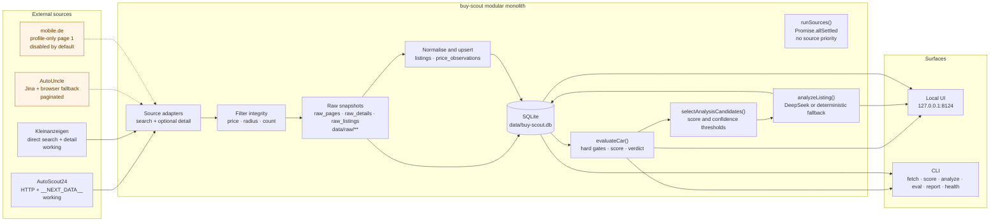
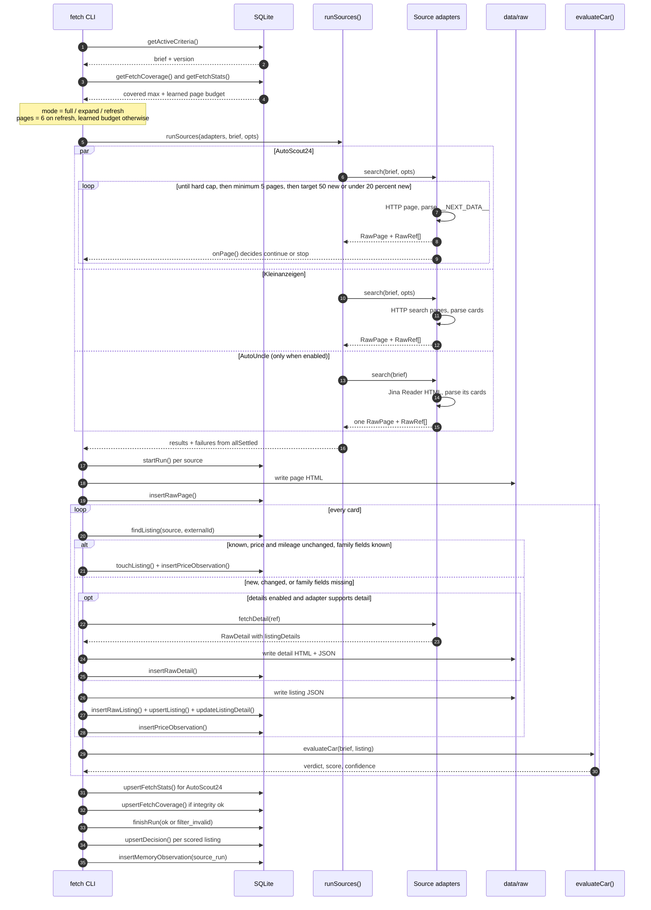
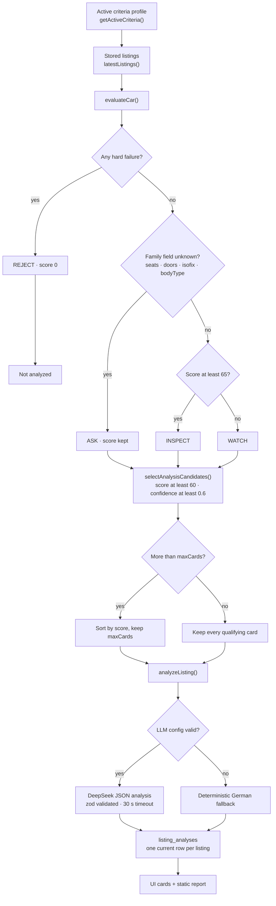
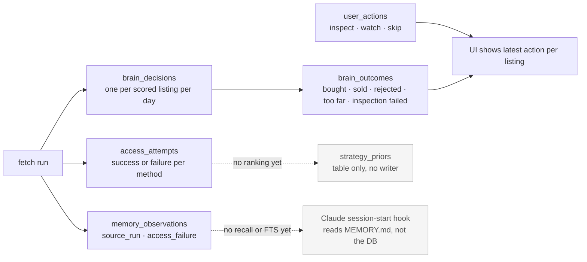

# Architecture

buy-scout is a **buy-side search and decision engine**: it searches several marketplaces, normalises what it finds, screens it against a family-car brief, and records what was recommended and what the human did. It is deliberately **not** a universal scraper.

The POC target is a used family car near Wiesloch 69168 for two adults and two children, with a first purchase targeted for January 2027. The active saved profile is **v18**: a €7,000 car cap, an €800 reserve, €7,800 all-in, and a 200 km radius. `purchaseMaxEur` is the car cap; the reserve is reporting-only. The core contracts are `SearchBrief`, `SourceAdapter`, and `NormalisedListing`; the car-specific rules live in `src/domain/cars/`. The current product is car-first, not a general-purpose scraper or a television engine.

## Why a modular monolith

The system is one TypeScript codebase on Node 24, one SQLite database, raw snapshots on the local filesystem, and a set of CLI entry points plus a local HTTP UI. There is no queue, no worker service, and no service mesh.

- **One set of rules.** The CLI, the UI, eval, and the report all call the same `evaluateCar()`. A listing cannot be INSPECT in the UI and WATCH in the CLI.
- **Parallelism without infrastructure.** `runSources()` uses in-process `Promise.allSettled`; a blocked source is data, not an outage.
- **One failure domain, one writer.** SQLite runs in WAL mode. Reads are cheap and concurrent; writes are serialised. The UI stays responsive while the fetch child process writes.
- **Clear extraction seams.** `SourceAdapter` isolates site-specific parsing, and `analyzeListing()` isolates the model call. Either can become a separate service later without changing the evaluator.

The trade-off is that a crash or a long fetch is visible to the whole local app, and SQLite is the write bottleneck. That is acceptable for a single-user POC and would not be the right shape for multi-tenant production.

## Operating state

This document does not carry a live count of listings, sources, tests, or storage. Those numbers change with every fetch and have already drifted twice. The current values belong in [Status](./STATUS.md) and are produced by:

```bash
npm run health
npm run eval
```

The only stable facts in this document are the contracts, boundaries, and invariants. If a number matters to a decision, read it from the command output, not from a paragraph.

## Operating plan

The build is not the purchase. The dates below are the decision gates, not feature wishes.

| Date | Gate | What must be true |
|---|---|---|
| 2026-11-15 | POC demo | Truth fixes, decision contract, 70+ tests, docs build |
| 2026-12-06 | Rules freeze | At least three cars inspected; labels recorded; no scoring changes after this date |
| 2026-12-15 | Shortlist decision | Best ASK car has seats, doors and ISOFIX confirmed by phone |
| 2027-01-15 | Buy or extend | Walk-away applied, or a written extension |

Walk-away: €7,000 including transfer. The €800 reserve is untouchable. Imminent HU or tyres add about €500 to the effective cost and force a budget reject if that breaks the cap. On purchase: stop fetching, freeze the report, archive the database.

The contingency is prepared but not active: a €7,800/300 km profile may be created only if the data gate shows fewer than one new INSPECT per week. Activating it creates a criteria version and clears analyses.

## Design principles

1. **N sources in parallel, no priority.** `runSources()` builds only enabled adapters from the `sources` table and settles them together. A blocked source is returned as a `SourceFailure` with a symptom and a recommended ladder; it never holds back the others. See [ADR-0001](./adr/0001-poc-architecture.md).
2. **Raw before parse.** Search pages, card payloads, and detail pages are written to disk before the database row is inserted. The raw store is the recovery input; `npm run reparse` rebuilds page-level AutoScout24 or Kleinanzeigen listings from stored pages without a network fetch. Detail-page reparse is not implemented yet.
3. **Deterministic extraction.** Parsers own every field. AutoScout24 uses `__NEXT_DATA__`; Kleinanzeigen uses search and detail HTML; AutoUncle uses Jina Reader HTML with a local Chrome fallback when Cloudflare challenges the request. DeepSeek does not populate listing fields.
4. **Rules own vetoes.** Budget, distance, seats, doors, ISOFIX, year, mileage, damage, seller type, fuel/gearbox, and red flags are deterministic hard gates. A preference weight can never rescue a hard failure.
5. **Laya classifies, DeepSeek explains.** Laya is a classifier for need and listing fit; DeepSeek produces analysis, contradictions, questions, and German drafting. Laya is advisory and never suppresses the explanation.
6. **Filter integrity is a first-class check.** A 200 response with implausible results is a failed run. Integrity is evaluated by each adapter before the run is trusted. See [ADR-0002](./adr/0002-detail-enrichment-and-family-gates.md) and [Access Playbook](./ACCESS-PLAYBOOK.md).
7. **Criteria are versioned; analysis is a cache.** Saving criteria creates a new version and deletes stored analyses. Scoring happens on read; a save does not score every row.
8. **Memory is local, not a second database.** The memory tables live in the same SQLite file as the listings. Outcomes are captured in the UI; recall and prior learning are not wired yet.

## Module map

| Module | Responsibility | Owning documents |
|---|---|---|
| `src/core/` | Contracts, brief schema, parallel runner, distance tolerance, integrity, parse helpers, dedupe | [Data Model](./DATA-MODEL.md), [Criteria](./CRITERIA.md) |
| `src/sources/` | One adapter per source; search and optional detail | [Sources](./SOURCES.md), [Source operations](./SOURCES-OPERATIONS.md) |
| `src/domain/` | Car gates, score, verdicts, preference weights | [Criteria](./CRITERIA.md), [Verdicts](./VERDICTS.md) |
| `src/intelligence/` | Analysis selection, DeepSeek fallback, Laya classification, research, saved-preference learning, seller messages | [Analysis](./ANALYSIS.md) |
| `src/acquisition/` | Access symptom classifier and strategy ladder | [Access Playbook](./ACCESS-PLAYBOOK.md) |
| `src/ingest/` | Email lead parsing | [Sources](./SOURCES.md) |
| `src/db/` | Schema and repository functions | [Data Model](./DATA-MODEL.md) |
| `src/report/` | Static HTML shortlist report | [UI](./UI.md) |
| `src/ui/` | Local HTTP server and single-page UI | [UI](./UI.md) |
| `src/cli/` | Fetch, score, analyze, eval, report, health, playbook, email, labels, Laya bulk, intake, reparse, UI | [Runbook](./RUNBOOK.md) |
| `tests/` | Evaluator, parser, integrity, criteria, coverage, selection, preferences, email, health, adversarial | `npm test` |

## System context



The external sites are untrusted and unstable; adapters are the only code that knows their shape. Everything downstream works on `NormalisedListing`. The raw store is the audit trail and the normalised database is the working set. Evaluation is a pure function over the active brief and a listing, which is why the UI can re-score the current working set on every request without a cache.

## The four stages

The canonical loop is **FETCH → PROCESS → ANALYZE → PROPOSE**. Older notes call the middle stages REFINE and DECIDE and the last stage LEARN. The mapping is FETCH → FETCH, REFINE → PROCESS, DECIDE → ANALYZE + PROPOSE, LEARN → not implemented. Use the canonical names in code and new documents.

| Stage | Question it answers | Main code |
|---|---|---|
| FETCH | What is out there now, and did the source honour the filters? | `src/cli/fetch.ts`, `src/sources/*`, `src/core/integrity.ts` |
| PROCESS | What is this listing, canonically? | adapters' `normalise*`, `mergeAs24Detail()`, `upsertListing()`, `dedupeListings()` |
| ANALYZE | Does it fit the brief, and what is missing? | `evaluateCar()`, `selectAnalysisCandidates()`, `analyzeListing()` |
| PROPOSE | What should the human look at, and what do we remember? | UI, report, `brain_decisions`, `memory_observations`, `user_actions` |

### FETCH

Fetching starts from the **active criteria profile**, never from unsaved form state:

1. `getActiveCriteria()` reads the active `criteria_profiles` row and validates the JSON.
2. CLI overrides (`--zip`, `--radius`, `--max`) modify the in-memory brief only. They do **not** create a new criteria version.
3. `fetch_coverage` and `fetch_stats` decide the mode and page budget. The coverage key includes ZIP, radius, fuel, transmission and the car cap, so changing the cap starts a new coverage row instead of poisoning the old one.

```text
coveredMax = coverage.sweptTo ?? 0

mode = --full                 -> full
     | --refresh              -> refresh
     | no coverage            -> full
     | cap > coveredMax       -> expand from coveredMax to cap
     | otherwise              -> refresh

pages = --pages ?? (mode is refresh ? 6 : learned budget)
learned budget = avg_new_per_page >= 15 -> 10
               | avg_new_per_page >= 8  -> 8
               | otherwise              -> 6
```

The defaults are `maxPages` 10 (refresh 6), `minPages` 5, `targetNew` 50. A stop rule is evaluated only after the page number reaches `minPages`. The order is: hard page cap, then minimum pages, then target-new, then the under-20-percent-new ratio.

```text
page 1: 20/20 new -> continue
page 2: 20/20 new -> continue
page 3: 20/20 new -> 60 new total, continue (minimum is 5 pages)
page 4: 20/20 new -> continue
page 5: 20/20 new -> stop (target 50 and minimum 5 reached)

next run after those are known:
page 1: 0/20 new -> continue (minimum 5 pages)
page 2: 0/20 new -> continue (minimum not reached)
...
page 5: 0/20 new -> stop (mostly known)
```

AutoScout24 and Kleinanzeigen both have multi-page search loops. AutoScout24 has detail enrichment; Kleinanzeigen has a 2-page search and detail fetch. AutoUncle is enabled and paginated; its price bucket is rounded up and filtered locally. A server-side challenge falls back to a local Chrome session.

**Detail enrichment** runs for new cards, cards whose price or mileage changed, and unchanged cards that still have unknown seats, doors or ISOFIX:

| Card state | Detail fetch? | Why |
|---|---|---|
| New | Yes | Need seats, doors, ISOFIX, description, median |
| Price or mileage changed | Yes | Description/equipment may also have changed |
| Unchanged, family fields known | No | Avoid one request per card per run |
| Unchanged, family fields missing | Yes | Backfill seats, doors or ISOFIX |

Detail failures degrade the listing to what the search card knows; they do not crash the run. With `--no-details`, family fields stay `null` and most verdicts become ASK.

**Integrity** is evaluated by each adapter before its results are trusted. The checks differ by source:

- AutoScout24: observed maximum price above `purchaseMaxEur`; observed maximum distance above `radiusKm` plus the shared tolerance; total results above 50,000; zero parsed listings while the source claims a non-zero total.
- Kleinanzeigen: local card filtering uses the cap and radius before detail; the adapter's own integrity check uses a small allowance for card-level noise.
- AutoUncle, when enabled: fetches a rounded price bucket, then filters locally; its distance is a ZIP-prefix estimate.

The shared distance tolerance is `max(5 km, 5% of radius)`. The same function is used by fetch pre-filtering, integrity and `evaluateCar()`.

A failed check sets `source_runs.status = filter_invalid` and logs an `access_attempts` row with symptom `filter_ignored`. Raw pages are still written, but the source's listings are not persisted and coverage is not advanced. A run is not successful because the HTTP status was 200.

### PROCESS

Each adapter normalises its own payload into a `NormalisedListing`. Field provenance is deliberately narrow:

| Field group | Source | Notes |
|---|---|---|
| Price, mileage, first registration, fuel, gearbox, power, seller, city, ZIP, distance | Search card | AutoScout24 `__NEXT_DATA__`; Kleinanzeigen card HTML; AutoUncle card text |
| Seats, doors, body type, equipment, description, median, warranty, CarFax, commercial-only, red flags, HU | Detail page | AutoScout24 and Kleinanzeigen when enrichment runs |
| ISOFIX | Detail equipment list and description | Equipment present without ISOFIX is `false`; an absent list remains unknown |
| AutoUncle distance | ZIP-prefix estimate | Not a geocoder; a POC approximation |
| Score, verdict, confidence | Computed at read | Never stored on `listings` |
| Analysis | DeepSeek or fallback | Cached in `listing_analyses` |

Persistence is an upsert keyed by `(source, external_id)`. Insert sets `first_seen_at` and `last_seen_at`; conflict preserves the original `first_seen_at`, moves `last_seen_at`, and clears a prior delisting. Detail fields are written by a second statement, so a failed detail fetch leaves the card-level row valid. Every scored card also appends a `price_observations` row.

Availability is a separate signal. A source-confirmed 404/410 or explicit gone page sets `delisted_at`; a live detail page clears it. `latestListings()` hides delisted rows by default, while `findListing()` keeps them available for the detail drawer. The fetch job probes a small stale shortlist; `npm run availability` can sweep more. Absence from a partial search page is never treated as proof of delisting.

Dedupe is heuristic and post-hoc. `dedupeListings()` groups by make, model, registration month, a 5,000 km mileage bucket, and a €250 price bucket, then keeps the most complete listing. It is used for CLI output and eval reporting; it does **not** delete rows. The only database-level uniqueness is per source, so the same car can exist twice. The current duplicate count belongs in `data/eval.json`, not in this paragraph.

### ANALYZE

`evaluateCar(brief, listing)` is a pure function. It produces hard failures, unknowns, a score, a confidence, reasons, preference matches, and a verdict.

```text
rawScore = 100 × (0.30·family + 0.25·deal + 0.15·age + 0.15·mileage + 0.10·distance + 0.05·evidence)
score    = hardFailures.length > 0 ? 0 : min(100, rawScore + preferenceBoost)
```

| Component | Weight | Input |
|---|---|---|
| `family` | 0.30 | Seats (5+), side doors (4+), ISOFIX, body type |
| `deal` | 0.25 | Delta to market median, else the AutoScout24 price label |
| `age` | 0.15 | First registration; newer is better |
| `mileage` | 0.15 | Lower is better above a 100,000 km floor |
| `distance` | 0.10 | Distance from the search ZIP, relative to radius |
| `evidence` | 0.05 | Known fields out of nine |
| `preference` | 0 to +25 | Weighted model/spec boosts; capped |

The family subscore weights seats 2, side doors 2, ISOFIX 2, and body type 1. A Kombi, SUV, van, or tourer scores full body-type points; other body types score half. Missing family fields are tracked as unknowns rather than silently scoring zero.

Confidence is evidence coverage, not a probability: the fraction of nine fields present (price, mileage, first registration, fuel, transmission, seats, doors, ISOFIX, body type). A cheap car with no seats or doors is low confidence even when the price is good.

Verdict precedence is exact and ordered:

| Verdict | Rule |
|---|---|
| `reject` | Any hard failure. Score is forced to 0. |
| `ask` | No hard failure, but at least one of `seats`, `doors`, `hasIsofix`, `bodyType` is unknown. |
| `inspect` | No hard failure, no family unknowns, score of at least 65. |
| `watch` | No hard failure, no family unknowns, score below 65. |

A 90-point car with unknown seats is still ASK, not INSPECT. See [What the Badges Mean](./VERDICTS.md).

Preference rules (`make`, `model`, `variant`, `title`, `equipment`, `bodyType`, `fuel`, `transmission`, `sellerType`) match by `contains` or `equals` and add 0–25 points in total. They never filter, never hide a non-match, and never rescue a hard failure.

Analysis selection is threshold-based, not a fixed top ten:

```text
candidates = recent listings, evaluated
eligible   = candidates where verdict != reject
             and score >= minScore (default 60)
             and confidence >= minConfidence (default 0.6)
selected   = eligible sorted by score, capped at maxCards (default 30, range 1–100)
```

Analysis reads the newest 500 listings by `last_seen_at`; the UI reads up to 1,000. A single-listing lookup uses the database key `(source, external_id)` rather than loading the whole working set. `npm run analyze -- --top N` bypasses the threshold as a manual override.

`analyzeListing()` calls the configured OpenAI-compatible LLM only when `readLlmConfig()` succeeds. It sends the normalised listing and the rule result, requests JSON, validates it with zod, and times out after 30 seconds. Missing configuration, a non-2xx response, a timeout, a network error, or a schema failure returns the deterministic German fallback (`model: "deterministic-fallback"`), which still produces a summary, questions, negotiation points, and red flags. The LLM never writes listing fields.

Laya is enabled by default for CLI `fetch`, `analyze`, `daily` and `laya:classify`; `--no-laya` disables it for a run and `LAYA_ENABLED=0` disables it globally. It loads local weights on first use and classifies four questions: family fit, risk, recommended action, and deal. It defers to DeepSeek when the mean confidence is below 0.45 or the action confidence is below 0.30. It is advisory, not a veto, and a confident Laya answer does not suppress the DeepSeek explanation. The UI's **Fetch now** runs `fetch:report` with `--no-laya`, and `POST /api/analyze` does not invoke Laya.

### PROPOSE

The proposal layer includes more than the static shortlist:

- **UI.** `npm run ui` serves the shortlist on `http://127.0.0.1:8124`. Every request re-evaluates stored listings against the active criteria, so a verdict is derived from the active rules. Analysis prose can still be stale after a price change.
- **Report.** `npm run report` renders a static `data/report.html` with the same verdicts and source table, using the active brief for its header.
- **Decisions.** During fetch, every scored listing gets a `brain_decisions` row with the verdict, rationale, confidence, criteria version, brief hash, and an evidence snapshot. The id is a date-scoped hash, so re-running the same day updates rather than duplicates.
- **Saved listings and actions.** The UI can save a listing, record `inspect`, `watch`, or `skip`, and clear an action. The latest action wins per listing; actions survive criteria changes.
- **Research and messages.** `POST /api/research` stores a research dossier (web/model or deterministic fallback). `POST /api/message` generates a seller message in the ad's language, stored in `seller_messages`.
- **Learned preferences.** `POST /api/preferences/learn` reads saved listings, derives strong preference rules, and creates a new criteria version. It is fenced while a fetch is running. The derivation is advisory and requires at least two saved cars.
- **Outcomes.** The detail drawer records `bought`, `sold`, `rejected_after_viewing`, `too_far`, `inspection_failed`, or `other` against the newest decision, with optional notes. `brain_decisions.outcome` is updated and `brain_outcomes` keeps history. Recall and prior learning are not wired.

## Fetch and processing, end to end



Failure handling is part of the same path:

- `runSources()` never rejects. Each adapter's rejection becomes a `SourceFailure` with a classified symptom and a strategy ladder.
- `fetch` records an `access_attempts` row and an `access_failure` observation, prints the recommendations, and continues.
- The process exits 0 when any source returned at least one listing. Partial success is still usable; completely empty is a failure.
- The UI's **Fetch now** runs the same CLI as a child process, one at a time. A second click returns HTTP 409; status exposes the last 30 log lines.

## Analysis and selection



Two details matter for reading the diagram:

- **WATCH cards are eligible for analysis.** They pass the hard gates; they simply score below 65. Only REJECT is excluded.
- **The cap is safety, not ranking.** `maxCards` truncates by score after the threshold has decided eligibility. Changing the cap does not change which cards clear the threshold.

## Decision persistence and memory

The memory schema mirrors Work Intelligence, but only part of the loop is closed.



What works:

- Decisions are persisted for every scored listing, including rejects, with the evidence used at that moment.
- Access attempts and approved lessons are queryable through `npm run playbook`.
- Human actions persist in SQLite and survive criteria saves.
- Purchase outcomes are recorded from the detail drawer against the newest decision; `brain_decisions.outcome` is updated and `brain_outcomes` keeps the history.
- The Claude Code session-start hook prints `MEMORY.md` and the latest source runs; the stop hook appends a session note.

What does not:

- `brain_outcomes` is now written from the detail drawer; outcomes are not yet used to adjust ranking or priors.
- `strategy_priors` is empty and the playbook ladder is static. Attempts are recorded but not used to rank strategies.
- `memory_observations` has no FTS index or recall path. Nothing reads observations back into a prompt.
- The session-start hook reads the Markdown memory file, not the database.

So "LEARN" is currently "record", not "learn from". The gap is tracked in [Backlog](./BACKLOG.md).

## Runtime surfaces

### CLI

| Command | What it does |
|---|---|
| `npm run fetch:as24` | Smart fetch against the active criteria; supports `--pages`, `--min-pages`, `--target-new`, `--refresh-pages`, `--max`, `--zip`, `--radius`, `--full`, `--refresh`, `--no-details`, `--no-laya`, `--delay`, `--db`, `--raw` |
| `npm run reparse` | Rebuilds page-level AutoScout24 or Kleinanzeigen listings from stored raw pages; `--source` and `--limit` control it |
| `npm run intake` | Adds a hand-found car from typed fields; runs the same evaluator |
| `npm run score` | Re-scores stored listings and prints the top N |
| `npm run analyze` | Threshold-based analysis; `--top N` overrides; `--no-laya` disables Laya |
| `npm run eval` | Writes `data/eval.json`: totals, verdict split, field coverage, top 10 |
| `npm run report` | Writes the static `data/report.html` |
| `npm run health` | Prints source health, run counts, and DB totals; exits non-zero when a source or the insert stream is stale |
| `npm run playbook` | Prints the symptom ladder, approved lessons, and attempt history |
| `npm run email` | Extracts AutoScout24, mobile.de, and Kleinanzeigen links from saved-search emails |
| `npm run laya:classify` | Runs the Laya classifier in bulk |
| `npm run labels:export` / `npm run labels:score` | Exports and scores human labels |
| `npm run ui` | Starts the local UI on port 8124 |
| `npm run daily` | Fetch, analyse, eval, report, then health in sequence; Laya runs here |
| `npm run fetch:report` | Fetch without Laya, then refresh the static report; used by UI Fetch now |

### UI HTTP surface

| Method and path | Behaviour |
|---|---|
| `GET /` | Static single-page UI |
| `GET /api/listings` | Evaluated listings with filters (`verdict`, `source`, `make`, `model`, `body`, `gearbox`, `maxPrice`, `maxKm`, `minYear`, `q`, `savedOnly`, `riskOnly`, `newOnly`, `includeRejected`, `includeSkipped`, `sort`) and a summary |
| `GET /api/summary` | Summary counts; evaluates the listing set |
| `GET /api/listing` | One listing by `source` and `externalId`, with evaluation, action, analysis, Laya, research and message |
| `GET /api/criteria` | Active profile plus all versions |
| `POST /api/criteria` | Validate and save a new version; deletes stored analyses; 409 while a fetch is running |
| `POST /api/analyze` | Threshold selection and analysis; returns considered, analysed, and thresholds |
| `POST /api/fetch` | Starts the fetch/report child process; 202 on start, 409 if one is running |
| `GET /api/fetch/status` | Job status plus the last 30 log lines |
| `POST /api/save` | Toggles a saved listing |
| `POST /api/research` | Builds or returns a research dossier |
| `POST /api/message` | Generates a seller message |
| `POST /api/preferences/learn` | Derives and applies strong preference rules from saved cars |
| `POST /api/action` | Appends `inspect`, `watch`, or `skip` |
| `DELETE /api/action` | Clears the latest action |

Data locations:

```text
data/
  buy-scout.db
  report.html
  eval.json
  analysis.json
  raw/<source>/<YYYY-MM-DD>/*.html
  raw/<source>/<YYYY-MM-DD>/listings/<externalId>.json
  raw/<source>/<YYYY-MM-DD>/details/<externalId>.html
  raw/<source>/<YYYY-MM-DD>/details/<externalId>.json
```

## Working, blocked, credential-dependent

### Working

| Capability | Evidence |
|---|---|
| AutoScout24 search, newest-first, multi-page | Adaptive page loop and detail enrichment exercised |
| Kleinanzeigen search and detail | Direct HTTP search plus detail parsing; enabled in the source registry |
| AutoScout24 detail enrichment | Seats, doors, body type, ISOFIX, equipment, description, median, warranty, CarFax, red flags |
| Parallel runner with no priority | `Promise.allSettled`; partial success keeps the chain alive |
| Filter integrity | Price, distance, total-count, and zero-listing assertions |
| Smart fetch | Coverage ledger, learned page budget, detail skip |
| Deterministic scoring and verdicts | Family hard gates, weighted score, four verdicts |
| Cross-source dedupe | Conservative grouping; report only, not deletion |
| Decision and user-action persistence | `brain_decisions`, `user_actions` |
| Threshold analysis with fallback | Runs without a key; writes `listing_analyses` |
| Eval and report | Real corpus plus adversarial cases; static HTML |
| Local UI and Fetch now | Criteria editor, filters, actions, live fetch progress |

### Blocked

| Capability | Why it is blocked | Next step |
|---|---|---|
| mobile.de search | Direct HTTP 403, Playwright blocked, Jina 403, official API 401; Firecrawl returns 200 but ignores the filters | Saved-search email as trigger, then a detail path or manual intake |
| AutoUncle search | Jina Reader can return a Cloudflare challenge; local Chrome fallback is used | Keep the browser fallback and one-page-at-a-time integrity checks |
| mobile.de detail | No adapter; Firecrawl path not implemented | Detail fetch after an email lead, or manual intake |

Blocked does not mean hidden. `npm run health` lists every source with its status and note. The `sources` table is canonical: AutoScout24, Kleinanzeigen and AutoUncle are enabled and working. mobile.de is disabled by default because fresh sessions fail Akamai; a supplied Chrome profile enables page-1 search. Only enabled adapters are constructed.

### Credential-dependent or environment-dependent

| Dependency | Needed for | Current state |
|---|---|---|
| `LLM_BASE_URL`, `LLM_MODEL`, `LLM_API_KEY` | Live model analysis | No key; the deterministic fallback is used |
| Laya weights, about 1.7 GB | Classification | On by default for CLI fetch/analyze/daily; weights load on first use; disable with `--no-laya` or `LAYA_ENABLED=0` |
| Firecrawl key | Web research and hosted unblocking | Not configured; research uses the model-knowledge fallback |
| 50 human labels | precision@10 | Harness exists; labels not collected |

None of these blocks the POC's core loop: search, normalisation, scoring, shortlist, and persisted decisions all run without a key. They block the "model does the reasoning" and "measured ranking quality" claims.

Configuration precedence: the saved criteria profile wins over the environment after the first seed. `SEARCH_*`, `PURCHASE_MAX_EUR` and `RESERVE_EUR` only build version 1 when `criteria_profiles` is empty. Fetch flags override environment values for that run. See [Operations](./OPERATIONS.md) for the variable table.

## Known limits and non-goals

- **Availability is evidence-based.** Listings are retired only after a source confirms a 404/410 or explicit gone page. Unprobed stale cards remain visible; `npm run availability` closes that gap gradually.
- **Re-parse coverage is partial.** `npm run reparse` rebuilds page-level AutoScout24 and Kleinanzeigen listings. Detail pages are not re-parsed yet.
- **Coverage is AutoScout24-only.** AutoUncle is a single bucket page; mobile.de has no coverage.
- **Dedupe is heuristic.** No VIN matching. It groups by make, model, month, mileage band, and price band.
- **Memory is partly closed.** Outcomes are captured; recall and prior learning are not wired.
- **Analysis is a cache with no version stamp.** Criteria saves clear it; price changes do not.
- **Evaluation is on-read.** There is no stored score column. `latestListings()` caps the working set (500 for analysis, 1,000 for the UI) ordered by last-seen date; a single-listing lookup uses the database key.
- **Single-user, local-only.** The UI binds to 127.0.0.1, checks same-origin requests, caps request bodies, and is not a deployment.
- **No auto-messaging, payment, or contract flow.** Drafts only; the UI can copy the message and open the listing.
- **POC v1 score.** Safety, cost, reliability, and ownership dossiers are not modelled.

Non-goals: universal crawling, TV coverage in this phase, fine-tuning Laya, multi-user auth, billing, and any CAPTCHA-solving or credential-replay arms race.

## Related docs

- [Data Model](./DATA-MODEL.md) — every table, raw vs derived, retention, gaps.
- [ADR-0001: Car-first POC architecture](./adr/0001-poc-architecture.md)
- [ADR-0002: Detail enrichment and family gates](./adr/0002-detail-enrichment-and-family-gates.md)
- [Status](./STATUS.md) — what is done, partial, blocked, next.
- [Roadmap](./ROADMAP.md) — dated POC and purchase gates.
- [Acceptance criteria](./ACCEPTANCE.md) — the testable POC contract.
- [Smart Fetch](./SMART-FETCH.md) — newest-first, adaptive pages, coverage ledger, detail skip.
- [Sources](./SOURCES.md) — source matrix and filter integrity.
- [Access Playbook](./ACCESS-PLAYBOOK.md) — symptom to strategy ladder and approved lessons.
- [Criteria and Filter Flow](./CRITERIA-FLOW.md) — criteria vs view filters vs fetch vs analyse.
- [What the Badges Mean](./VERDICTS.md) — INSPECT, ASK, WATCH, REJECT.
- [Runbook](./RUNBOOK.md) — commands, data layout, troubleshooting.
- [Plan](./PLAN.md) and [Backlog](./BACKLOG.md) — scope and next work.
