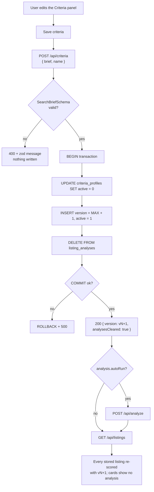
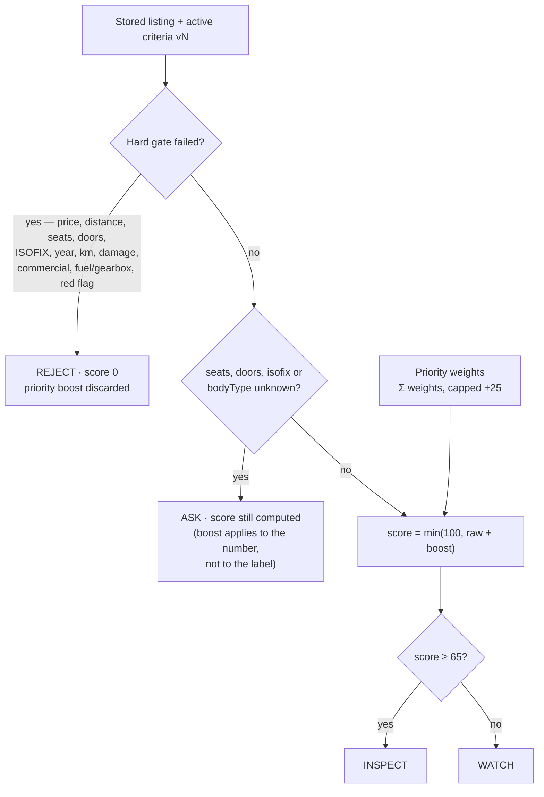

# Criteria & Priorities

buy-scout separates **what you are willing to buy** from **what you are currently looking at**. Only one of those changes a score, and only one of them ever touches the network.

| Layer | What it is | Changes score / verdict? | Fetches? | Re-analyzes? |
|---|---|---|---|---|
| **Criteria profile** | Budget, reserve, radius, seats, doors, year, km, fuel, gearbox, boot, priorities, analysis thresholds | **Yes** | No | Clears all stored analyses |
| **View filters** | Verdict, source, max price, max km, min year, search text | No — display only | No | No |
| **Fetch** (`Fetch now`, `npm run fetch:as24`) | Runs the source adapters | Uses the active criteria | **Yes** | No |
| **Analyze** (`Analyze qualifying cards`, `npm run analyze`) | Explains the current shortlist | No | No | **Yes** |

:::tip The rule
**Criteria = decision rules.** **View filters = what you want to look at.** **Fetch = get new listings.** **Analyze = explain the current shortlist.**
:::

---

## 1. What a criteria profile contains

A profile is a `SearchBrief` (`src/core/types.ts`), validated by `SearchBriefSchema` (`src/core/brief.ts`) before it is ever stored.

| Field | Type / constraint | Default | Effect |
|---|---|---|---|
| `category` | literal `"car"` | `car` | Domain discriminator |
| `purchaseMaxEur` | positive number | `7000` | **Car-price gate** + the source query cap; reserve is separate |
| `reserveEur` | ≥ 0 | `800` | Money held back; never filters |
| `budgetAllInEur` | positive number | `purchase + reserve` | Stored headline budget |
| `location.zip` | 5 digits | `69168` | Search region |
| `location.radiusKm` | positive | `200` | Distance gate (shared tolerance: max of 5 km or 5%) |
| `hard.minSeats` | int ≥ 2 | `5` | Hard gate |
| `hard.minDoors` | int ≥ 2 | `4` | Hard gate — **side doors**; 4 side doors = a 5-door car |
| `hard.minIsofix` | int ≥ 0 | `2` | Declared requirement (see gate note below) |
| `hard.minHuMonths` | int ≥ 0 | `12` | Stored, **not yet enforced** |
| `hard.minFirstRegistrationYear` | int ≥ 1950 | `2010` | Hard gate |
| `hard.maxMileageKm` | positive int | `180000` | Hard gate |
| `hard.fuel` | `any` / `petrol` / `diesel` | `any` | Hard gate when not `any` |
| `hard.transmission` | `any` / `manual` / `automatic` | `any` | Hard gate when not `any` |
| `hard.excludeDamaged` | boolean | `true` | Hard gate on `damaged === true` |
| `hard.excludeCommercialOnly` | boolean | `true` | Hard gate on `commercialOnly === true` |
| `soft.minBootLitres` | ≥ 0 | `450` | Stored, not scored |
| `soft.needsThreeAcross` | boolean | `false` | Passed to need characterisation only |
| `soft.maxLengthMm` | int or `null` | `null` | Stored, not scored |
| `soft.prioritise` | array of `family` / `safety` / `cost` / `reliability` / `deal` | all five | Metadata; scoring is fixed-weight |
| `analysis.minScore` | 0–100 | `60` | Analysis threshold |
| `analysis.minConfidence` | 0–1 | `0.6` | Analysis threshold |
| `analysis.maxCards` | 1–100 | `30` | Safety cap, **not** a top-N |
| `analysis.autoRun` | boolean | `false` | Run analysis right after saving |
| `preferences[]` | `{id, label, field, match, value, weight 0–25, enabled?}` | `[]` | Ranking boost only |

:::warning No cross-field validation
`SearchBriefSchema` checks each field, but it does **not** check that `budgetAllInEur === purchaseMaxEur + reserveEur`. The UI always computes it (`cPurchase + cReserve`); a hand-written `POST /api/criteria` can submit an inconsistent triple and nothing will complain. Keep it consistent if you script the API.
:::

---

## 2. Versioning

Every save creates a **new immutable version**. Nothing is edited in place.

```text
criteria_profiles
  id            INTEGER PK
  version       INTEGER NOT NULL UNIQUE
  name          TEXT
  criteria_json TEXT          -- the full SearchBrief
  active        INTEGER       -- 0 / 1
  created_at    TEXT

CREATE UNIQUE INDEX idx_criteria_active
  ON criteria_profiles(active) WHERE active = 1;
```

- **Exactly one active row** is enforced by the partial unique index.
- `getActiveCriteria(db)` reads `WHERE active = 1 ORDER BY version DESC LIMIT 1` and seeds version 1 from `defaultBrief()` if the table is empty.
- `saveCriteria(db, brief, name)` allocates `MAX(version) + 1`, deactivates everything, inserts the new active row, and **`DELETE FROM listing_analyses`** — all inside one transaction.
- The consumers of the active profile are: fetch, score, analyze, eval, report, and the UI (`GET /api/criteria`, `GET /api/listings`).
- `GET /api/criteria` also returns `versions[]` so the UI can show the history.
- The version number is rendered in the UI header and printed by the CLIs. The active version is v18; older rows remain as history.

:::info Why version instead of editing
Because analyses are expensive and verdicts are decisions. A version number makes "this shortlist was produced by these rules" answerable, and it gives the invalidation step a clean boundary: *one save, one version, zero stale analyses.*
:::

### Save flow



Note what is **not** in that diagram: no HTTP request to AutoScout24 or AutoUncle, no new rows in `listings`, and no deletion of your own decisions (`user_actions` survive).

---

## 3. Budget vs reserve

Two numbers, two different jobs:

```text
budgetAllInEur = purchaseMaxEur + reserveEur
```

- **`purchaseMaxEur` is the only price gate.** A car above it is `REJECT`, score 0.
- **`reserveEur` is not a filter.** It is money kept back for registration/transfer, insurance and plates, tyres/brakes/battery, first service and repairs, and a small buffer for surprises. It never excludes a listing, and it is never available to the purchase.

Consequence: **you cannot spend the reserve on the car.**

### Worked example — active v18 (€7,000 car cap + €800 reserve)

```text
purchaseMaxEur = 7000
reserveEur     = 800
budgetAllInEur = 7800
```

This is the profile active in the database. The car search caps at €7,000 and keeps €800 back, so the all-in ceiling is €7,800.

A Kia Ceed SW listing with full family data (5 seats, 5 doors, ISOFIX, Kombi, 2016, 120,000 km, 48 km away, "good price" label) and a `make equals Kia` priority at weight 8:

| Car price | Gate | Verdict | Score | Why |
|---|---|---|---|---|
| **€6,150** | passes | `INSPECT` | **88.6** → **96.6** with the +8 Kia boost | Fits the €7,000 cap; €6,150 + €800 = €6,950 of the €7,800 |
| **€7,000** | passes (boundary) | `INSPECT` | 88.6 | The gate is `price > cap`, so equality survives |
| **€7,050** | **fails** | `REJECT` | **0** | `price 7050 € > cap 7000 €` |

The score arithmetic for the €6,150 car (no boost), straight from `evaluateCar`:

```text
family   1.00  × 0.30 = 0.300   (7/7: seats 5, doors 5, ISOFIX yes, Kombi)
deal     0.80  × 0.25 = 0.200   ("good-price" label)
age      0.87  × 0.15 = 0.130   (2016 → 1 − (10−8)/15)
mileage  0.87  × 0.15 = 0.130   (120k km → 1 − 20000/150000)
distance 0.76  × 0.10 = 0.076   (48 km of a 200 km radius)
evidence 1.00  × 0.05 = 0.050   (9/9 known fields)
                        ------
raw                      88.6
+ 8 priority boost       96.6   → capped at 100
```

### Alternatives considered — other ceilings

Only the v18 triple is active. These two were written down as alternatives; they are not live and are not interchangeable with it:

```text
Setup A: purchaseMaxEur = 6200   reserveEur = 800   budgetAllInEur = 7000
Setup B: purchaseMaxEur = 7000   reserveEur = 0     budgetAllInEur = 7000
```

- **Setup A** treats €7,000 as all-in: a €6,200 car plus the €800 reserve.
- **Setup B** treats €7,000 as the car budget with no reserve.

:::warning Pick the setup that matches your real ceiling
All three are valid, but they are not interchangeable:

- **€7,000 is all you have** → Setup A (€6,200 car + €800 reserve) or Setup B (€7,000 car + €0 reserve).
- **€7,000 car + €800 reserve is fine** → the active v18 profile (€7,800 all-in).

Do not type `7000` into the purchase field while leaving an €800 reserve if your hard ceiling is €7,000. The UI shows the running all-in under the fields: “All-in budget: 7.800 € (car + reserve)”.
:::

---

## 4. Hard gates vs soft preferences

### Hard gates (deterministic vetoes)

Evaluated in `src/domain/cars/evaluate.ts`, all of them produce `REJECT` and force **score 0**, regardless of how good the rest of the car is.

| Gate | Exact condition | Notes |
|---|---|---|
| Price | `priceEur > purchaseMaxEur` | Strict `>`; equal passes; this is the car cap, not the all-in budget |
| Distance | `distanceKm > radiusKm + max(5, ceil(radiusKm × 0.05))` | One shared tolerance for fetch, integrity and evaluation |
| Damage | `excludeDamaged && damaged === true` | `null` is unknown, not damaged |
| Commercial/export-only | `excludeCommercialOnly && commercialOnly === true` | |
| Seats | `seats < minSeats` | `null` → unknown, not a failure |
| Doors | `doors < minDoors` | Side doors only |
| ISOFIX | `hasIsofix === false` | `null` → unknown, not a failure |
| First registration | `year < minFirstRegistrationYear` | `null` → unknown |
| Mileage | `mileageKm > maxMileageKm` | `null` → unknown |
| Implausibly cheap | 2010-or-newer car below €1,000 | Guards against typo/scam listings; not a quality judgment |
| Fuel | profile is `petrol`/`diesel` and the listing states a different fuel | Skipped when the listing has no fuel |
| Gearbox | profile is `manual`/`automatic` and the listing states a different gearbox | Skipped when unstated |
| Red flags | any of `Unfallschaden`, `Bastler`, `Motorschaden`, `Getriebeschaden`, `ohne TÜV`, `kein TÜV`, `nicht fahrbereit` | Substring match on `redFlags` |

**Unknown ≠ fail.** A missing field never rejects a car; if it is family-critical it downgrades the badge to `ASK` (see [Verdicts & Score](./VERDICTS.md)).

:::note Stored-but-not-enforced
`hard.minHuMonths`, `soft.minBootLitres`, `soft.needsThreeAcross`, and `soft.maxLengthMm` are part of the schema and are saved with the profile, but `evaluateCar` does not gate or score them. `minBootLitres` and `needsThreeAcross` are only forwarded to Laya's need characterisation. Do not assume a boot-litre rule is protecting you.
:::

### Soft preferences (boost only)

Preferences are a weighted table, stored **inside the active criteria profile**, edited in the UI section **Priority weights**.

| Field | What it matches against |
|---|---|
| `make` | `listing.make` |
| `model` | `listing.model` |
| `variant` | `listing.variant` |
| `title` | title + variant + description |
| `equipment` | equipment list + title + description |
| `bodyType` | `listing.bodyType` |
| `fuel` | `listing.fuel` |
| `transmission` | `listing.transmission` |
| `sellerType` | `private` / `dealer` / `unknown` |

Each rule has `label`, `field`, `match` (`contains` or `equals`), `value`, `weight` (0–25), and an optional `enabled` flag (anything other than `false` participates).

Rules are skipped when `weight <= 0`, when `value` is empty, or when the target field is empty. Matching rules sum, then `applyPreferences` clamps:

```text
boost = min(25, Σ matched weights)
score = hardFail ? 0 : min(100, rawScore + boost)
```

Three guarantees:

1. **Boost only.** A non-matching listing is never removed or hidden — it just ranks lower.
2. **Total cap +25.** Even ten maxed-out rules cannot exceed +25, so preferences cannot overwhelm the family/deal/age/mileage components (which make up 95 of the raw 100).
3. **Never rescues a hard fail.** On a hard failure the score is set to 0 *after* the boost is computed, so the boost is discarded, not added.

```text
Cars:  equipment contains "Bose"   weight 10
       make equals "Kia"           weight 8
TVs:   make equals "Samsung"       weight 15
       make equals "Huawei"        weight 0    (visible, not preferred)
```

The UI shows why a car moved up: `Priority: Bose (+10) · Kia (+8)`. The same string is pushed into `evaluation.reasons`, and the header counts cards with a non-zero boost ("priority matches").

:::tip Preference weighting that behaves
Keep single weights at 5–10 and the total under 25. Because the raw score is usually 50–90, a +25 boost can move a `WATCH` into `INSPECT` (e.g. 57.0 + 8 = 65.0) — that is intended, since `INSPECT` is a ranking label. It still cannot move a `REJECT`.
:::

---

## 5. How criteria become a score

Weighted components, fixed in code (`0.30 / 0.25 / 0.15 / 0.15 / 0.10 / 0.05`):

| Component | Weight | Input |
|---|---|---|
| `family` | 30% | Seats 2, doors 2, ISOFIX 2, body type 1; `score = earned / known weight`; unknowns leave the denominator |
| `deal` | 25% | `clamp01(0.5 + 1.5 × (priceMedian − price) / priceMedian)` when a median exists; otherwise label mapping: super/very-good 0.95, good 0.80, fair 0.55, high 0.30, unknown 0.50 |
| `age` | 15% | `clamp01(1 − max(0, currentYear − registrationYear − 8) / 15)` |
| `mileage` | 15% | `clamp01(1 − max(0, mileageKm − 100000) / 150000)` |
| `distance` | 10% | `clamp01(1 − distanceKm / radiusKm)` |
| `evidence` | 5% | `knownFields / 9` |

```text
rawScore = 100 × (0.30·family + 0.25·deal + 0.15·age + 0.15·mileage + 0.10·distance + 0.05·evidence)
score    = hardFailure ? 0 : min(100, rawScore + min(25, Σ matched preference weights))
```

## 6. Decision precedence



Precedence in words:

```text
hard gate  >  family unknown  >  score threshold  >  priority boost
```

A boost can change `WATCH` → `INSPECT` (it feeds the score), but it can never change `REJECT` → anything, and it can never remove the `ASK` downgrade.

---

## 7. The exact lifecycle

### 7.1 Save criteria

```bash
# UI
open http://127.0.0.1:8124   # npm run ui
# edit → Save criteria

# or directly
curl -s -X POST http://127.0.0.1:8124/api/criteria \
  -H 'content-type: application/json' \
  -d '{"name":"Family profile","brief":{ ...full SearchBrief... }}'
```

1. Zod validates the brief; invalid input returns `400` and writes nothing. While the UI's fetch job is running, `POST /api/criteria` returns `409` instead of writing.
2. Transaction: deactivate all → insert `vN+1` active → `DELETE FROM listing_analyses` → commit.
3. Response: `{ version: vN+1, analysesCleared: true }`.
4. Every stored listing is re-scored **on the next read** — there is no batch write of scores, because scores are derived, not stored.
5. If **Analyze qualifying after save** is checked, the UI immediately calls `POST /api/analyze`.

No fetch. No source contacted. Your `inspect` / `watch` / `skip` actions survive, because they are decisions, not machine output.

### 7.2 Change a view filter

```text
GET /api/listings?verdict=inspect&maxPrice=6000&q=Kia
```

Server reads the 1,000 newest listings, evaluates each with the active brief, then filters and sorts (verdict rank `inspect < ask < watch < reject`, then score descending). No fetch, no analysis, no criteria change, nothing persisted.

### 7.3 Fetch

```bash
npm run fetch:as24                    # smart fetch, active criteria
npm run fetch:as24 -- --full          # force a full rescan
npm run fetch:as24 -- --refresh       # newest pages only
npm run fetch:as24 -- --max 7000      # one-off override, does NOT save criteria
npm run daily                         # fetch + analyze + eval + report
```

Reads the active profile, runs all enabled adapters in parallel, normalizes and scores new rows, updates known rows. Fetch **does not** clear analyses and **does not** analyze; new listings simply have none until you run Analyze. See [Smart Fetch](./SMART-FETCH.md).

### 7.4 Analyze

```bash
npm run analyze                                # all qualifying cards; Laya runs by default
npm run analyze -- --top 10                    # manual override
npm run analyze -- --min-score 70 --max-cards 10
npm run analyze -- --no-laya                   # skip Laya for this run
```

Selects every non-rejected card clearing `score >= analysis.minScore` **and** `confidence >= analysis.minConfidence`, capped by `maxCards`. Full detail in [Analysis (Laya & DeepSeek)](./ANALYSIS.md).

### 7.5 Action → effect

| Action | Network? | Re-scores? | Analyses |
|---|---|---|---|
| Save criteria | No | Yes, all stored listings | **Deleted** |
| Save + auto-run analysis | No | Yes | Regenerated for qualifiers |
| Edit a view filter | No | Re-evaluated per request | Untouched |
| Fetch | **Yes** | New/updated rows | Untouched |
| Analyze | No (unless DeepSeek is configured) | Uses current scores | Upserted per card |

---

## 8. Gotchas

| Symptom | Cause | Fix |
|---|---|---|
| "I lowered the budget but nothing new appeared" | Saving is a local re-score | Fetch separately |
| "I saved criteria and my analysis text vanished" | By design: stale reasoning is worse than none | Re-run Analyze, or check autoRun |
| "9 cards were analyzed, not 10" | Thresholds select, `maxCards` only caps | That is correct — see Analysis |
| "A €7,100 car is under my €7,800 all-in budget but rejected" | The car cap is €7,000; the €800 reserve is not spendable | Raise the cap or lower the reserve |
| "My Bose preference did not hide the other cars" | Preferences never filter | Use a view filter, or a hard gate |
| "A +25 priority still shows REJECT" | Hard failures zero the score after boost | Change the criteria or the data |

---

## See also

- [Verdicts & Score](./VERDICTS.md) — what `INSPECT` / `ASK` / `WATCH` / `REJECT` mean, score vs confidence, pre-purchase checklist.
- [Analysis (Laya & DeepSeek)](./ANALYSIS.md) — threshold selection, fallback, caching.
- [Smart Fetch](./SMART-FETCH.md) — adaptive pages, coverage ledger, detail skip.
- `docs/CRITERIA-FLOW.md`, `src/core/brief.ts`, `src/domain/cars/evaluate.ts`, `src/intelligence/selection.ts`.
