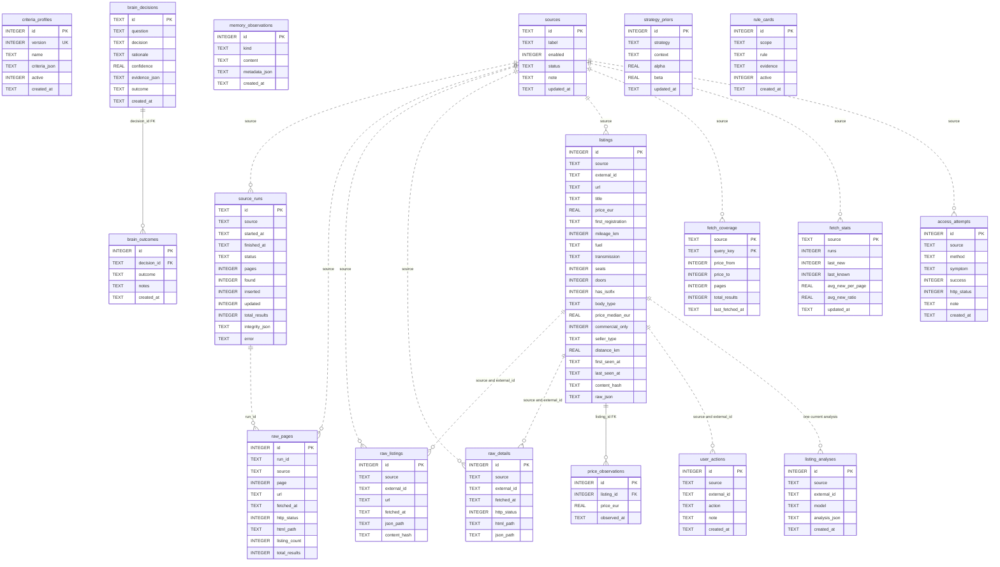

# Data Model

buy-scout keeps one SQLite database at `data/buy-scout.db` and stores the bulky source artifacts on disk under `data/raw/`. The database is the working set; the files are the audit trail. The schema lives in `src/db/schema.sql`, and `openDb()` in `src/db/index.ts` applies it, runs a small additive migration, and seeds the catalogue tables.

```text
openDb(path)
  -> resolve path, create parent directory
  -> new DatabaseSync(path)
  -> exec schema.sql            (PRAGMA WAL, foreign_keys ON, CREATE IF NOT EXISTS)
  -> ensureListingColumns()     (ALTER TABLE for 11 columns added after v1)
  -> seedSources()              (4 rows, upserted every open)
  -> seedAccessLessons()        (4 rule_cards, INSERT OR IGNORE)
  -> seedCriteria()             (v1 default profile if the table is empty)
```

There is no migration framework and no `PRAGMA user_version`. Every CLI command and the UI open their own connection. WAL allows concurrent readers and one writer; there is no application-level lock, so two fetch processes can race on the same rows.

## Layers

| Layer | Tables | Mutability |
|---|---|---|
| Operational catalogue | `criteria_profiles`, `sources`, `source_runs` | Versioned, upserted, or appended |
| Raw snapshots | `raw_pages`, `raw_details`, `raw_listings` plus `data/raw/**` | Append-only by convention |
| Derived listings | `listings`, `price_observations` | Upserted current state; append-only prices |
| Analysis and decisions | `listing_analyses`, `brain_decisions`, `brain_outcomes`, `memory_observations`, `user_actions` | Cache, append, or schema-only |
| Access learning | `access_attempts`, `rule_cards`, `strategy_priors` | Append, seed, or schema-only |
| Fetch optimisation | `fetch_coverage`, `fetch_stats` | Upserted, monotonic in one field |

Only two real foreign keys exist: `price_observations.listing_id` and `brain_outcomes.decision_id`. Every other relationship is a logical text key (`source`, `external_id`, `run_id`, `decision_id`) with no constraint. Deleting a listing does not delete its observations, actions, analyses, or snapshots.

## Row counts

Counts are generated on every fetch and save, so this page does not carry them. `npm run health` prints listings, decisions, observations, raw pages and raw details; `npm run eval` prints listings, per-source totals, dedupe groups and the verdict split. For the other tables, query the database read-only.

| Table | What a row means | Since it grows, expect |
|---|---|---|
| `criteria_profiles` | One saved criteria version; exactly one active | One row per save, never pruned |
| `sources` | One registry entry: enabled flag, status, note | Four seeded rows |
| `source_runs` | One source per fetch invocation | One per source per run |
| `raw_pages` | One search-page snapshot | Every page of every run |
| `raw_details` | One detail-page snapshot | New or changed cards with detail |
| `raw_listings` | One card payload | Every fetched card |
| `listings` | Current normalised state, one per source + external id | Bounded by inventory; confirmed-gone rows are retained and hidden by default |
| `price_observations` | One price sample | Every scored card on every run |
| `memory_observations` | One `source_run` or `access_failure` observation | Per run plus failures |
| `brain_decisions` | One decision per scored listing per day | Per listing per day |
| `brain_outcomes` | Outcome capture | Written by the detail drawer; read by `getLatestOutcome` |
| `strategy_priors` | Beta prior per strategy and context | Empty; no writer |
| `rule_cards` | Approved access lesson | Four seeded rows |
| `access_attempts` | One access attempt, success or failure | Per source per run |
| `user_actions` | One human inspect/watch/skip click | Per click |
| `listing_analyses` | Cached analysis, one per listing | Cleared by every criteria save |
| `fetch_coverage` | Covered price band per source and query context | One per context, never deleted |
| `fetch_stats` | Learned page budget per source | One per source |

## Entity relationship



Solid lines are enforced foreign keys. Dashed lines are logical joins with no constraint. `criteria_profiles`, `memory_observations`, `strategy_priors`, and `rule_cards` are standalone.

## Table reference

### `criteria_profiles`

- **Purpose.** Immutable snapshots of the `SearchBrief`; exactly one row is active and every scorer reads it.
- **Key columns.** `id` (autoincrement), `version` (unique, monotonically increasing), `name`, `criteria_json` (zod-validated `SearchBrief`), `active` (0/1), `created_at`.
- **Relationships.** None declared. No table records which criteria version produced an analysis; `brain_decisions.evidence_json` does record `criteriaVersion` and `briefHash`.
- **Lifecycle.** `seedCriteria()` inserts v1 from `defaultBrief()` only when the table is empty. `saveCriteria()` runs a transaction: deactivate every row, insert `MAX(version) + 1` as active, delete all `listing_analyses`, commit. Versions are never edited or deleted. A partial unique index (`idx_criteria_active` on `active = 1`) enforces a single active row.
- **Writers and readers.** Writer: `seedCriteria()`, `saveCriteria()` (from `POST /api/criteria`). Readers: `getActiveCriteria()` in fetch, score, analyse, eval, report, and the UI; `listCriteriaVersions()` in the UI.

### `sources`

- **Purpose.** Operational registry used by `npm run health` and the report to show working and blocked sources. Only enabled rows produce adapters.
- **Key columns.** `id` (`autoscout24`, `mobile_de`, `autouncle`, `kleinanzeigen`), `label`, `enabled`, `status`, `note`, `updated_at`.
- **Relationships.** Logical parent of `source_runs`, `fetch_coverage`, `fetch_stats`, and `access_attempts`; not a foreign key.
- **Lifecycle.** `seedSources()` inserts all four rows on **every** database open; on conflict it updates only `label` and `updated_at`. `enabled`, `status` and `note` are written on first insert, so later manual edits to those columns persist.
- **Writers and readers.** Writer: `seedSources()`. Readers: `src/cli/fetch.ts` (adapter switch), `src/cli/health.ts`, `src/cli/report.ts`.

:::warning
The seeded flags are `autoscout24 = 1`, `kleinanzeigen = 1`, `autouncle = 1`, `mobile_de = 0`. `src/cli/fetch.ts` constructs AutoScout24, AutoUncle, Kleinanzeigen and mobile.de adapters and keeps only those whose registry row is enabled. mobile.de stays disabled by default because fresh sessions fail Akamai; a supplied Chrome profile enables its page-1 search. Edit `enabled` in the table to change the switch.
:::

### `source_runs`

- **Purpose.** One audit row per source per fetch invocation, with counts, integrity result, and error text.
- **Key columns.** `id` (text, `<source>-<ISO timestamp>`), `source`, `started_at`, `finished_at`, `status` (`running`, `ok`, `filter_invalid`; the type also allows `failed` but no current path writes it), `pages`, `found`, `inserted`, `updated`, `total_results`, `integrity_json`, `error`.
- **Relationships.** `raw_pages.run_id` points here logically.
- **Lifecycle.** Inserted as `running` before page writes, updated once by `finishRun()`. If the process dies mid-run, the row stays `running` forever. Runs are never deleted.
- **Writers and readers.** Writers: `startRun()`, `finishRun()` in `src/cli/fetch.ts`. Readers: health and report join for run counts and averages.

### `raw_pages`

- **Purpose.** Pointer to each immutable search-page snapshot.
- **Key columns.** `run_id`, `source`, `page`, `url`, `fetched_at`, `http_status`, `html_path`, `listing_count`, `total_results`. Unique on `(run_id, page)`.
- **Relationships.** `run_id` belongs to a `source_runs` row by convention only.
- **Lifecycle.** Append-only. The HTML file is written first to `data/raw/<source>/<YYYY-MM-DD>/<runId>-p<page>.html`, then the row is inserted. Each run gets a new `run_id`, so page paths never collide.
- **Writers and readers.** Writer: `insertRawPage()`. Readers: health and `npm run reparse` for AutoScout24 pages.

### `raw_details`

- **Purpose.** Pointer to each AutoScout24 detail-page snapshot.
- **Key columns.** `source`, `external_id`, `fetched_at`, `http_status`, `html_path`, `json_path`. Unique on `(source, external_id, fetched_at)`.
- **Relationships.** Logical join to `listings` on `(source, external_id)`.
- **Lifecycle.** `INSERT OR IGNORE`, because `fetched_at` has second resolution. Files go to `data/raw/<source>/<YYYY-MM-DD>/details/<externalId>.html` and `.json`. A second fetch of the same car on the same day overwrites both files while the older row keeps pointing at the same path.
- **Writers and readers.** Writer: `insertRawDetail()` via `fetchDetailForRef()`. Readers: none yet.

### `raw_listings`

- **Purpose.** Pointer to the card-level payload persisted for each fetched card.
- **Key columns.** `source`, `external_id`, `url`, `fetched_at`, `json_path`, `content_hash`. Unique on `(source, external_id, fetched_at)`.
- **Relationships.** Logical join to `listings` on `(source, external_id)`.
- **Lifecycle.** `INSERT OR IGNORE`. The file is `data/raw/<source>/<YYYY-MM-DD>/listings/<externalId>.json`, overwritten on a same-day re-fetch.
- **Writers and readers.** Writer: `insertRawListing()` in `src/cli/fetch.ts`. Readers: none.

:::note[What is actually in the JSON]
`raw_listings.json_path` stores `NormalisedListing.rawJson`. For AutoScout24 that is the search-card object; when detail enrichment runs, `mergeAs24Detail()` replaces `rawJson` with the detail `listingDetails` payload. For AutoUncle it is the parsed card object. It is not uniformly the untouched source document.
:::

### `listings`

- **Purpose.** The current normalised state, one row per `(source, external_id)`. This is the only table `evaluateCar()` reads.
- **Key columns.** Identity (`source`, `external_id`, unique together), `url`, `title`, `price_eur`, `make`, `model`, `variant`, `first_registration`, `mileage_km`, `fuel`, `transmission`, `power_kw`, `power_ps`, `body_type`, `seats`, `doors`, `price_median_eur`, `commercial_only`, `has_isofix`, `hu_due`, `warranty`, `carfax_url`, `description`, `equipment_json`, `red_flags_json`, `seller_type`, `seller_name`, `city`, `zip`, `distance_km`, `price_label`, `price_evaluation`, `damaged`, `summary`, `image_url`, `first_seen_at`, `last_seen_at`, `delisted_at`, `delist_reason`, `availability_checked_at`, `content_hash`, `raw_json`.
- **Relationships.** Parent of `price_observations` by foreign key; logical parent of `user_actions`, `listing_analyses`, `raw_listings`, and `raw_details`.
- **Lifecycle.** `upsertListing()` inserts core fields or updates them on conflict while preserving `first_seen_at`; `updateListingDetail()` fills detail-only fields; `touchListing()` moves `last_seen_at` and clears a prior delisting. `markListingUnavailable()` sets `delisted_at`, `delist_reason` and `availability_checked_at` only when a source confirms a 404/410 or explicit gone page; `markListingAvailable()` clears the delisting. There is no delete. `latestListings()` hides delisted rows by default; `findListing()` still returns them for the detail drawer. Indexes exist on `price_eur`, `city`, and `first_seen_at`.
- **Writers and readers.** Writers: `upsertListing()`, `updateListingDetail()`, `touchListing()` from fetch. Readers: `latestListings()` (ordered by `first_seen_at` descending; callers use 500 or 1,000), `findListing()`, `countListings()`, score, analyse, eval, report, and the UI.

There is no stored `score`, `verdict`, or `confidence`. They are recomputed against the active brief on every read, which is why a criteria save re-scores instantly without touching `listings`.

### `price_observations`

- **Purpose.** Append-only price time series per listing.
- **Key columns.** `listing_id` (foreign key), `price_eur`, `observed_at`.
- **Relationships.** Many rows per `listings.id`; no unique constraint.
- **Lifecycle.** One insert per card per run, including unchanged cards, so the table grows with `runs × cards`, not with actual price changes. There is no index on `listing_id` (SQLite does not create one automatically for foreign keys).
- **Writers and readers.** Writer: `insertPriceObservation()` in fetch. Readers: none in the POC — the table is write-only, and there is no price-history chart.

### `memory_observations`

- **Purpose.** Work-Intelligence-style observation log for later recall.
- **Key columns.** `kind`, `content`, `metadata_json`, `created_at`.
- **Relationships.** None.
- **Lifecycle.** Append-only. Current kinds are `source_run` (one per fetch, with per-source counts and failures) and `access_failure` (one per failed source, with error and recommendations). No FTS index, no embeddings, no recall path.
- **Writers and readers.** Writer: `insertMemoryObservation()` in fetch. Readers: count queries in health and report only.

### `brain_decisions`

- **Purpose.** Persisted decision record for each scored listing, with the evidence used at the time.
- **Key columns.** `id` (`sha256(source:externalId:YYYY-MM-DD)[:32]`), `question`, `decision` (the verdict), `rationale`, `confidence`, `evidence_json` (score, components, hard failures, unknowns, listing snapshot), `outcome` (updated when the buyer records an outcome), `created_at`.
- **Relationships.** Parent of `brain_outcomes` by foreign key.
- **Lifecycle.** Upserted per scored listing, including rejects. The date-scoped id means a re-run on the same day updates the row; a new day creates a new row. `created_at` is set on first insert and not updated on conflict.
- **Writers and readers.** Writer: `upsertDecision()` in fetch. Readers: counts only.

:::note[Two quirks worth knowing]
The question text is `"Shortlist this car for a family of four near <ZIP>?"`, derived from the active brief. `evidence_json` records `criteriaVersion`, `briefHash`, score, components, hard failures and unknowns, so a decision can be tied to the profile that produced it.
:::

### `brain_outcomes`

- **Purpose.** Outcome capture for a decision (`bought`, `sold`, `rejected after viewing`, and so on).
- **Key columns.** `decision_id` (foreign key), `outcome`, `notes`, `created_at`.
- **Relationships.** Many rows per `brain_decisions.id`.
- **Lifecycle.** Schema only. No code inserts, updates, or reads it; the table is empty.
- **Writers and readers.** None in the POC.

### `strategy_priors`

- **Purpose.** Beta priors per `(strategy, context)` so the access recommender can eventually rank the strategy that worked last time.
- **Key columns.** `strategy`, `context`, `alpha`, `beta`, `updated_at`. Unique on `(strategy, context)`.
- **Relationships.** None.
- **Lifecycle.** Schema only. Empty. The playbook ladder remains static.
- **Writers and readers.** None in the POC.

### `rule_cards`

- **Purpose.** Approved, reusable access lessons scoped to a source or to `access:generic`.
- **Key columns.** `scope`, `rule`, `evidence`, `active`, `created_at`. Unique on `(scope, rule)`.
- **Relationships.** None.
- **Lifecycle.** `seedAccessLessons()` inserts four lessons with `INSERT OR IGNORE` on every open. Manually added lessons persist; changing seed text does not update an existing `(scope, rule)` row. Deactivating a lesson is respected by the playbook reader.
- **Writers and readers.** Writer: `seedAccessLessons()`. Reader: `npm run playbook` selects `active = 1`.

### `access_attempts`

- **Purpose.** Audit log of access method success and failure, by source and symptom.
- **Key columns.** `source`, `method`, `symptom`, `success`, `http_status`, `note`, `created_at`. Indexes on `source` and `symptom`.
- **Relationships.** Logical join to `sources.id`; no foreign key.
- **Lifecycle.** Append-only. Fetch records one row per successful source after integrity (`success = integrity.ok`; symptom `filter_ignored` when invalid; `http_status` hardcoded to 200) and one row per thrown failure (`http_status` null). Detail failures are not recorded.
- **Writers and readers.** Writer: `recordAccessAttempt()`. Reader: `npm run playbook` groups history.

### `user_actions`

- **Purpose.** Human decisions on a listing: inspect, watch, or skip.
- **Key columns.** `source`, `external_id`, `action` (CHECK constraint), `note`, `created_at`. Index on `(source, external_id)`.
- **Relationships.** Logical join to `listings`; no foreign key.
- **Lifecycle.** Append-only. The UI shows the latest row per listing (`MAX(id)` grouped by source and external id). Actions are **not** cleared when criteria change, because they are the human's decisions, not the machine's.
- **Writers and readers.** Writer: `recordUserAction()` from `POST /api/action`. Reader: `latestUserActions()` in the UI.

### `listing_analyses`

- **Purpose.** Cache of the latest analysis for a listing, so the UI and report do not re-call the model on every read.
- **Key columns.** `source`, `external_id`, `model`, `analysis_json`, `created_at`. Unique on `(source, external_id)`.
- **Relationships.** Logical join to `listings`; no foreign key.
- **Lifecycle.** Upserted by `npm run analyze` and `POST /api/analyze`; **all rows are deleted** inside `saveCriteria()`. The JSON shape is `{ analysis, laya }`; `analysis.source` is `deepseek` or `fallback`, and the CLI appends `+laya` to `model` when the classifier ran. Only one analysis per listing is retained — there is no history.
- **Writers and readers.** Writers: `upsertListingAnalysis()`, `DELETE` in `saveCriteria()`. Reader: `getListingAnalysis()` in the UI.

### `fetch_coverage`

- **Purpose.** Remembers which price band has already been fetched for a source and query context, so a daily run can refresh instead of re-scanning. `swept_to` is the last full/expand cap; `peeked_to` is the last refresh cap. A refresh does not move `swept_to`.
- **Key columns.** Composite primary key `(source, query_key)`; `query_key` is `zip|radius|fuel|transmission`; `price_from`, `price_to`, `pages`, `total_results`, `last_fetched_at`.
- **Relationships.** Logical join to `sources.id`.
- **Lifecycle.** Upserted only for AutoScout24 and only when integrity is OK. `price_to = MAX(existing, excluded)` makes the covered band monotonic; `price_from` is overwritten. Rows are never deleted. The covered band is a price range, not an exhaustive sweep.
- **Writers and readers.** Writers: `upsertFetchCoverage()`. Reader: `getFetchCoverage()` in fetch's mode decision.

### `fetch_stats`

- **Purpose.** Learned page budget per source, based on an EWMA of new listings per page.
- **Key columns.** `source` (primary key), `runs`, `last_new`, `last_known`, `avg_new_per_page`, `avg_new_ratio`, `updated_at`.
- **Relationships.** Logical join to `sources.id`.
- **Lifecycle.** Upserted only for AutoScout24 after a run with page stats. EWMA is `old × 0.7 + current × 0.3`; a cold start uses the current value. Query the table for the current run count and learned budget.
- **Writers and readers.** Writers: `upsertFetchStats()`. Reader: `getFetchStats()` in fetch's page-budget decision.

## Raw versus derived data

| Artifact | Stored in | Built from | Rebuildable without the network? |
|---|---|---|---|
| Search page HTML | `data/raw/...` + `raw_pages` | Adapter HTTP | `npm run reparse` rebuilds AutoScout24 listings |
| Detail HTML and payload | `data/raw/...` + `raw_details` | AutoScout24 detail HTTP | No |
| Card payload | `data/raw/...` + `raw_listings` | Adapter card JSON, or detail payload after merge | No |
| Current listing | `listings` | Card plus detail merge | Only by re-fetching |
| Price history | `price_observations` | Every scored card per run | No |
| Analysis | `listing_analyses` | `listings` plus the active brief | Yes, re-run `npm run analyze` |
| Decision | `brain_decisions` | Evaluation snapshot at fetch time | No; the criteria version and brief hash are recorded, the full brief is not |
| Human action | `user_actions` | Human | No, by definition |

**Immutability is a convention, not an enforcement.** No trigger blocks an `UPDATE` or `DELETE` on a `raw_*` table, and the files themselves are replaced when the same listing is re-fetched on the same day. The scheme has three additional leaks:

1. `listings/<externalId>.json` and `details/<externalId>.html` are keyed by day and listing, not by fetch. Two rows with different `fetched_at` values can point at one path whose content is the newer snapshot.
2. `raw_listings` sometimes holds the detail payload rather than the search-card payload, so it is not a uniform raw artifact.
3. Deleting the database leaves the files; deleting the files leaves dangling paths in the tables. There is no reconciliation.

## Criteria versioning

`criteria_profiles` is an append-only configuration log with a movable active pointer.

```text
POST /api/criteria
  -> SearchBriefSchema.parse(brief)          reject invalid values
  -> BEGIN
       UPDATE criteria_profiles SET active = 0
       INSERT version = MAX(version) + 1, active = 1
       DELETE FROM listing_analyses
     COMMIT
```

Consequences:

- **No fetch.** Saving criteria is a local re-score, not a refresh. Sources are not contacted.
- **Fenced while a UI fetch runs.** `POST /api/criteria` returns `409` instead of saving.
- **Every stored listing is re-scored on the next read**, because the score is never materialised.
- **Analyses are invalidated globally.** The reasoning may depend on budget, year, mileage, or radius, so it is safer to delete than to show stale advice.
- **User actions survive.** They are human decisions.
- **Decisions survive** but carry no criteria version, so an old decision cannot be tied to the profile that produced it.
- **Versions accumulate forever.** There is no pruning and no rename/delete API.

**v18 is the current €7,000 car cap + €800 reserve over 200 km.** Earlier versions remain as history. `defaultBrief()` now produces the v18-compatible defaults (€7,000/200 km) when the table is first seeded. Older rows remain as history.

## Analysis invalidation

`listing_analyses` is a cache with a deliberately blunt invalidation rule: **any criteria save deletes every row.** The table has no `criteria_version`, `listing_content_hash`, or `invalidated_at` column, so nothing can selectively invalidate.

What that means in practice:

- After a criteria change, the UI shows no analysis until `npm run analyze` or the Analyze button runs again. With `analysis.autoRun` enabled, the UI immediately calls `POST /api/analyze`.
- A fetch that changes a listing's price, mileage, or description does **not** clear its analysis. The old summary and questions remain visible until the next analysis run or criteria save.
- Because `listing_analyses` is unique on `(source, external_id)`, re-analysis replaces the previous row rather than appending. There is no analysis history.
- The table can be empty immediately after a criteria save, because that save deleted every row.

## Coverage and the learned page budget

Two small tables close the fetch loop.

`fetch_coverage` answers "which price band have I already covered for this search context?" The key deliberately excludes the price cap; the cap is the value being tracked.

```text
example row: autoscout24 | 69168|200|any|any | 0 -> 10,000 EUR | 6-page refresh window
mode for a 7,000 EUR cap: refresh (covered)
mode for a 10,000 EUR cap: refresh (covered)
mode for a 12,000 EUR cap: expand 10,000 -> 12,000
```

- `price_to` only grows (`MAX` on conflict). Lowering the budget does not shrink coverage and does not delete higher-priced listings; they are simply rejected by the current score.
- `--full` ignores coverage for the run but still writes the result back.
- A `--max` override can expand coverage without creating a criteria version. That is how the ledger reached €10,000 while the active profile caps at €7,000.
- Coverage is written only for AutoScout24 and only after a valid integrity check. AutoUncle and mobile.de have no coverage rows.

`fetch_stats` answers "how many pages are worth fetching?" It stores an EWMA of new listings per page and the new ratio. The next full run uses 10 pages at 15 or more new per page, 8 pages at 8 or more, and 6 pages otherwise. Refresh runs use at least 6 pages. Only AutoScout24 writes this table; query it for the current runs and learned budget.

## User actions

`user_actions` is an append-only human log, not a state column:

- `action` is constrained to `inspect`, `watch`, or `skip`.
- The UI reads the latest row per listing with `MAX(id)` grouped by `(source, external_id)`.
- There is no uniqueness constraint and no foreign key; a deleted listing leaves its actions behind.
- Criteria changes do not clear actions. They are the user's judgement, not a model output.
- Rows come from UI clicks, not imported history.

## Retention and cleanup

No retention job exists. The table below is guidance if one is added; do not run destructive SQL against the working database without a backup.

| Table | Growth driver | POC retention | Cleanup note |
|---|---|---|---|
| `raw_pages` | One row plus roughly 1 MB HTML per page per run | Keep 30–90 days | Delete row and file together; no cascade |
| `raw_details` | One row and two files per detail fetch | Keep 30–90 days | Largest disk consumer; prune by `fetched_at` |
| `raw_listings` | One row per card fetch, including changes | Keep 30–90 days | Same-day file overwrite limits historical value |
| `listings` | Bounded by source inventory | Keep all | Confirmed-gone rows are retained for audit; default reads hide them |
| `price_observations` | Every run times every scored card | Downsample to daily | Duplicate samples per run; no index on `listing_id` |
| `brain_decisions` | Listing times day | Keep until outcomes exist | Outcomes are wired; prune only with a retention policy |
| `brain_outcomes` | Written on demand | Keep all | No recall yet; do not prune |
| `memory_observations` | Per run plus failures | Keep all | Small; no recall path |
| `access_attempts` | Per source per run | Keep all, or aggregate yearly | Small; useful for future priors |
| `rule_cards` | Seeded plus manual | Keep all | Deactivate rather than delete |
| `strategy_priors` | Empty | Keep all | No writer yet |
| `user_actions` | Human clicks | Keep all | Human-scale |
| `listing_analyses` | Bounded by listings | Keep current only | Already cleared wholesale on criteria save |
| `criteria_profiles` | One per save | Keep all | 11 versions; useful audit trail |
| `source_runs` | One per source per fetch | Keep 90 days | Audit trail for health |
| `fetch_coverage` | One per source and context | Keep all | Monotonic; deleting resets coverage |
| `fetch_stats` | One per source | Keep all | Deleting forces a cold start |
| `sources` | Fixed four rows | Keep all | Reseeded on open |

The raw store was about 87 MB across 371 files after two days of runs, so detail HTML dominates disk growth. `data/report.html`, `data/eval.json`, and `data/analysis.json` are generated artifacts and can be regenerated.

## Known POC gaps

1. **Logical keys are unenforced.** Only two foreign keys exist. Deleting a listing or a run orphans observations, snapshots, actions, and analyses.
2. **Same-day snapshot overwrite.** Per-listing file paths are day-scoped, not fetch-scoped, so an earlier snapshot can be silently replaced while its row survives.
3. **`raw_listings` is not uniformly raw.** After detail enrichment it contains the detail payload; before enrichment it contains the card.
4. **Re-parse is partial.** `npm run reparse` rebuilds AutoScout24 pages; details and Kleinanzeigen pages are not re-parsed yet.
5. **Analyses have no version stamp.** `listing_analyses` cannot say which criteria or content hash produced a row, and a price change does not invalidate it.
6. **Outcome capture is wired; priors are not.** `brain_outcomes` is written by the detail drawer and read by the latest-outcome lookup. `strategy_priors` has no writer or reader.
7. **Decisions are not fully reproducible.** `evidence_json` records the criteria version and brief hash, but not the full brief, so replaying an old decision needs that criteria row.
8. **Availability is evidence-based, not inferred.** A row is hidden only after a source confirms 404/410 or its explicit gone page. Absence from a partial search sweep is not proof, so unprobed stale cards remain visible until a detail check. Automatic fetch checks probe a small stale shortlist; `npm run availability` sweeps more.
9. **Price observations are write-only and duplicative.** Every run appends a sample even when the price is unchanged, and there is no `listing_id` index.
10. **Coverage is AutoScout24-only and cap-agnostic.** `query_key` excludes the price cap, so one row tracks the highest band ever covered, and a `--max` override can widen it without a criteria version.
11. **`sources.enabled` is not authoritative.** All four rows are seeded enabled, and `openDb()` overwrites manual status edits.
12. **Seed lessons do not update.** `INSERT OR IGNORE` means edited seed text never replaces an existing `(scope, rule)` row.
13. **No migration framework.** `ensureListingColumns()` patches only `listings`; any other schema change needs a manual migration.
14. **Working-set caps hide old rows.** `latestListings()` limits to 500 (analysis/report), 1,000 (UI/eval), or 5,000 (`findListing`), ordered by `first_seen_at`; older listings fall out of view and out of decisions.
15. **No retention or backup policy.** WAL files, raw HTML, and append-only observations grow without a cleanup command.

## Related docs

- [Architecture](./ARCHITECTURE.md) — modules, stages, and runtime surfaces.
- [Smart Fetch](./SMART-FETCH.md) — coverage modes, detail skip, learned budget.
- [Criteria and Filter Flow](./CRITERIA-FLOW.md) — criteria saves versus view filters.
- [Runbook](./RUNBOOK.md) — commands, data layout, reset instructions.
- [ADR-0001: Car-first POC architecture](./adr/0001-poc-architecture.md)
- [ADR-0002: Detail enrichment and family gates](./adr/0002-detail-enrichment-and-family-gates.md)
- [Status](./STATUS.md) and [Backlog](./BACKLOG.md) — current state and next work.
