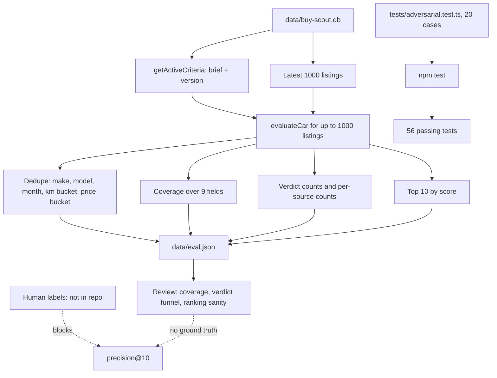

---

id: evaluation
title: Evaluation
sidebar_position: 2
description: "buy-scout — Evaluation: 292 real listings, 20 adversarial cases, coverage, verdict distribution, and the precision@10 gap."
---

# Evaluation

:::warning Historical evaluation

The tables below were produced against criteria **v11** and an earlier 292-listing corpus. The active profile is **v18** and the corpus has changed. The methodology and adversarial cases remain useful; the counts and verdict split are not current. Run `npm run eval` for the current values.

:::

`npm run eval` answers three narrow questions and refuses to answer a fourth:

1. What is in the database, and how complete are the fields the rules depend on?
2. How does the current active criteria profile distribute verdicts across that data?
3. Which ten cars does the current rule set rank highest?

It does **not** answer "is the shortlist good?". That needs human labels, and the
repository has none yet. Everything below distinguishes measured numbers from the
quality claim that is still missing.

`data/eval.json` is the source of truth for the numbers on this page. `docs/STATUS.md`
and `docs/ACCEPTANCE.md` are prose snapshots and can lag; when they disagree with
`data/eval.json`, the JSON wins.

## Current snapshot

Generated `2026-10-29T08:30:16Z`, criteria version **11**:

| Metric | Value | Where it comes from |
|---|---|---|
| Real listings scored | **292** | `totals.listings`, `totals.realListings` |
| Adversarial cases | **20** | `totals.adversarialCases` (declared, not executed — see below) |
| Sources | **2** — `autoscout24` 267, `autouncle` 25 | `totals.bySource` |
| Dedupe groups | **1** | `totals.dedupeGroups` |
| Duplicates collapsed | **1** | `totals.duplicates` |
| INSPECT / ASK / WATCH / REJECT | **30 / 11 / 6 / 245** | `totals.verdicts` |
| Passing tests | **56** | `npm test` (20 of them adversarial) |

Active profile behind these numbers: purchase cap €7,000, reserve €800, 200 km radius,
5 seats, 4 doors, ISOFIX required, first registration 2010+, max 180,000 km, min boot
450 L (soft), analysis thresholds 60 / 0.6 / 30, no priority weights.

:::caution These numbers belong to a superseded profile
The snapshot above was produced under v11. The active profile is v18 (€7,000 car cap +
€800 reserve, €7,800 all-in, 200 km), and `docs/PLAN.md`, the UI subtitle and the defaults
all derive from it now. The eval numbers are correct *for v11*; they would be different
for the active profile. Run `npm run eval` before comparing runs.
:::

## What the harness does

`src/cli/eval.ts` is a single pass, about 80 lines:

```text
open SQLite (--db, default DB_PATH or ./data/buy-scout.db)
  -> read the ACTIVE criteria profile (brief + version)
  -> load the latest 1000 listings from the DB
  -> evaluateCar(brief, listing) for each        # same function as UI, score and report
  -> dedupeListings(listings)                    # conservative make/model/date/km/price buckets
  -> coverage over 9 fields                      # null or empty string counts as missing
  -> verdict counts + per-source counts
  -> top 10 by score
  -> write JSON (--out, default ./data/eval.json) and print totals
```

```bash
npm run eval                                   # writes ./data/eval.json
npm run eval -- --db ./data/buy-scout.db       # explicit database
npm run eval -- --out /tmp/eval-run.json       # do not overwrite the committed snapshot
```

The command prints only `report.totals`; open the JSON for coverage, top 10 and the brief
snapshot. Because the brief is embedded in the output, a result is reproducible against
the profile that produced it even after the active profile changes.

### Two honesty notes about the output

- **`adversarialCases: 20` is a literal in the source.** `npm run eval` does not run the
  adversarial tests; it records that they exist. They execute under `npm test`
  (`tests/adversarial.test.ts`, exactly 20 `test()` calls).
- **`realListings` duplicates `listings`.** The field is a leftover from the 50-listing
  POC target. Read `totals.listings`, not the label.
- **`top10` is by score, not by verdict.** In the current data no REJECT can appear
  because a hard failure zeroes the score, but the selection itself is unaware of verdict.

## Eval flow



## Field coverage

Nine fields feed `evaluateCar`. Six of them are gates or ranking components; three are the
family-critical fields that decide INSPECT versus ASK. Evidence is `knownFields / 9`, so a
missing family field also caps confidence.

| Field | Present | Total | Coverage | Role |
|---|---|---|---|---|
| `priceEur` | 292 | 292 | 100% | Hard cap, deal component |
| `mileageKm` | 292 | 292 | 100% | Hard cap, mileage component |
| `firstRegistration` | 292 | 292 | 100% | Hard gate, age component |
| `fuel` | 292 | 292 | 100% | Conditional hard gate |
| `transmission` | 292 | 292 | 100% | Conditional hard gate |
| `seats` | 220 | 292 | 75.3% | Hard gate; unknown forces ASK |
| `doors` | 223 | 292 | 76.4% | Hard gate; unknown forces ASK |
| `hasIsofix` | 218 | 292 | 74.7% | Hard gate; unknown forces ASK |
| `bodyType` | 253 | 292 | 86.6% | Family component; unknown forces ASK |

Percentages are rounded; 220 / 292 is 75.3% and 253 / 292 is 86.6%. ISOFIX is 218 / 292 = 74.7%.

### Where the gaps are

| Source | Listings | seats / doors / ISOFIX missing | body type missing |
|---|---|---|---|
| `autoscout24` | 129 | 43 | 40 |
| `autouncle` | 25 | 25 | 0 |

- **AutoUncle never supplies family fields.** Its card payload has body type but no seats,
  doors or ISOFIX, and there is no detail fetch. All 25 AutoUncle listings are therefore
  capped at six of nine known fields — confidence **0.67** — and can never reach INSPECT,
  only ASK, WATCH or REJECT. Three of the top ten are exactly this case.
- **AutoScout24 gaps come from detail enrichment.** 43 of 129 listings lack the family
  fields and 40 lack body type, usually because the detail page was skipped, failed, or the
  seller left the field blank. Running the fetch with `--no-details` would push all of them
  to unknown and turn the whole list into ASK.

This is a **data-completeness metric, not a source ranking**. AutoUncle being unable to
produce INSPECT says nothing about whether its cars are good; it says the adapter does not
read the fields the rule set needs yet.

## Verdict distribution

Against profile v11 (292 listings):

| Verdict | Count | Share | Reading |
|---|---|---|---|
| INSPECT | 8 | 5.2% | Passed every gate, family fields known, score ≥ 65 |
| ASK | 9 | 5.8% | Passed every gate, at least one family field unknown |
| WATCH | 2 | 1.3% | Passed every gate, score below 65 |
| REJECT | 245 | 83.9% | At least one hard failure, score 0 |
| **Not rejected** | **47** | **16.1%** | The real working shortlist: 30 + 11 + 6 |

A 83.9% rejection rate is expected for a hard-gated funnel, not a sign of a broken scorer.
The brief is deliberately narrow — €7,000, 200 km, 2010+, 180,000 km, 5 seats, 4 doors,
ISOFIX, no damage, no commercial-only sellers, plus seven red-flag phrases. Most of a
regional used-car market fails at least one of those. What matters is whether the 47
survivors are the *right* 47, and that is the unanswered question.

Two consequences worth remembering:

- A change that moves REJECT from 135 to 130 is not automatically an improvement; it may
  mean a gate stopped firing.
- The INSPECT count is tiny (8), so a single mis-scored car moves the share by more than a
  percentage point. Treat small deltas as noise.

## Top 10 as measured

Ordered by score, from `data/eval.json`:

| # | Car | Source | Price | Mileage | Verdict | Score | Confidence |
|---|---|---|---|---|---|---|---|
| 1 | Kia Ceed SW / cee'd | autoscout24 | €3,990 | 165,000 km | INSPECT | 77.0 | 1.00 |
| 2 | Hyundai i20 | autoscout24 | €4,985 | 160,000 km | INSPECT | 76.9 | 1.00 |
| 3 | Fiat Punto 5-Türer 1.4 8V | autoscout24 | €4,499 | 89,000 km | INSPECT | 76.9 | 1.00 |
| 4 | Mercedes-Benz B-Klasse B 180 | autoscout24 | €6,985 | 98,000 km | INSPECT | 76.5 | 1.00 |
| 5 | Peugeot TePee Active 73 PS | autouncle | €1,750 | 144,000 km | ASK | 76.2 | 0.67 |
| 6 | Hyundai i20 1.2 | autoscout24 | €4,690 | 149,000 km | INSPECT | 74.7 | 1.00 |
| 7 | Hyundai i10 1.2 | autoscout24 | €6,489 | 138,954 km | INSPECT | 74.5 | 1.00 |
| 8 | Peugeot TePee Allure 120 PS | autouncle | €5,996 | 105,200 km | ASK | 73.8 | 0.67 |
| 9 | Opel Meriva | autoscout24 | €5,985 | 162,000 km | INSPECT | 73.3 | 1.00 |
| 10 | Citroën Grand C4 Picasso 120 PS | autouncle | €4,999 | 170,000 km | ASK | 72.3 | 0.67 |

What the table shows:

- **Seven INSPECT, three ASK.** The ASK cars are all AutoUncle: their scores are competitive
  (76.2, 73.8, 72.3) but confidence 0.67 blocks INSPECT by construction.
- **The score band is narrow.** 77.0 down to 72.3 across ten cars, with the top three inside
  0.1 points. The ranking is stable enough to read, but the gaps between positions 2 and 3
  are not meaningful.
- **Price and mileage are not monotonic with score** — position 4 costs €6,985 while
  position 5 costs €1,750 — because family fit and deal quality dominate the formula and
  the family component is a step function over four fields.
- **Two Hyundai i20s and two Peugeot TePees appear.** They are different listings, not
  duplicates; dedupe correctly found 0 groups because their month, mileage bucket or price
  bucket differ.

## Precision@10: the missing measurement

`data/eval.json` ends with the note: *"Human shortlist labels are still needed for
precision@10."* That is the honest state of the evaluation.

### What exists

- A reproducible top-10 list, regenerated by one command.
- 20 adversarial cases that pin the rule engine's boundaries in CI.
- Coverage and verdict aggregates that make data regressions obvious.
- A UI in which a human can mark Inspect / Watch / Skip, stored in `user_actions`.

### What does not exist

- Any human judgement of "would I actually view this car?", stored where evaluation can
  read it.
- Any precision, recall, NDCG or ranking metric.
- Any label file, schema or export command. `user_actions` records in-UI decisions, but it
  mixes exploring with deciding and is not frozen per eval run.

### Why 7 of 10 INSPECT is not precision

It is tempting to call the seven INSPECT cards in the top ten an accuracy figure. It is
not: those labels were produced by the same rules being evaluated. Agreement would be
100% by construction. Precision@10 needs a label that the scorer did not generate.

### What it would take

1. **Freeze a candidate set.** Snapshot the top 10 (or top 20) with `source` and
   `externalId`, so the set is stable across threshold changes.
2. **Label blind.** Have the buyer mark each candidate Inspect / Watch / Skip with a
   one-line reason, without looking at the verdict or score. Fifty labels is the target in
   `docs/BACKLOG.md` P0 item 2.
3. **Store outside the scorer.** A JSON file such as `data/labels.json` with
   `source`, `externalId`, `decision`, `reason`, `labelledAt`, `reviewer`. Nothing in the
   repo reads this yet; it has to be built.
4. **Compute in the harness.** Add a precision@k block to `eval.ts`: precision at k = 10,
   plus agreement split by verdict band and by source, and write it into `data/eval.json`.
5. **Hold out.** Do not tune thresholds on the same fifty cars forever. Label in batches
   and keep one batch untouched until a change is accepted.

Until steps 1–4 exist, treat the eval as a **regression and coverage monitor**, never as a
quality score. `docs/ACCEPTANCE.md` AC-15 is marked partial for exactly this reason.

## Adversarial suite

Twenty cases in `tests/adversarial.test.ts`, all against one fixed brief: €5,200 purchase
cap, €800 reserve, 50 km, 5 seats, 4 doors, 2× ISOFIX, 2010+, 180,000 km, damage and
commercial-only excluded. Each case builds a clean Kia Ceed and overrides one field.

| Category | Cases | Expected outcome |
|---|---|---|
| Budget boundary | Price €6,000 over the cap; price exactly €5,200 | Fail; pass |
| Distance boundary | 56 km against a 50 km radius; exactly 50 km | Fail; pass |
| Condition | Listed as damaged | Fail, score 0 |
| Seller type | Commercial/export-only seller | Fail |
| Family gates | 4 seats; 3 doors; no ISOFIX | Fail each |
| Age and mileage | Registered 2008; 250,000 km | Fail each |
| Red flags | `Unfallschaden`, `Bastler`, `Motorschaden`, `ohne TÜV` | Fail each |
| Powertrain | Diesel against a petrol brief; automatic against a manual brief | Fail each |
| Verdict logic | All four family fields unknown; a clean car; a hard fail | ASK; INSPECT; REJECT with score 0 |

Designed behaviours the suite pins down:

- **Inclusive caps.** A price of exactly the car cap and a distance of exactly the radius both pass, so
  boundary values are not accidentally exclusive.
- **Distance tolerance.** The evaluator shares one tolerance with fetch and integrity: `max(5 km, 5% of radius)`. At a 50 km radius the tolerance is 5 km; at 200 km it is 10 km.
  but 54 km would pass. The tolerance is a deliberate POC hedge against coarse source
  distances, not an oversight.
- **Unknown is not failure.** Missing seats, doors, ISOFIX and body type produce ASK, never
  REJECT. That is the single most important rule in the product and the suite protects it.
- **Hard fail means zero.** A rejected car never retains a partial score that could outrank
  a legitimate WATCH.

The adversarial cases are unit tests, not listings. They are not in the database, do not
appear in `bySource`, and do not affect the 292. When the table above says "20", that is the
whole accounting: 292 real + 20 adversarial = 312 evaluated behaviours, of which only 292
are rows in `data/eval.json`.

## Label 50 cars

The precision@10 gap is closed by a small CSV loop:

```bash
npm run labels:export      # writes ./data/labels.csv (50 candidates)
# fill label with inspect | skip | no, add a short reason
npm run labels:score       # precision@10 over the labelled rows
```

The export takes the non-rejected shortlist first and fills the remainder with the highest-scoring rejected cards, so the file has exactly 50 candidates even when fewer than 50 pass the gates. `labels:score` counts `inspect`, `good` and `yes` as positive; `skip` and `no` are negative. A label file is intentionally not committed — it is buyer judgement, not generated data.

## How to run

```bash
npm run typecheck        # tsc --noEmit
npm test                 # current suite, including the 20 adversarial cases
npm run eval             # regenerate data/eval.json
npm run score -- --top 20   # inspect the ranked list in the terminal
npm run report              # static HTML with the same verdicts
```

Reading a run, in order:

1. `totals.listings` — did the fetch actually add anything, or is this the same 292?
2. `totals.bySource` — did a source silently drop to zero?
3. `coverage` — did family-field coverage fall? That is the usual cause of an ASK spike.
4. `totals.verdicts` — compare with the previous run; explain any large move by a rule or
   a data change, not by "the scorer got better".
5. `top10` — open two or three of the cars. Ranking sanity is still a human check.

Always re-run `npm run eval` after saving criteria in the UI: the active profile and the
committed `eval.json` diverge silently otherwise, which is how `docs/STATUS.md` ended up
quoting version 9 while the data was at version 11.

## Known limitations

| Limitation | Impact on the numbers | Mitigation |
|---|---|---|
| **AutoUncle has no family fields** (0 / 25 have seats, doors, ISOFIX) | 25 listings capped at confidence 0.67 and structurally unable to be INSPECT; they inflate ASK | Add detail enrichment for AutoUncle, or treat its cards as lead-only and ASK every one |
| **Heuristic distance** — AutoUncle distance comes from a ZIP-prefix table, AutoScout24 from the portal | A car within a few km of the radius edge can flip between pass and fail; the distance component is coarse | Geocode from a PLZ centroid table; keep the 5 km tolerance until then |
| **No VIN** anywhere in the pipeline | Cross-source dedupe is make/model/month/mileage±2.5k/price±125 buckets; `dedupeGroups: 0` means nothing was merged, not that nothing is duplicated | Add VIN to detail enrichment, then a VIN-first dedupe pass (P1) |
| **No human labels** | precision@10, recall and threshold tuning are all blocked; AC-15 stays partial | Label 50 candidates blind and add a precision block to the harness |
| **Adversarial count is declarative** | `adversarialCases: 20` in the JSON proves nothing by itself | Read `npm test` output; the count matches because there are 20 tests |
| **Snapshot drift** | The JSON embeds one profile; `STATUS.md` and the UI subtitle quote another | Quote `criteriaVersion` with every number; re-run before citing |
| **Score is uncalibrated** | 65 is a hand-set cut; a 77 is not "77% good" and the difference between 76.9 and 77.0 is noise | Never compare scores across profiles; compare ranking changes |
| **Only two sources** | `bySource` is not a market sample; mobile.de is absent, which biases the top ten toward AutoScout24 inventory | State the source mix whenever quoting a distribution |
| **No confidence interval** | 30 INSPECT out of 292 is a small sample; one changed car is about 0.3 of a point | Treat small deltas as noise; look for direction over multiple runs |

## Related reading

- [What the Badges Mean](./VERDICTS.md) — the rules and precedence the harness scores.
- [Criteria & Filter Flow](./CRITERIA-FLOW.md) — what a profile change does to stored data.
- [Interactive UI](./UI.md) — where the Inspect / Watch / Skip labels come from.
- [Roadmap](./ROADMAP.md) — why labels are a P0, not a nice-to-have.
- [Backlog](./BACKLOG.md) — the ordered task list behind this page.
