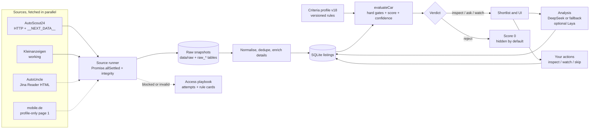

buy-scout is a local, single-user **buy-side search, normalisation, shortlist and decision engine**. It was built for one purchase — a used family car near Wiesloch (PLZ 69168) — but the core is domain-agnostic: source adapters in, normalised listings out, versioned criteria applied, a shortlist you can act on.

It is not a scraper framework, a price predictor or a purchase bot. It never messages a seller, pays, or signs anything; messaging stays draft-only.

:::info Status at a glance

Counts and verdicts change with every fetch. Run `npm run health` for source state and `npm run eval` for the current corpus. The active criteria profile is **v18**: €7,000 car cap, €800 reserve, €7,800 all-in, 200 km. The POC deadline is 2026-11-15; the purchase target is January 2027.

This is a working local prototype, not a product. Read the command output as the current state, not a prose snapshot.
:::

## The brief it was built for

Family of four: two adults, two children, one car. Current saved profile (v18):

| Brief | Value | Enforced by |
|---|---|---|
| Purchase cap | €7,000 | Hard gate: price above the cap rejects the listing |
| Reserve | €800 | Arithmetic only: €7,000 + €800 = **€7,800 all-in** |
| Search radius | 200 km | Hard gate, with one shared tolerance of max(5 km, 5%) |
| Seats | at least 5 | Hard gate |
| Doors | at least 4 (a 5-door car; the tailgate is not counted) | Hard gate |
| ISOFIX | required | Presence only — `minIsofix: 2` is stored but not enforced |
| First registration | 2010 or later | Hard gate |
| Mileage | at most 180,000 km | Hard gate |
| Fuel / gearbox | any | Gate only when set to petrol, diesel, manual or automatic |
| Boot | at least 450 L | Advisory, not enforced: no boot field exists on listings and it is not scored; only sent to Laya |
| HU | at least 12 months | Configured but not enforced |

The original template was €6,000 all-in (€5,200 car + €800 reserve) over 50 km. The code defaults, `.env.example` and the active profile now use the widened v18 brief. [Criteria & filters](./CRITERIA.md) explains exactly what is enforced.

## Quickstart

Node 24 or newer. No API key is needed — the analysis layer falls back deterministically.

```bash
npm install
npm run typecheck
npm test
npm run fetch:as24          # smart fetch against the active criteria
npm run score -- --top 20   # terminal shortlist
npm run analyze             # every qualifying card
npm run eval                # corpus, verdict and coverage report
npm run ui                  # http://127.0.0.1:8124
```

Useful extras:

```bash
npm run health                                  # source status from SQLite
npm run playbook -- --symptom cloudflare        # known access fixes
npm run report                                  # static data/report.html
npm run email -- --dir data/emails              # parse saved-search digests
npm run daily                                   # fetch + analyze + eval + report
```

Data lands in `data/`: `buy-scout.db`, `analysis.json`, `eval.json`, `report.html`, and immutable snapshots under `data/raw/<source>/<date>/`. Add `--no-details` to skip detail enrichment — faster, but family fields become unknown and verdicts collapse to ASK.

The interactive UI is the normal entry point: edit criteria, save, press **Fetch now**, then **Analyze qualifying cards**. Saving criteria creates a new version and clears old analyses; scoring happens on read. Saving criteria never fetches.

## Architecture at a glance



The loop is **FETCH → REFINE → DECIDE → LEARN**, and six rules hold it together:

- **N sources in parallel.** `Promise.allSettled` over enabled adapters; a blocked source is reported, never fatal.
- **Raw is immutable.** Every page and payload is stored before parsing, so re-parsing never requires re-fetching.
- **Parsers extract, models explain.** AutoScout24 `__NEXT_DATA__` and Kleinanzeigen HTML are parsed by code; DeepSeek never fills a field.
- **Rules own vetoes.** Hard gates are deterministic; any failure means `reject` and score 0.
- **Criteria are versioned.** Saving creates a new version and invalidates analyses; fetching is a separate action.
- **Verdicts are screening labels.** INSPECT means "worth a viewing", not "approved" and not "mechanically checked".

## What works, what is blocked

| Area | State | Notes |
|---|---|---|
| AutoScout24 | working | HTTP + `__NEXT_DATA__`; search, detail enrichment, family fields |
| AutoUncle | working | Jina Reader with local Chrome fallback; paginated |
| mobile.de | profile-only | page-1 search with a supplied Chrome profile; saved-search email and URL import supported |
| Kleinanzeigen | working | Direct search and detail; no key |
| Parallel runner + integrity | working | Filter assertions; a `filter_invalid` run is not treated as a successful fetch |
| Storage | working | Immutable raw snapshots plus SQLite: listings, criteria profiles, coverage, attempts, actions, memory |
| Decision layer | working | Hard gates, weighted score, confidence, four verdicts, conservative cross-source dedupe |
| Smart fetch | working on AutoScout24 | Newest-first, adaptive pages, detail skip, coverage ledger; no coverage ledger for AutoUncle or mobile.de |
| Web UI | working | Criteria editor, view filters, inspect/watch/skip, Fetch now with live progress, analysis on cards |
| Analysis | working with fallback | Threshold selection plus deterministic German questions; DeepSeek when a key is present |
| Laya | on by default for CLI fetch/analyze/daily | Advisory classifier; loads local weights on first use; `--no-laya` or `LAYA_ENABLED=0` disables; never part of the score; UI paths skip it |
| Evaluation | partial | Current corpus plus 20 adversarial rule tests; human labels and precision@10 still missing |
| Access playbook | working | Symptom classifier and strategy ladder; every try is recorded in `access_attempts`; seeded lessons in `rule_cards` |

## Where to go next

| Page | Read it for |
|---|---|
| [Architecture](./ARCHITECTURE.md) | Pipeline, module map, ADR links, what each layer owns |
| [Data model](./DATA-MODEL.md) | Raw versus derived, every table, the listing lifecycle |
| [Criteria & filters](./CRITERIA.md) | What gates, what only ranks, re-scoring, invalidation |
| [Verdicts & scoring](./VERDICTS.md) | The four labels, precedence, score and confidence maths |
| [Analysis](./ANALYSIS.md) | Selection thresholds, DeepSeek, Laya, analysis invalidation |
| [Web UI](./UI.md) | Screens, filters, Fetch now, actions, endpoints |
| [Operations](./OPERATIONS.md) | Setup, commands, env vars, reset, troubleshooting |
| [Sources & access](./SOURCES-OPERATIONS.md) | Source matrix, Jina and Firecrawl, playbook, probes |
| [Evaluation](./EVALUATION.md) | Corpus, coverage, adversarial tests, what is still unmeasured |
| [Roadmap](./ROADMAP.md) | Timeline, backlog, acceptance criteria, open questions |
| [Glossary](./GLOSSARY.md) | Vocabulary, and the pairs that get confused |
| [ADR-0001](./adr/0001-poc-architecture.md) · [ADR-0002](./adr/0002-detail-enrichment-and-family-gates.md) | The two accepted architecture decisions |

:::warning Not a buying recommendation
INSPECT is a screening label produced by rules you configured. It does not verify accident history, mileage authenticity, service history, HU validity, seller identity or whether the equipment is real. Always inspect the car, check the VIN and documents, and test your own child seats before paying.
:::
