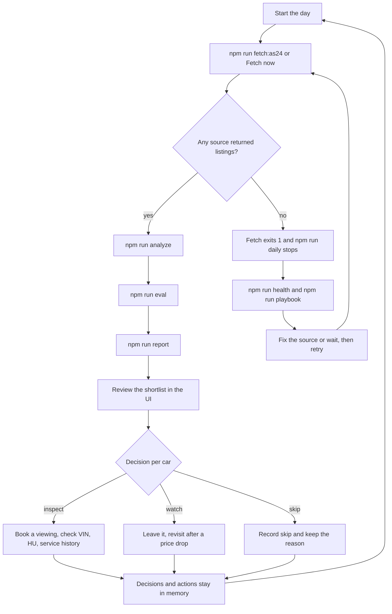

# Operations

Day-to-day operation of buy-scout: first run, the daily loop, the UI, email leads, health, report, eval, storage, environment and recovery. For how each source is reached, how filter integrity works and how fetch decides what to pull, see [Sources & Operations](./SOURCES-OPERATIONS.md).

## First run

```bash
cd buy-scout
npm install
npm run typecheck
npm test
```

Node 24 is required because the database layer uses `node:sqlite`. Then a first smoke run:

```bash
npm run fetch:as24 -- --pages 1 --delay 500
npm run score -- --top 20
npm run analyze
npm run eval
npm run report
npm run health
npm run intake -- --title "VW Passat" --url https://... --price 6500 --mileage 150000 --year 2013 --seats 5 --doors 5 --isofix yes --body Kombi --zip 69168
```

The first fetch has no coverage row, so it runs in `full` mode; `--pages 1` keeps it short. Opening the database seeds `sources`, the approved access lessons, and criteria v1 from the environment defaults if no profile exists. After that, the stored profile is authoritative: `SEARCH_*` and `PURCHASE_MAX_EUR` no longer affect runs.

Open the UI:

```bash
npm run ui
# http://127.0.0.1:8124
```

## Daily loop



The whole chain is one command:

```bash
npm run daily      # fetch:as24 && analyze && eval && report && health
```

It runs `health` at the end and does **not** start the UI.

### Step by step

1. **Fetch** — `npm run fetch:as24`, or click **Fetch now** in the UI. Uses the saved active criteria. New cards are scored, known cards are touched, details are fetched only for new or changed cars. A small stale shortlist is checked against the source detail page; confirmed-gone cars are hidden.
2. **Review quickly** — `npm run score -- --top 20` prints the current top 20 without writing anything.
3. **Analyse** — `npm run analyze` selects every non-rejected card clearing the score and confidence thresholds and writes summaries and questions. Without `DEEPSEEK_API_KEY` it uses the deterministic fallback.
4. **Evaluate** — `npm run eval` writes `data/eval.json` with verdict counts, field coverage, dedupe totals and the top 10.
5. **Report** — `npm run report` writes the static `data/report.html`.
6. **Decide** — open the UI, use Inspect / Watch / Skip, and keep the reason in the note.

## Command reference

| Command | What it does | Network | Writes |
| --- | --- | --- | --- |
| `npm run fetch:as24` | Smart parallel fetch against the saved criteria | Yes | DB, `data/raw/`, coverage, stats |
| `npm run fetch:as24 -- --full` | Same, ignoring the coverage ledger | Yes | Same |
| `npm run fetch:as24 -- --refresh` | Newest with a 6-page minimum | Yes | Same |
| `npm run fetch:as24 -- --no-details` | Skip AS24 detail pages; family fields stay unknown | Yes | DB, `data/raw/` |
| `npm run fetch:as24 -- --no-availability` | Skip the automatic stale-listing check | Yes | DB, `data/raw/` |
| `npm run availability -- --limit 50 --order oldest` | Check 50 oldest stale rows, spaced | Yes | Availability columns |
| `npm run fetch:report` | Fetch with `--no-laya`, then regenerate the static report; used by UI Fetch now | Yes | DB, `data/raw/`, `data/report.html` |
| `npm run availability` | Check stale active listings for 404/410/gone pages and retire confirmed-gone rows | Yes | `listings` availability columns |
| `npm run intake -- --title "VW Passat" --url ... --price 6500` | Add a hand-found car through the normal evaluator | No | `listings`, raw listing |
| `npm run reparse -- --limit 5` | Rebuild AutoScout24 listings from stored pages | No | `listings` |
| `npm run score -- --top 20` | Print the top N from stored listings | No | Nothing |
| `npm run analyze` | Threshold analysis for qualifying cards | Only with a DeepSeek key | `listing_analyses`, `data/analysis.json` |
| `npm run analyze -- --top 10` | Manual override of the threshold selection | Only with a key | Same |
| `npm run eval` | Metrics, field coverage, top 10 | No | `data/eval.json` |
| `npm run report` | Static HTML shortlist | No | `data/report.html` |
| `npm run health` | Source health and DB counts | No | Nothing |
| `npm run playbook` | Symptom ladders, lessons, attempt history | No | Nothing |
| `npm run playbook -- --symptom cloudflare` | One symptom only | No | Nothing |
| `npm run email -- --dir data/emails` | Parse saved-search digests into leads | No | `data/email-leads.json` |
| `npm run ui` | Local UI on 127.0.0.1:8124 | Local only | Actions, criteria, fetch results |
| `npm run daily` | fetch → analyze → eval → report → health | Yes | All of the above |
| `npm run typecheck` | TypeScript check | No | Nothing |
| `npm test` | Current test suite | No | Nothing |

## Interactive UI

```bash
npm run ui
UI_PORT=8125 npm run ui
```

The server binds `127.0.0.1` only and prints the DB path on start.

### Panels

- **Criteria** — budget cap, reserve, ZIP, radius, seats, doors, ISOFIX, first-registration year, max km, fuel, gearbox, boot, the three analysis thresholds, and the priority weight table.
- **View filters** — verdict, source, max price, max km, min year, free text. Display only.
- **Cards** — badge, score, confidence, reasons, unknowns, analysis summary and questions, and the Inspect / Watch / Skip buttons.
- **Header** — criteria version, summary counts, **Fetch now** with live progress.

### Saved criteria vs unsaved form edits

This distinction matters more than any other in the UI.

| Action | Uses saved criteria? | Fetches? | Writes | Re-scores? |
| --- | --- | --- | --- | --- |
| Edit a field in the criteria form | n/a | No | Nothing until saved | No |
| **Save criteria** | Creates it | No | New `criteria_profiles` version, clears `listing_analyses` | Yes, on the next read |
| Change a view filter | Yes | No | Nothing | No |
| **Fetch now** | **Yes, saved only** | Yes | `listings`, `data/raw/`, runs, coverage, stats | Yes, for fetched cards |
| CLI fetch or `npm run daily` | **Yes, saved only** | Yes | Same | Yes |
| **Analyze qualifying cards** | Yes | No | `listing_analyses`, `data/analysis.json` | No |

The rules:

- The form is a **draft**. Nothing you type takes effect until **Save criteria**.
- **Fetch now ignores unsaved edits.** If you raise the cap and click Fetch now without saving, the fetch still uses the stored cap.
- Saving a profile creates a **new version**, deactivates the old one, and clears stored analyses. Scoring happens on read against the new rules. It does **not** contact any source.
- User actions (Inspect / Watch / Skip) are **not** cleared. They are your decisions, not the machine's.
- View filters never persist, never re-score and never fetch.
- Reloading the page discards unsaved edits. There is no autosave.
- If **Analyze qualifying after save** is checked, saving also runs the threshold selection. Otherwise click **Analyze qualifying cards**.

A profile save is cheap and reversible by re-saving the old values; every version stays in `criteria_profiles`.

### Fetch now

Step by step:

1. You click **Fetch now**.
2. The UI sends `POST /api/fetch` and receives `202` with a job id.
3. The server spawns a child process that runs `npm run fetch:report` (fetch with `--no-laya`, then report) from the repo root.
4. The UI polls `GET /api/fetch/status` and shows page progress in the header.
5. When the child exits, the header shows `done` or `failed` and the shortlist reloads.

Behaviour worth knowing:

- **One fetch at a time.** A second click returns `409` with the running job; wait for `done`.
- **Saved criteria only.** Save first if you changed values.
- **Criteria saves are fenced.** While the job is running, `POST /api/criteria` returns `409`, so a profile cannot change mid-fetch.
- **Same code path as the CLI**, so coverage mode, learned page budget and detail skip all apply.
- **No Laya on this path.** `fetch:report` passes `--no-laya`; the UI analysis endpoint is also Laya-free.
- **Partial success is success.** If AutoScout24 returns listings and another source fails, the child exits `0` and the run is `done`.
- **A stuck job is in-memory only.** Restart `npm run ui` to clear it.

Equivalent API calls:

```bash
curl -s -X POST http://127.0.0.1:8124/api/fetch
curl -s http://127.0.0.1:8124/api/fetch/status
curl -s "http://127.0.0.1:8124/api/listings?verdict=inspect&maxPrice=7000"
```

## Email leads

Saved-search digests are the supported path for sources whose search pages are blocked.

```bash
mkdir -p data/emails
# save .eml, .html or .txt digests into data/emails
npm run email -- --dir data/emails
```

- Accepts `.eml`, `.html`, `.htm` and `.txt`.
- Extracts links for AutoScout24, mobile.de and Kleinanzeigen and derives an external id per source.
- Writes `data/email-leads.json` with `generatedAt` and a de-duplicated `leads` array.
- Prints the link count and the per-source breakdown.

Leads are **not** imported into `listings` yet. Importing them and fetching details through Firecrawl is the first open backlog item for mobile.de.

## Access playbook

```bash
npm run playbook
npm run playbook -- --symptom http_403
npm run playbook -- --symptom cloudflare
npm run playbook -- --symptom filter_ignored
npm run playbook -- --symptom empty_payload
npm run playbook -- --symptom js_only
```

It prints every symptom ladder, the active `rule_cards` lessons, and the grouped attempt history. See [Sources & Operations](./SOURCES-OPERATIONS.md#access-playbook) for the decision tree and the design rules.

## Source health

```bash
npm run health
```

Columns:

| Column | Meaning |
| --- | --- |
| `source` | Registry id: `autoscout24`, `kleinanzeigen`, `autouncle`, `mobile_de` |
| `enabled` | The `sources` flag; only enabled adapters are constructed |
| `status` | `working` or `blocked`, seeded in `sources` |
| `last_ok` | Newest `source_runs` row with status `ok` |
| `last_new` | Newest run that inserted at least one listing |

Then DB counts: listings, decisions, observations, raw pages, raw details.

It exits non-zero (`DEGRADED`) when an enabled source has had no successful run in 72 hours, when no new listing has been inserted for 7 days, or when no successful insertion was ever recorded. A `HEALTHY` line means those checks passed, not that every source is enabled.

A blocked source is reported, never fatal. But a source that never appears in `source_runs` may still be failing: cross-check `npm run playbook` for `access_attempts`.

## Static report

```bash
npm run report          # writes data/report.html
open data/report.html   # macOS
```

The report carries the ranked shortlist, the verdict legend and the same disclaimer as the UI. It is a snapshot, not a live page; regenerate it after each analyze.

## Eval

```bash
npm run eval            # writes data/eval.json
```

It prints totals and writes:

- `totals.listings` and `totals.bySource`
- `totals.verdicts` (inspect, ask, watch, reject)
- `totals.dedupeGroups` and `totals.duplicates`
- `coverage` per field, present versus total
- `top10` with score and confidence
- the active `brief` and `criteriaVersion`

The harness covers the current real corpus plus 20 adversarial cases in `tests/adversarial.test.ts`. Human labels for precision@10 are still missing, so treat the numbers as coverage and distribution checks, not quality scores.

## Data and database paths

```text
data/
  buy-scout.db                      SQLite database (plus -wal and -shm)
  report.html                       static report
  eval.json                         eval output
  analysis.json                     analyze output
  email-leads.json                  parsed leads
  emails/                           saved-search digests you drop here
  raw/
    autoscout24/2026-10-29/
      autoscout24-<runId>-p1.html   raw search page
      listings/<externalId>.json    normalised card payload
      details/<externalId>.html     detail page
      details/<externalId>.json     detail payload
    autouncle/2026-10-29/
      autouncle-<runId>-p1.html
      listings/<externalId>.json
```

The default database path is `./data/buy-scout.db`; every CLI accepts `--db` and honours `DB_PATH`. Raw snapshots default to `./data/raw` and honour `RAW_DIR` and `--raw`.

Everything under `data/` is generated. Do not commit it, and never edit a snapshot by hand to make a parser pass.

## Environment variables

```bash
cp .env.example .env
```

`.env` is a reference, not loaded automatically. Export values in your shell before running a command:

```bash
export DB_PATH=./data/buy-scout.db
export FETCH_TARGET_NEW=50
npm run fetch:as24
```

| Variable | Default | Used by | Effect |
| --- | --- | --- | --- |
| `DB_PATH` | `./data/buy-scout.db` | All CLIs and the UI | Database file |
| `RAW_DIR` | `./data/raw` | Fetch | Snapshot root |
| `SEARCH_ZIP` | `69168` | First seed only | Builds the v1 criteria profile |
| `SEARCH_RADIUS_KM` | `200` | First seed only | Builds the v1 criteria profile |
| `PURCHASE_MAX_EUR` | `7000` | First seed only | Builds the v1 criteria profile; this is the car cap |
| `RESERVE_EUR` | `800` | First seed only | Builds the v1 criteria profile |
| `FETCH_DELAY_MS` | `3000` | Fetch | Page delay; detail delay floors at 1000 ms |
| `FETCH_MIN_PAGES` | `5` | Fetch | Pages before stop rules apply |
| `FETCH_TARGET_NEW` | `50` | Fetch | New-listing target |
| `FETCH_REFRESH_PAGES` | `10` | Fetch | Minimum page budget on a refresh |
| `FETCH_AVAILABILITY_LIMIT` | `12` | Fetch | Stale listings checked after a fetch; `0` disables |
| `FETCH_AVAILABILITY_HOURS` | `24` | Fetch | Only check rows not seen for this many hours |
| `AVAILABILITY_LIMIT` | `100` | `npm run availability` | Default sweep size |
| `AVAILABILITY_DELAY_MS` | `2000` | `npm run availability` | Spacing between detail checks |
| `UI_PORT` | `8124` | UI | Local port, bound to 127.0.0.1 |
| `DEEPSEEK_API_KEY` | unset | Analyze | Unset means deterministic fallback |
| `DEEPSEEK_BASE_URL` | unset | Analyze | Custom endpoint |
| `DEEPSEEK_MODEL` | `deepseek-v4.1-flash` | Analyze | Model name |
| `LAYA_ENABLED` | `1` | Fetch and analyze | On by default; `0` or `--no-laya` disables |
| `LAYA_SUBFOLDER` | empty | Laya | Weights subfolder; empty resolves the bundle at the repo root |
| `LAYA_REVISION` | unset | Laya | Weights revision |
| `LAYA_CACHE` | unset | Laya | Weights cache directory |

Page count comes from `--pages`, `FETCH_REFRESH_PAGES`, coverage and `fetch_stats`. Availability checks are capped by `FETCH_AVAILABILITY_LIMIT` (default 12, `--availability-limit`) and only probe rows not seen for `FETCH_AVAILABILITY_HOURS` (default 24). `npm run availability` has its own `--limit`, `--hours`, `--delay`, `--order` and `--source`. Search and detail timeouts are fixed at 30 s; Jina uses 60 s. `AS24_PAGES` and `FETCH_TIMEOUT_MS` are no longer in `.env.example` because no code reads them.

`SEARCH_*` and `PURCHASE_MAX_EUR` only matter when the database is first seeded. After that the active profile in SQLite wins, and the UI or a new saved profile is the way to change criteria.

## Troubleshooting

| Symptom | Likely cause | Fix |
| --- | --- | --- |
| `403 Zugriff verweigert` from a source | Bot protection | `npm run playbook -- --symptom http_403`, then follow the ladder |
| `body too small (6123 bytes) — likely blocked` | Jina returned a block page, usually rate limiting | Back off, retry later, use Firecrawl, run the `empty_payload` ladder |
| `integrity=INVALID` with `price filter leaked` | Hand-built URL reset the filter | Re-run with explicit `--max` and `--radius`, check the URL, filter locally |
| `result set implausibly broad: 212000 listings` | Filters ignored, as on mobile.de | Do not trust the count; switch to the email trigger |
| Fetch exits 1 and `npm run daily` stops | No source returned listings | `npm run health`, `npm run playbook`, retry after a pause |
| Fetch exits 0 but a disabled or secondary source has nothing new | Partial success is normal | Check `access_attempts` and `npm run health` |
| UI shows `409` on Fetch now | A fetch is already running | Wait for `done` in the header |
| `EADDRINUSE` on start | Port 8124 is taken | `UI_PORT=8125 npm run ui` |
| Shortlist looks empty after a criteria change | A view filter is still applied | Clear filters; analyses are rebuilt with `npm run analyze` |
| Analysis says "deterministic fallback" | No DeepSeek key | Set `DEEPSEEK_API_KEY` or accept the fallback |
| Old cars keep appearing | The card was not yet checked at the source, or the source still serves a live page | Run `npm run availability`; confirmed 404/410 rows disappear. Use **Show unavailable** to audit them. |
| `SQLITE_BUSY` or slow writes | Two fetch processes on one database | Run one at a time; the UI enforces it, the CLI does not |
| `ExperimentalWarning: SQLite is an experimental feature` | Node 24 `node:sqlite` | Expected for the POC; no action |
| `Cannot find module 'tsx'` | Dependencies missing | `npm install` |

## Recovery procedures

### One source is blocked

Nothing to recover. The run continues, the failure is logged, and the other sources still produce a shortlist. Read the printed ladder, apply the first untried strategy, and record what worked.

```bash
npm run fetch:as24
npm run playbook -- --symptom http_403
```

### All sources fail

The fetch exits `1`, so `npm run daily` stops before analyze, eval and report. That is intentional: do not analyse a source-less run.

```bash
npm run health
npm run playbook
# wait, then retry at a lower frequency
npm run fetch:as24 -- --delay 5000
```

If the block is a rate limit, waiting is the fix. If it is structural, switch to the email path for that source.

### A run is marked `filter_invalid`

Coverage does not advance and the counts are untrustworthy. Re-run with explicit parameters and confirm the observed max price and distance in the banner.

```bash
npm run fetch:as24 -- --max 7000 --radius 200 --refresh
```

### Criteria were saved by mistake

Profiles are versioned and append-only; there is no activation/revert command. Re-enter the previous values and save to create a new version. The old row stays in `criteria_profiles` as history. Saving clears stored analyses, so run `npm run analyze` afterwards.

### Stored analyses look stale

They are invalidated on every criteria save, by design.

```bash
npm run analyze
```

### The UI job is stuck, or the DB was replaced

The job lives in memory. Restart the server:

```bash
# Ctrl-C, then
npm run ui
```

### Start over

Destructive. Back up first if you care about the decisions.

```bash
rm -rf data/buy-scout.db data/raw data/report.html
npm run fetch:as24
```

The next `openDb` recreates the schema, seeds `sources`, seeds the access lessons and creates criteria v1 from the environment defaults.

## Verify and reset

```bash
npm run typecheck
npm test
```

Both must pass before you trust a change: the current test suite and TypeScript strict.

## Notes

- Node 24 `node:sqlite` prints an ExperimentalWarning. Acceptable for the POC.
- Do not store seller phone numbers in normalised tables.
- A 200 response is not success; check `integrity`.
- One fetch at a time per database.
- `data/` is generated and git-ignored.

## Adding a source

1. Implement `SourceAdapter` in `src/sources/`.
2. `search()` returns `RawRef[]` and `RawPage[]`.
3. Optional `fetchDetail()` returns `RawDetail`.
4. Add filter integrity assertions for price, radius and count.
5. Register the adapter in `src/cli/fetch.ts` so the parallel runner picks it up.
6. Seed its row in `sources` and add a fixture test.

Then run `npm run fetch:as24`, `npm run health` and `npm run playbook` to confirm the new source reports successes and failures in the same shape as the existing ones.

## See also

- [Sources & Operations](./SOURCES-OPERATIONS.md) — source matrix, access methods, filter integrity, smart fetch, access playbook.
- `docs/CRITERIA-FLOW.md` — criteria vs view filters vs fetch vs analyze.
- `docs/VERDICTS.md` — what INSPECT, ASK, WATCH and REJECT mean.
