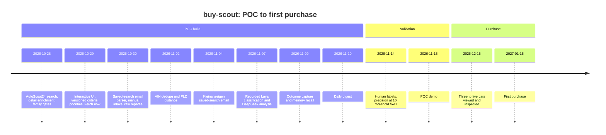

---

id: roadmap
title: Roadmap
sidebar_position: 1
description: "buy-scout — Roadmap: POC status, acceptance criteria, P0/P1/P2 priorities, milestones, and what is live versus credential-dependent."
---

# Roadmap

This page consolidates [Plan](./PLAN.md), [Acceptance Criteria](./ACCEPTANCE.md),
[Backlog](./BACKLOG.md) and [Status](./STATUS.md) into one view, and separates two things
that those documents sometimes blur: **what runs today** and **what needs a credential,
a download, a third party, or a human**.

- **POC deadline:** 2026-11-15
- **First purchase target:** January 2027
- **Position today (2026-10-31):** POC feature-complete as a local prototype. AutoScout24
  and Kleinanzeigen are enabled; AutoUncle and mobile.de are disabled. Manual intake and
  raw reparse now provide fallback paths. The remaining external items are human labels
  and the optional model keys.

## Where we are

Measured state is generated, not copied:

```bash
npm run health
npm run eval
npm test
```

The source registry is canonical. AutoScout24, Kleinanzeigen and AutoUncle are enabled and working. mobile.de is disabled by default and requires a supplied Chrome profile for page 1. The active criteria are v18: €7,000 car cap + €800 reserve, 200 km. Counts and verdicts change on every fetch.

:::caution Scope drift to resolve before the demo
The active profile is v18: €7,000 car cap, €800 reserve, €7,800 all-in, 200 km. The original €6,000/50 km template is historical. The subtitle, report and defaults now derive from the active brief.
:::

## Milestones (planned targets)



| Dates | Milestone | Plan status | Actual |
|---|---|---|---|
| Oct 28 | Research, architecture, repo, AS24 search + detail + gates | done | **done** |
| Oct 29–30 | Saved-search email parser + Firecrawl detail; interactive UI | next | **UI and email parser done**; mobile.de detail open |
| Oct 31–Nov 2 | Real VIN dedupe + PLZ distance | next | not started |
| Nov 3–4 | Kleinanzeigen saved-search email | next | direct search + detail done; email parser only |
| Nov 5–7 | Laya classification + DeepSeek analysis | next | Laya on by default for CLI runs; no recorded classification; DeepSeek fallback only |
| Nov 8–9 | Outcome capture + memory recall | next | user actions persist; recall not started |
| Nov 10 | Daily digest | next | static report only |
| Nov 11–14 | Evaluate 50 real + 20 adversarial; fix | next | adversarial done; current corpus done; labels open |
| Nov 15 | POC demo | feature-complete, validation pending | on track |

The "plan status" column is stale in places: the interactive UI, the email parser, intake/reparse and Kleinanzeigen all shipped; AutoUncle is enabled with a Jina/browser fallback. The source registry, not this table, is authoritative.

## POC: done, partial, blocked

### Done and verified

- AutoScout24 adapter: newest-first adaptive multi-page search, detail enrichment, family
  fields, raw snapshots.
- AutoUncle adapter: Jina Reader with local Chrome fallback; paginated and enabled.
- Parallel source runner (`Promise.allSettled`, no priority), filter-integrity checks.
- SQLite persistence: listings, raw references, criteria profiles, decisions, user actions,
  coverage ledger, access attempts, rule cards.
- Family hard gates, rule score, four verdicts, hard fail = score 0, unknown = ASK.
- Cross-source dedupe (heuristic buckets).
- Versioned criteria profiles; saving clears stored analyses and scoring happens on read.
- Manual intake (`npm run intake`) and raw reparse (`npm run reparse`) provide fallback paths when a source breaks.
- Priority weights: additive boost capped at +25, never a filter.
- Interactive UI: criteria editor, view filters, search, Fetch now with live progress,
  threshold-based analysis, Inspect / Watch / Skip, legend and disclaimer.
- Analysis: threshold selection plus deterministic fallback, optional DeepSeek.
- Eval harness writing `data/eval.json`; static HTML report; health check; access playbook;
  email lead parser; Claude hooks; docs.
- Strict typecheck and a green `npm test`; test count is reported by the command, not copied here.

### Partial

| Item | What works | What is missing | AC |
|---|---|---|---|
| N sources, no priority | AutoScout24, Kleinanzeigen and AutoUncle run in parallel | mobile.de remains profile-only | AC-03 |
| 3 sources active | AutoScout24 + Kleinanzeigen + AutoUncle | mobile.de page 1 needs a supplied profile | AC-09 |
| Email path | Parser extracts AS24 / mobile.de / Kleinanzeigen links | No detail fetch from a lead | AC-10 |
| Laya classification | Package, adapter, questions; on by default for CLI fetch/analyze | Weights load on first use; no recorded live classification | AC-11 |
| DeepSeek analysis | Client, schema, timeout, fallback | No key, so only the fallback has run | AC-12 |
| Eval | Current corpus + 20 adversarial, coverage, top 10 | No human labels, so no precision@10 | AC-15 |

### Blocked outside the code

| Blocker | Nature | What unblocks it |
|---|---|---|
| mobile.de search | Anti-bot; the search page does not return usable HTML | Saved-search email → Firecrawl detail, or manual URL import |
| Laya weights | ~1.7 GB download, first-run only | One machine with bandwidth; Laya is otherwise on by default (`LAYA_ENABLED=0` disables) |
| DeepSeek | Requires **both** `DEEPSEEK_API_KEY` and `DEEPSEEK_BASE_URL` | Key plus base URL in the environment |
| Human labels | Buyer's own time and judgement | 50 blind Inspect / Watch / Skip decisions |
| Firecrawl | Third-party key for blocked-source detail pages | Account and key; optional in POC |

Nothing on this list blocks the POC demo except labels, and labels can be a demo step
rather than a prerequisite.

## Acceptance criteria summary

36 criteria, from `docs/ACCEPTANCE.md`:

| Status | Count | Share |
|---|---|---|
| `[x]` verified | **30** | 83% |
| `[~]` partial | **6** | 17% |
| `[ ]` not started | **0** | 0% |

The six partials, and what each is waiting for:

| AC | Criterion | Waiting on |
|---|---|---|
| AC-03 | N sources concurrent, no priority | Two enabled adapters already run concurrently; held open only if N is read as three |
| AC-09 | 3 sources active | mobile.de access path |
| AC-10 | Kleinanzeigen / mobile.de email path | Detail fetch from a parsed lead |
| AC-11 | Laya classification | Weights load, one recorded classification |
| AC-12 | DeepSeek analysis for top N | API key plus base URL, one live comparison |
| AC-15 | Eval: 50 real + 20 adversarial | Human labels and a precision@10 number |

Everything else is verified: repo separation and docs (AC-01), AS24 search and detail
(AC-02), snapshots (AC-04), filter integrity (AC-05), enrichment (AC-06), gates (AC-07),
score and verdicts (AC-08), decision persistence (AC-13), UI (AC-14), tests (AC-16),
no auto-messaging (AC-17), runbook and status (AC-18), hard fail and unknown semantics
(AC-19), dedupe (AC-20), health (AC-21), static report (AC-22), workarounds (AC-23), access
playbook (AC-24), persisted attempts (AC-25), email parser (AC-26), analysis fallback
(AC-27), eval harness (AC-28), versioned criteria (AC-29), criteria editor (AC-30),
weighted priorities (AC-31), threshold analysis (AC-32), legend and disclaimer (AC-33),
smart fetch (AC-34), coverage ledger (AC-35), Fetch now (AC-36).

:::note "Verified" means demonstrated, not proven correct
Every `[x]` is backed by a test, a CLI run or a document. None of them is backed by a human
judgement of shortlist quality — that is exactly what AC-15 is missing, and why a green AC
table does not mean the shortlist is good.
:::

## P0 — finish the POC

| # | Item | Why it matters | Exit criteria | Deps | AC |
|---|---|---|---|---|---|
| 1 | Truth lock and decision contract | The document, defaults and report disagreed with the code | Fresh DB seeds v18; active criteria v18; gate table and golden vectors; no stale current-state claims | Docs + tests | AC-29, AC-30 |
| 2 | Manual intake and reparse | A blocked dominant source must not stop the search | A hand-entered car appears with a verdict; stored AS24 pages rebuild without a fetch | Implemented | AC-10, AC-24 |
| 3 | Human labels | Without labels the eval cannot say whether the ranking is right | 50 blind labels stored in a label file; precision@10 printed and recorded | Buyer's time | AC-15 |
| 4 | Live model comparison | Laya and DeepSeek should be compared before trusting either | One run with Laya and one with DeepSeek; both recorded with model names | Optional keys | AC-11, AC-12 |

Sequence: 1 and 2 are the deadline-critical repairs, then 3, then 4. Do not start a fourth
source adapter before the POC demo.

## P1 — after the POC

| # | Item | Note |
|---|---|---|
| 5 | Kleinanzeigen email → detail path | Optional alternate intake; direct search is already working |
| 6 | Real VIN dedupe | Needs VIN in enrichment; today dedupe is heuristic buckets (run `npm run eval` for the current group count) |
| 7 | PLZ centroid / geocoder distance | Replaces the ZIP-prefix table behind AutoUncle distances |
| 8 | Daily digest / Telegram | `npm run daily` already chains fetch → analyze → eval → report |
| 9 | Productisation: auth, billing, deployment | Out of POC scope by ADR-0001; do not start early |

## P2 — February

| # | Item | Note |
|---|---|---|
| 10 | TV domain pack | The first proof that the core is domain-agnostic |
| 11 | Multi-category source registry | Sources declared per category, not hard-coded |
| 12 | Human-in-the-loop messaging | Draft-only today; sending stays manual |

## Live versus credential-dependent

This is the distinction that decides whether you can reproduce a number on your own
machine.

| Capability | Runs with no extra credentials? | Needs | Evidence today |
|---|---|---|---|
| AutoScout24 fetch | **Yes** — live | Outbound network only | Current listings in the DB |
| AutoUncle fetch | **Yes** — enabled and paginated | Browser fallback for Cloudflare | Page budget controls depth |
| Scoring, verdicts, dedupe, UI, eval, report | **Yes** — fully live | Nothing | Tests and current scored listings |
| Criteria profiles, priorities, user actions | **Yes** — live | Nothing | v18 active, actions persist |
| Kleinanzeigen | **Yes** — live | Outbound network only | Direct search and detail |
| mobile.de | **Partial** — page 1 with profile | `BUY_SCOUT_CHROME_PROFILE`; official feed for durability | Email/URL import is stable |
| Laya | **Yes** — on by default for CLI runs | A ~1.7 GB weight download on first use | Adapter code; no recorded live classification |
| DeepSeek analysis | **No** — fallback only | `DEEPSEEK_API_KEY` **and** `DEEPSEEK_BASE_URL`; optional `DEEPSEEK_MODEL` | `deterministic-fallback` rows only |
| Human labels | **No** | Buyer's time; no label schema exists yet | In-UI actions only |
| Firecrawl | **No** | Account and key | Optional for the POC |

Practical consequences:

- **A fresh clone can reproduce** the current eval only if it has the same
  `data/buy-scout.db`. Fetching its own listings will produce a different corpus, because the
  market moves between runs. Treat `eval.json` as a dated snapshot, not a fixture.
- **Laya and DeepSeek are not measured components.** Laya is on by default for CLI runs but
  no live classification has been recorded; DeepSeek has only produced fallback rows. No doc
  should claim their quality.
- **`.env.example` documents** `DB_PATH`, `RAW_DIR`, the search brief, fetch tuning,
  `UI_PORT`, the `LAYA_*` variables and the `DEEPSEEK_*` / `FIRECRAWL_API_KEY` placeholders.
- **Credential-dependent does not mean broken.** Each has a working degraded path: fallback
  analysis, heuristic distance, email leads, two live sources. The POC is usable without
  any of them, which is why status is "feature-complete" and not "blocked".

## Definition of done

### POC (2026-11-15)

- [ ] Either three sources live or mobile.de's block documented with the attempted paths
      and the chosen workaround.
- [ ] 50 human labels collected blind; precision@10 computed and written to `data/eval.json`
      (or an adjacent report) and quoted in the demo.
- [ ] Every AC `[x]`, or `[~]` with a one-line reason and an owner.
- [ ] `npm run typecheck` and `npm test` green on a clean checkout.
- [ ] `npm run eval` re-run against the profile used in the demo; `criteriaVersion` quoted.
- [ ] At least one live Laya classification and one live DeepSeek analysis recorded, with
      model names, in `docs/JOURNAL.md`.
- [ ] Docs agree with data: no current page quotes €6,000 / 50 km or a superseded criteria
      version as the active state.
- [ ] A demo script that works from a clean database: fetch → score → eval → UI → action.
- [ ] No auto-messaging, no payment, no purchase path — still true.

### First purchase (January 2027)

- [ ] A stable shortlist of 3–5 cars, each with a decision record and a reason.
- [ ] For every car viewed: VIN verified, HU/AU report seen, service history checked,
      mileage plausibility checked, cold start and test drive done, independent inspection
      for anything above the reserve.
- [ ] Two child seats physically fitted to the chosen car's ISOFIX points.
- [ ] Price negotiated against the median and the listed faults, not against the score.
- [ ] Outcome recorded, so the next search starts from memory rather than from zero.

## Risks and decision points

| Risk | Impact | Mitigation |
|---|---|---|
| Scope drift (budget, radius, subtitle) | Demo quotes numbers the data does not support | One active profile; subtitle and report derive from it |
| Threshold circularity | Precision@10 measured against the rules that produced the ranking is meaningless | Blind labels, held-out batch |
| Source fragility | A portal change silently empties a source | `npm run health`, coverage ledger, `bySource` in eval |
| Legal / terms of use | Aggressive fetching can get an IP blocked or worse | Rate limits, delay flags, documented access paths, no credential sharing |
| Narrow funnel | Most listings are REJECT, so the INSPECT set is small | Run `npm run eval` for the current split; show ASK prominently, ASK is often the best car |
| Time to Nov 15 | P0 items compete for a short window | Labels first, then mobile.de, then live models |
| Single-user local tool | No auth, no backup | Keep the DB in git-ignored `data/`, snapshot it before risky runs |
| Laya / DeepSeek never recorded | Docs overstate the intelligence layer | Mark both as unmeasured until a live run is recorded |

## Immediate next three tasks

1. **Label 50 candidates** in the UI, blind to verdict and score, and freeze them in a file.
2. **Wire mobile.de email → detail fetch** using the existing lead parser plus Firecrawl or
   a manual URL import.
3. **Run the auto-fallback executor** so the playbook's recommendations are executed and
   ranked by attempt history instead of by hand.

These are the same three items as `docs/STATUS.md`, re-ordered so the one with no external
dependency comes first.

## Related reading

- [Plan](./PLAN.md) — thesis, scope, source strategy, open questions.
- [Acceptance Criteria](./ACCEPTANCE.md) — the full 36-row table.
- [Backlog](./BACKLOG.md) — the original ordered task list.
- [Status](./STATUS.md) — prose snapshot, may lag the data.
- [Evaluation](./EVALUATION.md) — what the numbers above mean and what they cannot say.
- [Interactive UI](./UI.md) — where labels and user actions are produced.
