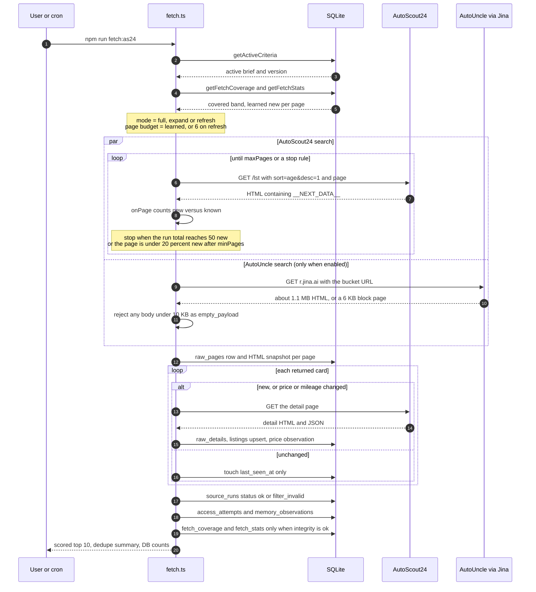
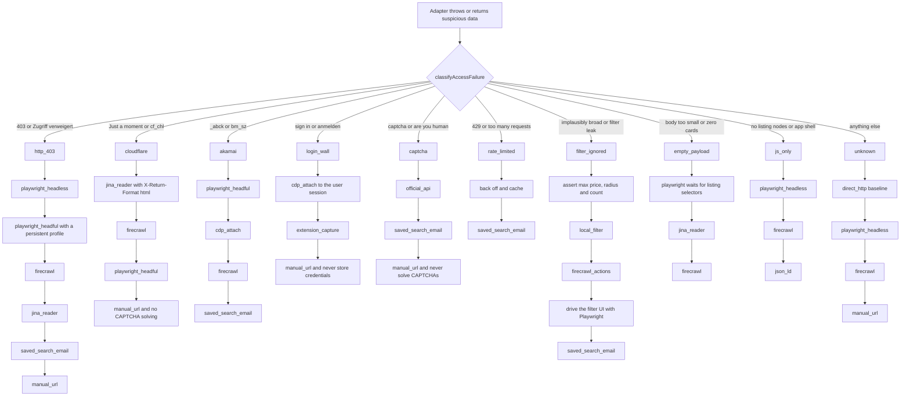

# Sources & Operations

buy-scout reaches each marketplace by a different route, and it treats "the page loaded" as the start of verification rather than the end of it. This page covers the source matrix, the access method behind each adapter, filter integrity, smart fetch behaviour, the access playbook, the commands that exercise them, and the guardrails that keep the fetcher polite.

For installation, daily commands, the UI, environment and recovery, see the [Runbook](./OPERATIONS.md).

## Operating principles

- **All sources run in parallel.** `runSources()` uses `Promise.allSettled`; there is no first/second/third priority, and one blocked source never holds back the rest.
- **A 200 response is not success.** Every run is judged by filter integrity and result count, not by HTTP status.
- **Platform-initiated paths win.** Saved-search email, official APIs and RSS beat fighting bot protection.
- **Parsers extract, rules veto.** The model analyses normalised listings; it never invents fields.
- **Every block becomes a record.** Symptoms, strategies and confirmed lessons are persisted, so the next run does not rediscover the same wall.

## Source matrix

| Source | Access path | Adapter | Status | Cards per page | Filter support |
| --- | --- | --- | --- | --- | --- |
| AutoScout24 | Direct HTTP + `__NEXT_DATA__` JSON | `src/sources/autoscout24.ts` | Working | 20 | Price cap, ZIP, radius, newest-first sort, new and used; detail enrichment |
| AutoUncle | Jina Reader HTML with local Chrome fallback | `src/sources/autouncle.ts` | Working; paginated | 25/page | Coarse price bucket only; region Baden-Württemberg |
| mobile.de | Browser profile + saved-search email | `src/sources/mobile-de.ts`; email parser | Disabled by default; profile required | ~20 | Search filters in URL; card fields only |
| Kleinanzeigen | Direct HTTP search + detail HTML | `src/sources/kleinanzeigen.ts` | Working, enabled | 27 | Local price and radius filtering; no server-side gearbox filter |
| Local dealers, 12gebrauchtwagen | HTTP or Playwright | None | Later | n/a | Warranty stock |
| heycar | None | None | Dropped | n/a | Redirects to drive.co.uk |

:::warning Kleinanzeigen terms

The direct Kleinanzeigen adapter is technically working, but the site's terms require written consent for crawlers, spiders and other automated mechanisms. Treat direct access as experimental and low-volume. The saved-search email is the compliant alternative; do not increase the fetch rate without permission.

:::

Adapters are constructed only for enabled rows in the `sources` table. AutoScout24, AutoUncle and Kleinanzeigen are enabled. AutoUncle uses Jina first and falls back to a headless local Chrome when Cloudflare returns a challenge. mobile.de remains disabled for search; individual mobile.de links can be imported with `npm run import:url` when a browser profile is configured.

## Access methods

### AutoScout24: direct HTTP

Search is a plain GET against `/lst` with query parameters:

```text
https://www.autoscout24.de/lst
  ?atype=C
  &cy=D
  &priceto=7000
  &zip=69168
  &zipr=200
  &sort=age
  &desc=1
  &ustate=N,U
  &page=2          # only sent when page > 1
```

- `sort=age&desc=1` is the URL pair for "Neueste Angebote zuerst". `sort=age` alone is `desc=0` (default order); `sort=age-descending` as one value returns zero listings.
- `pricefrom` is appended only on an expanding run (see [coverage ledger](#coverage-ledger)).
- `ustate=N,U` keeps new and used cars; `atype=C` restricts to cars.
- The adapter parses `<script id="__NEXT_DATA__">` and reads `props.pageProps.listings` plus `numberOfResults`. A missing `__NEXT_DATA__` or `pageProps` throws, which the runner classifies as a failure.
- Requests carry a desktop user agent, `accept-language: de-DE`, and a 30 s timeout.
- Detail pages are fetched per listing and yield seats, doors, body type, the equipment list, ISOFIX evidence, HU due date, warranty, red flags, description and market median.

### AutoUncle: Jina Reader

AutoUncle sits behind Cloudflare, so the adapter never touches the site directly. It requests the page through Jina Reader:

```text
GET https://r.jina.ai/https://www.autouncle.de/de/gebrauchtwagen/in/Baden-W%C3%BCrttemberg/mp-unter-7000-euro
X-Return-Format: html
```

- **Price buckets are coarse.** The adapter rounds the cap up to the next full thousand: `ceil(purchaseMaxEur / 1000) * 1000`. A €5,200 cap (the historical template) requests the 6000 bucket; the active €7,000 cap requests 7000. The 5200 bucket is a 404. The real cap is applied locally by the scoring rules, not by the URL.
- **Body size is a health check.** A healthy page is around 1.1 MB. If Jina returns a challenge or a small body, the adapter retries through a headless local Chrome. If the browser also gets a challenge, the source fails; it does not solve a CAPTCHA.
- **Paginated, 25 cards per page.** AutoUncle uses `?page=N` and follows the global page budget (`--pages` / learned fetch budget). There is no incremental price-band fetch and no detail fetch. The card text is the record, and it is also what the description field stores. Cards without family fields still score as `ask`.
- **Distance is estimated.** Cards expose a ZIP but no distance, so `estimateDistanceFromWiesloch()` maps ZIP prefixes to approximate kilometres (`691` → 5 km, `693` → 25 km, `761` → 45 km, and so on). Replace it with a geocoder or a PLZ centroid table before production.
- **Treat Jina as low-frequency.** One request per run, cached output, no polling.

### mobile.de: blocked on search

| Method | Result | Verdict |
| --- | --- | --- |
| Direct HTTP | `403 Zugriff verweigert` | No |
| Playwright headless | `403 Zugriff verweigert` | No |
| Playwright headful | Consent screen, then access denied | No |
| Jina Reader | `403` passed through | No |
| Firecrawl scrape | `200`, full page, filters ignored (212k results) | Partial |
| Official Search API | `401`, partner-only | No self-serve |
| Saved-search email (`Suchauftrag`) | Works as a trigger; daily digest | Recommended |
| Manual URL or browser capture | Works for Kleinanzeigen; mobile.de needs a browser profile | Fallback |

The supported path is: **saved-search email as the trigger, Firecrawl for the detail page, never the search filters**. The email parser already extracts mobile.de leads, and `npm run import:url` can import a single lead. See [mobile.de & fetch latency](./mobile-de-latency.md) for the latency budget and work breakdown.

### mobile.de: profile-backed search

`MobileDeAdapter` builds the search URL that mobile.de itself uses:

```text
/fahrzeuge/search.html?asl=true&cn=DE&gn=Wiesloch...&ll=49.29504,8.70178
  &p=:7000&rd=200&s=Car&vc=Car
```

It requires `BUY_SCOUT_CHROME_PROFILE` and the `mobile_de` source row enabled. A fresh profile still gets `403 Zugriff verweigert`; use a profile that can already open mobile.de in Chrome. The adapter parses only the search cards, so family fields remain unknown until a detail import.

### Import a single listing

Search coverage is not the only path. A listing URL can be imported directly:

```bash
npm run import:url -- --url "https://www.kleinanzeigen.de/s-anzeige/..."
npm run import:url -- --url "https://suchen.mobile.de/auto-inserat/..."
npm run fetch:as24 -- --source mobile_de --pages 1
```

The importer fetches the detail page, normalises it, writes the full detail fields, and scores it against the active criteria. The UI also exposes this as **Import link**.

- Kleinanzeigen usually works over plain HTTP.
- mobile.de blocks fresh HTTP and browser sessions. Set `BUY_SCOUT_CHROME_PROFILE` to a Chrome profile that can open mobile.de; the importer then uses that persistent profile. Without it, mobile.de returns `403 Zugriff verweigert`.
- AutoUncle `de/d` pages are not imported directly; use the source URL if available.

### Saved-search email leads

Mobile.de search is not directly accessible from a fresh session. The compliant intake path is the saved-search email:

```bash
npm run import:leads -- --dir ./data/emails --limit 50
```

It extracts listing links from `.eml`, `.html` or `.txt` files, imports the supported Kleinanzeigen and mobile.de links, and skips unsupported hosts. mobile.de imports still need `BUY_SCOUT_CHROME_PROFILE`; the email itself is the search trigger, not a bypass.

### Kleinanzeigen: direct HTTP

Kleinanzeigen search and detail pages are reachable with ordinary HTTP and a German-language browser header. The adapter parses search cards and detail attributes, applies the price and radius filters locally, and fetches details for new or family-incomplete cards. The email parser still recognises `kleinanzeigen.de/s-anzeige/` links as an alternate intake path.

## Filter integrity

Every adapter returns a `FilterIntegrity` object and the fetch run records it. The rule is simple: **a broad or empty result set is a failed run, even when the HTTP status is 200.**

AutoScout24 checks (`src/core/integrity.ts`):

| Check | Failure message |
| --- | --- |
| Observed max price above the cap | `price filter leaked: observed max N EUR > cap M EUR` |
| Observed max distance above radius plus tolerance, where tolerance is `max(5, ceil(radius × 0.05))` km | `radius filter leaked: observed max N km > radius + tolerance` |
| More than 50,000 total results | `result set implausibly broad: N listings — filters likely ignored` |
| Zero parsed listings against a non-zero result count | `zero listings parsed despite a non-zero result count` |

AutoUncle checks (`src/sources/autouncle.ts`):

| Check | Failure message |
| --- | --- |
| Observed max price above the bucket cap | `price filter leaked: observed max N EUR > source cap M EUR` |
| More than 50,000 total results | `result set implausibly broad: N listings` |
| No cards parsed | `zero cards parsed` |

AutoUncle reports an observed max distance but does not fail on it, because the region is fixed and distance is estimated.

Run status is written to `source_runs.status` as `ok` or `filter_invalid`. Coverage only advances on `ok`. The CLI prints the verdict per source:

```text
[autoscout24] 40 listings, total=30976
[autoscout24] integrity=OK maxPrice=6990€ maxDistance=198km
  cap=7.000 € radius=200km
```

When integrity fails, do not trust the count and do not treat the run as fresh data. Check the hand-built URL, re-run with explicit `--max` and `--radius`, and consult `npm run playbook -- --symptom filter_ignored`.

## Smart fetch

The fetcher is newest-first and adaptive. It is not "page 1 on a fixed sort order", and it does not re-download known detail pages.

```text
newest listings first
  → up to 10 pages of 20
  → target 50 new listings
  → stop when a page is mostly already-known
  → details only for new or changed cars
  → coverage ledger remembers the price band already covered
  → learned page budget from previous runs
```

### The page loop

| Setting | Default | Flag or source |
| --- | --- | --- |
| Max pages | learned 6–10, or 6 on a refresh | `--pages`, `fetch_stats` |
| Min pages before stop rules apply | 5 | `--min-pages`, `FETCH_MIN_PAGES` |
| New-listing target | 50 | `--target-new`, `FETCH_TARGET_NEW` |
| Stop ratio | page under 20% new | fixed |
| Page delay | 3000 ms | `--delay`, `FETCH_DELAY_MS` |

Example from a cold start:

```text
page 1: 20/20 new → continue
page 2: 20/20 new → continue
page 5: 20/20 new → 100 new, stop (target 50 and minimum 5 reached)
```

The next day, after those cards are known:

```text
page 1: 0/20 new → continue (minimum 5 pages)
page 5: 0/20 new → stop (mostly known)
```

The adapter also stops when a page parses zero listings. "New" is measured against `listings.external_id` for that source, snapshotted at the start of the run.

### Coverage ledger

`fetch_coverage` stores one row per `source + zip + radius + fuel + transmission`, with the covered price band, pages, total results and last fetch time.

| Situation | Mode | Behaviour |
| --- | --- | --- |
| No coverage row | `full` | Fetch from the bottom of the band to the cap |
| New cap above covered max | `expand` | Fetch `pricefrom = covered_max` up to the new cap |
| New cap at or below covered max | `refresh` | Check up to 6 pages (minimum 5) |
| `--full` | `full` | Ignore coverage |
| `--refresh` | `refresh` | Force a 6-page check |

```text
Covered 0–7,000
Set cap 5,000  → refresh, no full fetch
Set cap 7,000  → refresh, no full fetch
Set cap 10,000 → expand 7,000–10,000
```

Coverage only grows: the upsert keeps `MAX(existing price_to, new price_to)`. Lowering the budget does not shrink the ledger, and older higher-price listings stay in SQLite where the current score rejects them. Coverage is recorded only for AutoScout24, and only when integrity passed.

The ledger is a price-band record, not an exhaustive price sweep: pages are newest-first, so a covered band means "we have fetched the newest pages for this band", not "we have seen every listing in it".

### New, known and detail skip

| Card state | Database work | Detail fetch |
| --- | --- | --- |
| New `external_id` | Insert, score, price observation | Yes |
| Price changed | Update, price observation | Yes |
| Mileage changed | Update, price observation | Yes |
| Unchanged | `last_seen_at` touch, price observation | No |

This is why a daily refresh can score 40 known cards without re-downloading 40 detail pages. AutoUncle has no detail step at all.

### Learned page budget

`fetch_stats` keeps an EWMA (0.7 previous + 0.3 current) of new listings per page and new ratio.

| Learned new per page | Next full-run budget |
| --- | --- |
| 15 or more | 10 pages |
| 8 to 14.9 | 8 pages |
| below 8, or cold start | 10 pages on a cold start, otherwise 6 |
| any refresh run | up to 6 pages (minimum 5) |

### Smart fetch sequence



### Source differences

- **AutoScout24** supports `pricefrom` and `priceto`, newest-first sort and real pagination, so it gets the full adaptive loop and the coverage ledger.
- **AutoUncle** uses a single bucket URL, paginated in 25-card pages. It is filtered locally and has no incremental price-band fetch.
- **mobile.de** will get its own coverage model once the email-to-detail path lands.

## Access playbook

The playbook answers one question: **"This site is blocked. What did we do last time?"** It is code, data and approved lessons, not chat advice.

1. An adapter fails or returns implausible data.
2. `classifyAccessFailure()` maps the symptom.
3. `recommendStrategies()` returns an ordered ladder.
4. `npm run fetch:as24` prints the ladder when a source fails.
5. The attempt is written to `access_attempts`, for both success and failure.
6. A failure is written to `memory_observations` as `access_failure`.
7. A confirmed fix becomes a `rule_cards` lesson, scoped to the source or to `access:generic`.

### Symptoms to strategies

| Symptom | Signals | First moves |
| --- | --- | --- |
| `http_403` | 403, access denied, Zugriff verweigert | Playwright headless, headful persistent, Firecrawl, Jina, saved-search email |
| `cloudflare` | Just a moment, cf_chl, Sicherheitsüberprüfung | Jina Reader HTML, Firecrawl, headful, manual |
| `akamai` | `_abck`, `bm_sz`, Akamai | Headful persistent, CDP attach, Firecrawl, saved-search email |
| `login_wall` | sign in, login, anmelden | CDP attach to the user session, extension capture, manual |
| `captcha` | captcha, robot, are you human | Official API, saved-search email, manual |
| `rate_limited` | 429, too many requests | Back off and cache, saved-search email |
| `filter_ignored` | Implausibly broad, price or radius leak | Assert filters, local filter, Firecrawl actions, UI-driven Playwright, email |
| `empty_payload` | Body too small, zero cards | Playwright wait-for-content, Jina, Firecrawl |
| `js_only` | No listing nodes, app shell | Playwright, Firecrawl, JSON-LD |
| `unknown` | Anything else | Direct HTTP baseline, Playwright, Firecrawl, manual |

### Decision tree



Every terminal step should end in the same bookkeeping: record the attempt, record the failure observation, and promote a confirmed fix to a lesson.

### Approved lessons

Seeded in `rule_cards`:

- `access:autouncle` — Cloudflare challenge → Jina Reader HTML with `X-Return-Format: html`.
- `access:autouncle` — price bucket must be rounded up; 5200 is a 404, 6000 works, and the real cap is applied locally.
- `access:mobile_de` — 403 and Playwright blocked; saved-search email is the trigger, Firecrawl is for detail, search filters are silently ignored.
- `access:generic` — hand-built filter URLs may reset; assert max price, radius and count, then filter locally.

### Design rules

- Prefer platform-initiated paths over bot-protection arms races.
- A 200 is not success: assert price, radius, count and listing nodes.
- Cache and back off; do not poll a reader or hosted fetcher aggressively.
- Do not build CAPTCHA solving, credential replay or stealth tooling.
- Record success and failure per source and method; future ranking should use those counts.
- Keep the raw snapshot, the symptom and the chosen strategy together for audit.

## Commands

### Fetch

```bash
# normal smart run against the saved active criteria
npm run fetch:as24

# force a full re-scan and ignore the coverage ledger
npm run fetch:as24 -- --full

# only check the newest page or two
npm run fetch:as24 -- --refresh

# one-off overrides; they do not save criteria
npm run fetch:as24 -- --max 7000 --zip 69168 --radius 150 --pages 3 --target-new 50

# skip detail enrichment: faster, but family fields stay unknown and verdicts become ask
npm run fetch:as24 -- --no-details

# point at another database or snapshot root
npm run fetch:as24 -- --db ./data/buy-scout.db --raw ./data/raw
```

One-off `--zip`, `--radius` and `--max` values are written to the coverage ledger under their own query key, so they do not disturb the normal key unless the ZIP and radius match.

### Health, playbook, daily

```bash
npm run health
npm run playbook
npm run playbook -- --symptom cloudflare
npm run playbook -- --symptom filter_ignored
npm run playbook -- --symptom empty_payload
npm run daily
```

### UI Fetch now

```bash
npm run ui                      # http://127.0.0.1:8124
UI_PORT=8125 npm run ui         # different port
```

Click **Fetch now** in the header. The equivalent API calls:

```bash
curl -s -X POST http://127.0.0.1:8124/api/fetch
curl -s http://127.0.0.1:8124/api/fetch/status
```

- `POST /api/fetch` returns `202` with the job, or `409` when a fetch is already running.
- `GET /api/fetch/status` returns `running`, `done` or `failed`, plus the last log lines.
- The child process runs `npm run fetch:report` (fetch with `--no-laya`, then report), so coverage, learned budget and detail skip behave as they do on the CLI.
- It reads the **saved** criteria profile, not unsaved form edits.
- The shortlist reloads when the child exits.

## Operational guardrails

### Rate limits and politeness

- AutoScout24: 3000 ms between pages by default, and at least 1000 ms between detail requests.
- AutoUncle: exactly one Jina request per run. Treat it as a low-frequency digest, not a real-time crawler.
- AutoScout24 data comes from `__NEXT_DATA__`; there is no reason to raise request volume to get more fields.
- Run one fetch at a time. The UI enforces this with `409`; on the CLI, do not start a second process against the same database.

### No CAPTCHA solving, no credential replay

- The playbook never recommends solving a CAPTCHA. It recommends the official API, the saved-search email or manual handling.
- Credentials are never stored or replayed. Login walls fall back to CDP attach against the user's own browser session or to manual capture.

### Cache and backoff

- Raw pages, listing JSON and detail HTML are written to disk before parsing is trusted.
- Known cards skip detail fetches; Jina responses are guarded by the body-size check and by low frequency.
- On `429`, back off before changing tools. A `rate_limited` symptom is a frequency problem first.

### Raw snapshots

```text
data/raw/<source>/<YYYY-MM-DD>/<runId>-p<page>.html
data/raw/<source>/<YYYY-MM-DD>/listings/<externalId>.json
data/raw/<source>/<YYYY-MM-DD>/details/<externalId>.html
data/raw/<source>/<YYYY-MM-DD>/details/<externalId>.json
```

`raw_pages`, `raw_listings` and `raw_details` reference those files. Snapshots are append-only evidence: never hand-edit one to make a parser pass.

### Failure logging

| Where | What lands there |
| --- | --- |
| `access_attempts` | One row per source per run: method, symptom, success, note, timestamp |
| `memory_observations` | `access_failure` for failures, `source_run` for the per-run summary |
| `source_runs` | Status, pages, found, inserted, updated, total results, integrity JSON |
| `rule_cards` | Confirmed lessons, scoped to a source or `access:generic` |

The fetch process exits `0` when at least one source returned listings, and `1` when none did. That is why a blocked mobile.de does not stop the daily chain.

## Source health

```bash
npm run health
```

```text
source          enabled  status    last_ok       last_new
autoscout24           1  working   <timestamp>   <timestamp>
autouncle             0  blocked   —             —
kleinanzeigen         1  working   <timestamp>   <timestamp>
mobile_de             0  blocked   —             —  (page-1 adapter requires BUY_SCOUT_CHROME_PROFILE)

DB counts: listings, decisions, observations, rawPages, rawDetails
```

Health reads `sources` and `source_runs`, then prints DB counts. `last_ok` is the newest successful run and `last_new` the newest run that inserted a listing. It exits non-zero (`DEGRADED`) when an enabled source has had no successful run in 72 hours, when no new listing has been inserted for 7 days, or when no successful insertion was ever recorded. Values above are illustrative; run the command for current rows. Blocked sources stay visible instead of being deleted.

Two caveats when reading it:

- A source with zero runs is not necessarily broken; `mobile_de` has no adapter at all, while `kleinanzeigen` and `autouncle` have adapters that only run when enabled.
- Failures that never reach `source_runs` still appear in `access_attempts` and `memory_observations`. Check `npm run playbook` for the attempt history.

## Current live numbers

Current state is generated, not copied. Run:

```bash
npm run health
npm run eval
npm test
```

The source registry, run counts and criteria version in those outputs are authoritative. The section below describes behaviour, not a dated snapshot.

The refresh window is a minimum of five pages, so a short refresh does not stop at page two. AutoUncle is enabled and paginated; its stored rows are refreshed on each successful run.

## Known blockers

1. **mobile.de search is blocked.** Direct HTTP, headless and headful Playwright and Jina all fail with 403. Firecrawl returns 200 with filters silently ignored (212k results), and the official API is partner-only (`401`). The path is saved-search email as trigger plus Firecrawl for detail; only the email parser exists today.
2. **AutoUncle via Jina is currently degraded.** 14 consecutive `empty_payload` failures (body under 10 KB) through 2026-10-29T07:47Z, against one success on 2026-10-28T18:19Z. Back off, retry later, use Firecrawl as fallback, and check the body size before trusting a run. Its listings are stale until the next success.
3. **Kleinanzeigen is wired.** Direct search and detail work; it is enabled in the source registry.
4. **`mobile_de` and `autouncle` are disabled.** They remain visible in health but are not fetched.
5. **Laya is enabled by default.** It loads local weights and is advisory; `--no-laya` or `LAYA_ENABLED=0` disables it.
6. **No `DEEPSEEK_API_KEY`.** Analysis runs on the deterministic German fallback. Quality is lower, but the pipeline is intact.
7. **No human labels yet.** Precision@10 needs 50 labelled listings; the harness exists.
8. **Availability is evidence-based.** Source-confirmed 404/410/gone pages are retired from the default list. Unprobed stale cards remain until `npm run availability` checks them; absence from a partial sweep is not treated as proof.
9. **Coverage is AutoScout24-only**, and it is a price-band ledger over newest-first pages, not an exhaustive sweep. AutoUncle and mobile.de need their own model.
10. **Detail refresh is triggered by price, mileage, or missing family fields.** A description or equipment change with an unchanged price and complete family fields is not re-fetched.

## See also

- [Runbook](./OPERATIONS.md) — first run, daily loop, UI, environment and recovery.
- `docs/CRITERIA-FLOW.md` — criteria vs view filters vs fetch vs analyze.
- `docs/VERDICTS.md` — what INSPECT, ASK, WATCH and REJECT mean.
- `docs/WORKAROUNDS.md` — the raw access test matrix behind the ladder.
