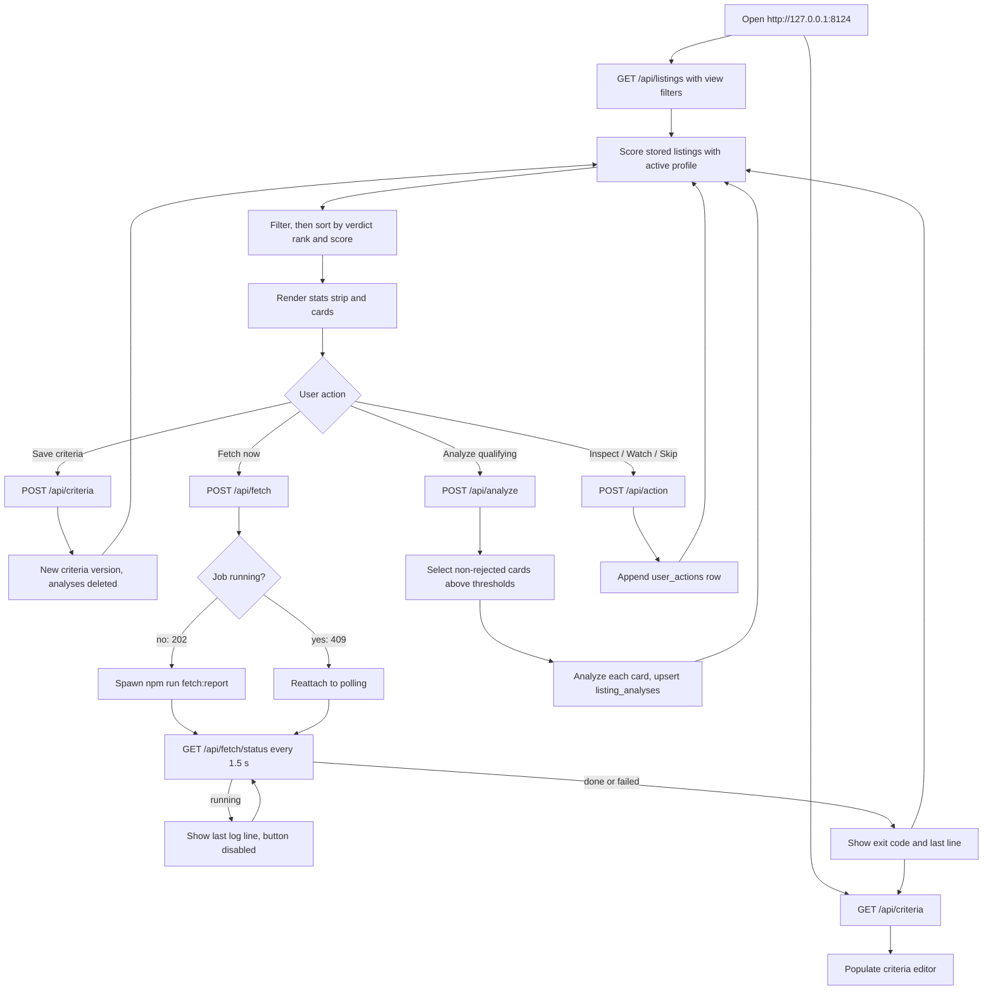

---

id: ui
title: Interactive UI
sidebar_position: 1
description: "buy-scout — Interactive UI: criteria editor, view filters, Fetch now, analysis cards, and the local API."
---

# Interactive UI

`npm run ui` starts a single-user console over the local SQLite database. It is a
**screening surface**: it re-scores what has already been fetched, lets you edit the
search brief, trigger a fetch, request analysis, and record a human decision per car.
It never buys, bids, or contacts a seller.

- One static `index.html` served by a plain `node:http` server; no bundler, no build step.
- Binds `127.0.0.1` only. There is no authentication, no CSRF token, and no multi-user state.
- All scoring happens server-side with the same `evaluateCar()` used by `npm run score`,
  `npm run report`, and `npm run eval`. The UI adds no scoring rules of its own.

## Run it

```bash
npm run ui
# buy-scout UI: http://127.0.0.1:8124
# DB: ./data/buy-scout.db
```

| Setting | Default | Meaning |
|---|---|---|
| `UI_PORT` | `8124` | HTTP port; the server prints the URL on start. |
| `DB_PATH` | `./data/buy-scout.db` | SQLite file opened at startup. |

Open `http://127.0.0.1:8124`. The page loads the active criteria and the current
listings immediately; nothing is fetched until you press **Fetch now**.

The active profile is **v18**: €7,000 car cap, €800 reserve, 200 km radius, 5 seats, 4 doors, ISOFIX, first registration 2010 or newer, max 180,000 km. Counts and verdicts are generated; run `npm run health` and `npm run eval` for the current values.

## Layout

The visual system is a buyer's field dossier: sage-tinted paper, a faint working grid,
editorial serif headings, compact ledger-style stats, and rule-separated listings. It is
not a generic dashboard of equal cards. Top to bottom, one scrolling column:

| Region | Contents |
|---|---|
| Title block | `buy-scout` wordmark, `Family car shortlist`, the active brief, and freshness. |
| Stats strip | A lead `worth viewing` count, then `ask seller`, `watching`, `in results`, `new`, and `hidden rejects`. |
| Fetch bar | **Fetch now** button, a status line, and the current fetch step. The job runs `fetch:report`, so the static report is refreshed too. |
| Disclaimer bar | Yellow, always visible: screening labels only. |
| Legend | Collapsible: what INSPECT / ASK / WATCH / REJECT mean, plus score-vs-confidence notes. |
| Criteria editor | Collapsible: budget, location, hard gates, analysis thresholds, priority weights, **Save criteria**, **Analyze qualifying cards**. |
| View filters | Search box, verdict, source, max price, max km, min year, sort, **New only**, **Show rejected**, **Show skipped**, **Show unavailable**, **Reset**. When the toolbar container is ≤1240 px they open in an overlay **Filters** panel; a narrow pane uses two columns. A wide desktop keeps the sticky filter row. |
| Card list | Rule-separated listing rows, sorted by verdict then score. Each row has a small photo, a serif title, price, compact facts, reasons, and actions. |
| Detail drawer | Price history, purchase outcome (bought/sold/rejected/too far/inspection failed/other), score breakdown, Laya, analysis, research, seller message, a **Check availability** action, and a **No longer available** banner for retired rows. |

The subtitle is rendered from the active brief: ZIP, car cap, all-in budget and radius. The static HTML carries a placeholder only until the first API response.

### Stats strip

The strip leads with the number worth viewing, then the ask/watch counts, the visible
result count, the new count and hidden rejects. Criteria version, priority matches and
freshness sit above it.

The counts are computed **after** the view filters are applied. With no filters they
describe the whole current working set; with a verdict filter they describe the filtered set
only. They are never a global total while a filter is active.

### Card order

Cards are sorted by verdict rank (`inspect`, `ask`, `watch`, `reject`) and then by score
descending. Within a verdict band the highest relative fit comes first; a REJECT always
sorts below a WATCH even when its raw components would score higher, because a hard
failure forces the score to 0.

## Criteria editor

The editor edits the **saved search brief**, which is versioned in SQLite. Saving creates
a new version, flips the active flag, deletes every stored analysis, and re-evaluates
stored listings on the next load. It never fetches.

| Control | Saved field | Effect on scoring |
|---|---|---|
| Purchase max € | `purchaseMaxEur` | Hard gate: a price above the cap rejects the car. |
| Reserve for fees/repairs € | `reserveEur` | Budget arithmetic only. All-in = purchase max + reserve, shown live under the buttons. Not a price filter. |
| ZIP | `location.zip` | Stored on the profile. It does not re-geocode existing listings. |
| Radius km | `location.radiusKm` | Hard gate with the shared tolerance `max(5 km, 5% of radius)`, plus the distance component of the score. |
| Min seats | `hard.minSeats` | Hard gate. Unknown seats become an ASK unknown, not a reject. |
| Min side doors | `hard.minDoors` | Hard gate; same unknown handling. |
| Min year | `hard.minFirstRegistrationYear` | Hard gate on the first four characters of the registration date. |
| Max km | `hard.maxMileageKm` | Hard gate. |
| Fuel | `hard.fuel` | Hard gate only when set to petrol or diesel; `any` disables it. |
| Gearbox | `hard.transmission` | Hard gate only when set to manual or automatic. |
| Min boot L | `soft.minBootLitres` | Stored on the profile, but **the car evaluator does not read it yet**. It feeds Laya need-characterisation only. |
| Analysis min score | `analysis.minScore` | Default 60. Candidate threshold for **Analyze qualifying cards**. |
| Analysis min confidence | `analysis.minConfidence` | Default 0.6. Second candidate threshold. |
| Analysis max cards | `analysis.maxCards` | Default 30, clamped to 1–100 by the server. |
| Analyze qualifying after save | `analysis.autoRun` | When checked, a successful save immediately runs the analysis pass. |
| Priority weights | `preferences[]` | Additive boost, never a filter. See below. |

Validation is server-side (`parseBriefJson`); an invalid brief returns HTTP 400 and the
message appears next to the buttons instead of a new version.

### Priority weights

Each row is a rule with a **label**, a **field** (`equipment`, `make`, `model`, `variant`,
`title`, `bodyType`, `fuel`, `transmission`, `sellerType`), a **value**, a **match**
(`contains` or `equals`) and a **weight** between 0 and 25. Rows with an empty value or a
zero weight are dropped on save.

A matching rule adds its weight to the score and prints `Priority: Bose (+10)` on the card.
A non-matching rule changes nothing and hides nothing — priorities reorder the shortlist,
they do not remove cars from it. The total boost is capped at +25, which is why a priority
can lift a good car into INSPECT but cannot rescue a car that failed a hard gate.

### Saved versus unsaved criteria

This is the most common source of confusion in the UI, so it is worth stating precisely.

```text
Editor fields  --Save criteria-->  criteria_profiles (active)  -->  scores every card
Editor fields  --no save------->   screen only; lost on reload
Fetch now      ----------------->  reads the ACTIVE SAVED profile, not the editor
Analyze        ----------------->  scores candidates with the ACTIVE SAVED profile,
                                   but uses the threshold numbers currently in the form
```

:::caution Save first, then fetch or analyze
- **Fetch now** is blocked while the criteria editor is dirty. Save first; the job uses the saved profile and refreshes `data/report.html` after the fetch.
- **Fetch now** runs the fetch pipeline against the **saved** profile. If you raised the
  price cap in the form but did not save, the fetch still uses the old cap.
- **Analyze qualifying cards** sends the threshold numbers visible in the form, but the
  candidate set is scored with the saved profile. Save before analyzing if you changed a
  hard gate, or the message will quote thresholds that do not match the cards.
- Reloading the page discards every unsaved edit without warning.
- Saving deletes all stored analyses. The card's analysis block disappears until you run
  analysis again.
:::

## View filters

Responsive behaviour is pane-driven, not viewport-only. The header, toolbar and listing surface are CSS containers. A toolbar pane ≤1240 px collapses to a **Filters** button plus a visible search field; the panel overlays the list with a 72vh scroll ceiling. A listing pane ≤620 px switches to full-width cards with a photo hero, stacked facts, and two-column actions. Header stats move to a 3-by-2 ledger below 900 px. This means split views, embedded web instances and narrow browser windows adapt from their own width rather than the screen width.

**Show unavailable** is off by default. Confirmed-gone rows are excluded from the default list and stats; enabling it includes them with a `Gone` badge and a retirement banner. Rejected gone rows are included by this toggle even when **Show rejected** is off.

Filters are display-only. They are sent to the server as query parameters, never written
to the criteria profile, and never trigger a fetch or a re-score.

| Control | Query parameter | Server-side behaviour |
|---|---|---|
| Search | `q` | Case-insensitive substring over title, make, model, city and description. |
| Verdict | `verdict` | Exact match on `inspect`, `ask`, `watch`, `reject`. |
| Source | `source` | Exact match; the option list is built from the sources present in the loaded result. |
| Max € | `maxPrice` | Drops cars priced above the value. A car with no price passes. |
| Max km | `maxKm` | Drops cars above the value. A car with no mileage passes. |
| Min year | `minYear` | Drops cars whose registration year is below the value. A car with no registration date is treated as year 0 and therefore filtered out. |
| Reset | — | Clears all six controls and reloads. |

Constraints worth knowing:

- The server loads at most **1000 listings** (`latestListings(db, 1000)`). There is no
  pagination or virtual scrolling, so a database above that size silently truncates.
- Filters combine with AND. The stats strip and the card list always describe the same
  filtered set.
- The source dropdown is rebuilt from the current result, so filtering by source can
  remove other sources from the dropdown until you reset.

## Fetch now

**Fetch now** runs `npm run fetch:report` — the smart-fetch pipeline with `--no-laya`, then
a static report refresh — without a terminal, and streams the child process output back into
the header.

### What happens on click

1. `POST /api/fetch` is sent with no body.
2. If a job is already running, the server answers **409** with the existing job; the page
   simply reattaches to polling and shows "A fetch is already running."
3. Otherwise the server answers **202** with a job object and spawns the job:
   `npm run fetch:report` through `npm_execpath`, falling back to
   `node_modules/.bin/tsx src/cli/fetch.ts` (fetch only). Working directory is the server's
   working directory, so start the UI from the repo root.
4. The button is disabled and the page polls `GET /api/fetch/status` every **1.5 seconds**,
   printing the last log line: `Fetching… …`.
5. When the child exits, the status line becomes `Fetch complete (exit 0). …` or
   `Fetch failed (exit N). …`, the button re-enables, and the page reloads both the
   criteria and the listings.

### One at a time

A single job lives in a module-level variable in `server.ts`. There is no queue: a second
request while running returns 409 rather than stacking a second crawl, which protects the
sources from accidental double-hits and keeps the coverage ledger coherent.

### What the job object contains

| Field | Notes |
|---|---|
| `id` | `fetch-<epoch ms>`. |
| `status` | `running`, `done`, `failed`. |
| `startedAt`, `finishedAt` | ISO timestamps; `finishedAt` is null while running. |
| `exitCode` | Null until exit; `0` means done. |
| `log` | Last 30 lines over the wire; the in-memory buffer keeps 120. |

:::caution Progress is line-level and in-memory
- There is no percentage. Progress is whatever the fetch CLI prints, so a quiet source
  looks like a stall.
- Job state is process memory. Restarting the UI forgets a running or finished fetch, and
  an orphaned child process keeps running with nobody polling it.
- Only stdout/stderr text is captured. Raw snapshots and the coverage ledger remain in
  `data/raw/` and SQLite.
- **Fetch now uses the saved criteria.** Unsaved edits are ignored; see the caveat above.
:::

## Analyze qualifying cards

The button runs threshold selection, not a fixed top 10. A card qualifies when all three
conditions hold:

1. the verdict is **not** `reject`;
2. its score is at least `analysis.minScore` (default 60);
3. its confidence is at least `analysis.minConfidence` (default 0.6).

Qualifying cards are sorted by score, capped at `analysis.maxCards` (default 30, clamped
1–100), and each one gets an analysis row.

```text
POST /api/analyze  { minScore, minConfidence, maxCards }
  -> score latest 500 listings with the ACTIVE SAVED profile
  -> filter non-reject, score >= minScore, confidence >= minConfidence
  -> sort by score, take maxCards
  -> analyzeListing() per card, upsert into listing_analyses
```

The message under the buttons reports
`Analyzed N of M qualifying cards (score ≥ x, confidence ≥ y, cap z).`
A high score with missing family data still qualifies — it is an ASK card, which is
exactly the card worth asking about.

### What the analysis contains

Each analysis is a JSON object with `summary`, `contradictions`, `questions`,
`negotiation` and `risk_notes`. The card shows the summary and the first three questions.

- With `LLM_API_KEY` **and** `LLM_BASE_URL` set, the call goes to
  `POST /chat/completions` with `model` from `LLM_MODEL` (default
  `deepseek-v4.1-flash`), a 30 s timeout, temperature 0.2 and JSON-only output.
- With either variable missing — or on a non-2xx response, timeout, or unparseable body —
  the deterministic fallback (`model: "deterministic-fallback"`) is used. It never invents
  history, VIN or accident-freedom; it turns the rule result into a summary and a list of
  questions for the seller.
- Requests are sequential (`await` inside the loop), so a cap of 30 cards can take a while.
  Start with a small cap while a source is slow.
- The UI does not display which model produced a card's analysis. `POST /api/analyze` does
  not invoke Laya, so rows written from the UI store `laya: null`; a CLI `npm run analyze`
  stores the classification in the same JSON and in `laya_classifications`.

## Inspect / Watch / Skip

Each card has three buttons. They write a human decision, not a score change.

- `POST /api/action` with `source`, `externalId`, `action` (`inspect`, `watch`, `skip`) and
  an optional `note`.
- Rows are append-only in `user_actions`; the UI displays the newest row per listing, so
  clicking again overwrites the visible decision but keeps the history.
- The card re-renders with `Your action: inspect`, a coloured left border (green inspect,
  amber watch, red skip) and a dimmed body for skips.
- These actions are the raw material for the outcome memory and for the human labels that
  precision@10 still needs. They are not exported by any command yet.
- There is no "clear" button. An action can only be replaced by another action.

## Disclaimer and legend

Two elements carry the safety message and neither is dismissable:

**The yellow bar** reads: *Screening labels only — not a purchase recommendation. Verify
VIN, HU/AU, service history, accident history and test-drive before buying.*

**The collapsible legend** spells out each badge and two definitions:

| Badge | Rule as implemented | Meaning in the UI |
|---|---|---|
| **INSPECT** | No hard failure, no family-critical unknown, score ≥ 65 | Worth a viewing. |
| **ASK** | No hard failure, at least one of seats, doors, ISOFIX, body type unknown | Ask the seller first. Not a rejection. |
| **WATCH** | No hard failure, family fields known, score below 65 | Keep watching for a price drop. |
| **REJECT** | At least one hard failure | Failed a hard rule; score 0. |

The legend footer adds the two definitions that get misread most often:

- **Score** is a 0–100 relative fit ranking. It is not a probability and not a quality grade.
- **Confidence** is data completeness (known fields out of nine). It is not model certainty.

Hovering a badge shows the same sentence as a tooltip. The full rule table, the order of
precedence and the mandatory pre-purchase checks live in
[What the Badges Mean](./VERDICTS.md).

## Analysis cards

One card per listing. The left border colour and the dimming are the only differences
between cards.

| Element | Source | Notes |
|---|---|---|
| Badge | `evaluation.verdict` | Tooltip carries the verdict explanation. |
| Score | `evaluation.score` | One decimal, tabular numerals. |
| Title link | `listing.title`, `listing.url` | Opens the source page in a new tab with `rel="noreferrer"`. |
| Source tag | `listing.source` | `autoscout24`, `kleinanzeigen`, or frozen `autouncle` rows. |
| Meta line | price, mileage, registration month, fuel, gearbox, city · distance | Missing values render as `—` or `?`. |
| Family line | seats, doors, ISOFIX, body type | `ISOFIX ?` means unknown, not absent. Unknown family fields are what force ASK. |
| Reason line | precedence: hard failures, else `Unknowns: …`, else reasons | A rejected card lists its hard failures; a passing card lists its strengths. |
| Flags | `listing.redFlags` | Red-flag chips; any hard red flag already forced a REJECT. |
| Priority line | `evaluation.preferenceMatches` | `Priority: Bose (+10)` per match. |
| Analysis block | stored analysis | Summary plus up to three seller questions. |
| Action line | newest `user_actions` row | `Your action: watch — note`. |
| Buttons | — | Inspect, Watch, Skip. |

When nothing matches, the list area shows `No listings match these filters.` — that is a
filter outcome, not an empty database.

## UI interaction flow



## API endpoints

The server exposes a small JSON API on the same port. Everything is `application/json`
except `/`.

| Method | Path | Request body | Response | Notes |
|---|---|---|---|---|
| `GET` | `/` | — | `src/ui/index.html` | Static page, read once at startup. |
| `GET` | `/api/listings` | Query: `q`, `verdict`, `source`, `maxPrice`, `maxKm`, `minYear` | `items[]`, `criteriaVersion`, `summary` | Scores up to 1000 listings on every request. Each item carries `listing`, `evaluation`, `action`, `analysis`. |
| `GET` | `/api/criteria` | — | `brief`, `version`, `versions[]` | The active profile plus the version history. |
| `POST` | `/api/criteria` | `brief`, optional `name` | `version`, `analysesCleared: true` | Validates, inserts a new version, deletes all analyses. `400` on an invalid brief; `409` while a fetch is running. |
| `POST` | `/api/analyze` | `minScore`, `minConfidence`, `maxCards` | `analyzed`, `considered`, `criteriaVersion`, `minScore`, `minConfidence`, `maxCards`, `reason` | Candidates come from the latest 500 listings, scored with the saved profile; Laya is not invoked. |
| `POST` | `/api/action` | `source`, `externalId`, `action`, optional `note` | `ok: true` | `action` must be `inspect`, `watch` or `skip`; otherwise `400`. |
| `POST` | `/api/fetch` | — | `job` | Starts `fetch:report`; `202` when started, `409` when a fetch is already running. |
| `GET` | `/api/fetch/status` | — | `job` or `null` | `job.log` is trimmed to the last 30 lines. |
| `GET` | `/api/summary` | Query as `/api/listings` | `summary` | Verdict counts only. Present for scripting; the page does not call it. |
| `*` | anything else | — | `error` | `404` with a JSON error. |

Unhandled exceptions become `500` with `error` set to the exception message. There is no
request logging and no rate limiting — acceptable on loopback, not on a shared host.

## Known limits

| Limit | Consequence | Mitigation |
|---|---|---|
| Loopback only, no auth | Anyone with local shell access can rewrite criteria and start fetches. | Never bind to `0.0.0.0` or expose the port. |
| One in-memory fetch job | A server restart forgets the job; an orphan child keeps crawling. | Watch the terminal; use `npm run health` after unusual runs. |
| 1000-listing cap per request | Larger databases truncate silently. | Keep the DB curated; prune or archive old rows. |
| Stats reflect filters | A count is only a global count with no filters. | Reset filters before quoting counts. |
| Save wipes analyses | Re-analysis costs tokens and time. | Save criteria changes in batches. |
| Analysis is sequential | Large caps are slow and can hit the 30 s per-call timeout. | Start with 5–10 cards. |
| Heuristic distance for AutoUncle rows | ZIP-prefix table, not a geocoder; the source is enabled but coarse. | Treat distances near the radius edge as uncertain. |
| No VIN anywhere | Dedupe is make/model/month/mileage-bucket/price-bucket, and a car can appear twice. | Verify the VIN on the phone before viewing. |

## Troubleshooting

| Symptom | Likely cause | Fix |
|---|---|---|
| `EADDRINUSE` on start | Port 8124 already taken. | `UI_PORT=8125 npm run ui`. |
| Page loads, list says "Loading…" forever | API request failed; check the terminal for a 500. | Confirm `DB_PATH` points at a real database and re-run `npm run fetch:as24`. |
| "No listings match these filters." | Filters exclude everything, or the DB is empty. | Press **Reset**; if still empty, fetch. |
| Fetch status sticks on "A fetch is already running." | An earlier job is still `running`, or an orphan child holds the state. | Wait for the exit line; if it never comes, restart the server. |
| Fetch finishes with `exit 1` | Source blocked, or npm/tsx not found. | Read the last log line, then `npm run health` and `npm run playbook -- --symptom <symptom>`. |
| Criteria save shows `Error: …` | Brief failed validation (for example a negative price or a bad enum). | Fix the highlighted field and save again. |
| Analysis block empty after saving | Saving deletes analyses by design. | Press **Analyze qualifying cards**. |
| Priorities do not change a REJECT | Hard failures zero the score before the boost. | Priorities only reorder cars that already passed the gates. |

## Related reading

- [Criteria & Filter Flow](./CRITERIA-FLOW.md) — criteria vs view filters vs fetch vs analyze.
- [What the Badges Mean](./VERDICTS.md) — rules, precedence, score versus confidence.
- [Analysis](./ANALYSIS.md) — Laya and DeepSeek responsibilities.
- [Evaluation](./EVALUATION.md) — what the current corpus actually measures.
- [Runbook](./RUNBOOK.md) — CLI equivalents of every button.
