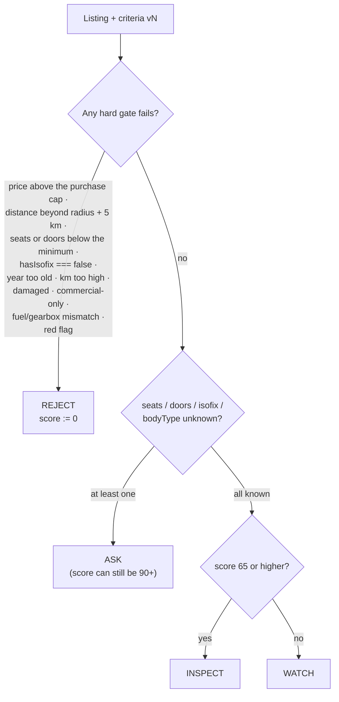

# Verdicts & Score

Every car gets **exactly one badge**. The badge is a **screening label**, not a purchase recommendation, not a probability, and not a mechanical assessment. The UI legend and the static report carry the same disclaimer as this page.

## The four labels

| Badge | Exact rule | What it means | What it does **not** mean |
|---|---|---|---|
| **INSPECT** | No hard failures, no family-critical unknowns, `score >= 65` | Worth a viewing. It cleared the budget/family gates and the data is good enough to shortlist. | Not "approved", not "safe", not "mechanically checked". |
| **ASK** | No hard failures, and at least one of `seats`, `doors`, `hasIsofix`, `bodyType` is unknown | Ask the seller for the missing facts before booking. **It may be the best car in the list.** | Not a rejection. A high score with missing family data still becomes `ASK`. |
| **WATCH** | No hard failures, no family-critical unknowns, `score < 65` | Keep watching. Passes the gates but is not a top pick; wait for a price drop or a better car. | Not broken, not rejected, not "almost INSPECT". |
| **REJECT** | At least one hard failure | Failed a rule *you configured*: price, distance, seats, doors, ISOFIX, year, mileage, damage, commercial/export-only seller, fuel/gearbox mismatch, or a red flag. Score is **0**. | Not necessarily a bad car — a bad fit for this brief, or disqualifying data. |

There is no combined badge. "Inspect Ask" is not a state; it is either two different cars or two options in the verdict filter.

## Decision tree



### Order of precedence

```text
hard failure        → REJECT (score 0)
else family unknown → ASK
else score >= 65    → INSPECT
else                → WATCH
```

`ASK` wins over `INSPECT`: a 90-point car with unknown seats is still `ASK`. `REJECT` wins over everything: the score is forced to 0 and the priority boost is discarded, not added.

:::note Exact comparison
`evaluateCar` compares the **unrounded** score against 65 and only then rounds for display (1 decimal). So a card showing `65.0` is `INSPECT`, and a raw 64.96 rounds to `65.0` but stays `WATCH`. In practice this is a sub-0.05 edge case; do not tune criteria against the displayed decimal.
:::

## Score vs confidence

Two independent numbers, often confused:

| | **Score** | **Confidence** |
|---|---|---|
| Range | 0–100 (1 dp) | 0–1 (2 dp) |
| Question it answers | "How well does this car fit the brief *relative to the others*?" | "How much evidence does the listing actually contain?" |
| Built from | family 30%, deal 25%, age 15%, mileage 15%, distance 10%, evidence 5%, + priority boost (cap +25) | known of 9 fields ÷ 9 |
| The 9 fields | — | price, mileage, first registration, fuel, gearbox, seats, doors, ISOFIX, body type |
| Meaning | A ranking, **not** a probability, **not** a quality grade | Data completeness, **not** model certainty |
| Failure effect | Forced to 0 on any hard failure | Unaffected by verdict |

`confidence = 0.67` means 6 of 9 fields parsed (e.g. no seats, no doors, no ISOFIX). `confidence = 1.00` means all nine. Description text, equipment lists and HU dates do **not** count toward confidence.

Consequences:

- A cheap car with no seats/doors/ISOFIX has **low confidence even if the price is great**.
- Missing year or mileage lowers score and confidence but does **not** trigger `ASK` — only the four family-critical fields do.
- `INSPECT` never implies high confidence *by rule*; it implies the family fields were known. A 65.0 `INSPECT` with confidence 0.67 is possible when the missing field is `firstRegistration` or `fuel`.

## Why ASK is a rejection's opposite

`ASK` is the system saying **"I don't know"**, never **"no"**.

- The label exists because three of the four family-critical fields are frequently absent from list pages: `seats`, `doors`, `hasIsofix` (and `bodyType`). Detail enrichment fills them; `--no-details` fetches do not.
- `hasIsofix === false` → hard failure → `REJECT`. `hasIsofix === null` → `ASK`. The pipeline distinguishes *disqualifying* from *unstated*.
- `ASK` cards are **non-rejected**, so they remain in the analysis pool: `selectAnalysisCandidates` filters only `verdict !== "reject"`. An `ASK` card can be the highest-scoring car analyzed.
- `ASK` cards sort after `INSPECT` in the UI but keep their real score — they are not visually buried.
- The generated analysis for an `ASK` card is mostly questions: ISOFIX, seat count, door count, HU date, service history, accident history, owners.

Resolving an `ASK` is cheap: one message to the seller. See *Changing a badge* below.

## Examples

Verified against `src/domain/cars/evaluate.ts` with the active v18 profile: `purchaseMaxEur = 7000`, `reserveEur = 800`, `budgetAllInEur = 7800`, radius 200 km, all other defaults.

| # | Car / situation | Verdict | Score | Conf. | Reason |
|---|---|---|---|---|---|
| 1 | Kia Ceed SW, €6,150, 2016, 120,000 km, 48 km, Kombi, 5 seats / 5 doors / ISOFIX, "good price" | **INSPECT** | **96.6** (88.6 + Kia +8) | 1.00 | Everything known, passes all gates |
| 2 | Same car at €7,050 | **REJECT** | 0.0 | 1.00 | `price 7050 € > cap 7000 €` |
| 3 | Same car at €7,000 exactly | **INSPECT** | 88.6 | 1.00 | Gate is strict `>`; equality passes |
| 4 | Same car with `seats`, `doors`, `hasIsofix` unparsed | **ASK** | **86.9** | 0.67 | Score is still high — the badge is about missing facts |
| 5 | 2010 car, 179,000 km, €6,100, 48 km away, "high price" | **WATCH** | **57.0** | 1.00 | Passes gates, ranks low |
| 6 | Any of the above flagged `damaged` | **REJECT** | 0.0 | 1.00 | `listed as damaged` |
| 7 | First registration 2009 | **REJECT** | 0.0 | 1.00 | `first registration 2009 < 2010` |
| 8 | **Peugeot TePee Active 73 PS** (frozen AutoUncle row), €1,750, 2013, 144,000 km, 5 km, Kombi, "Superpreis" | **ASK** | **76.2** | **0.67** | `passes hard gates; strong family fit; unknowns: seats, doors, isofix` |

### The 76.2 ASK Peugeot TePee case

Recorded in `data/eval.json` and `data/analysis.json`; still reproduces as of the current database.

```text
price       1,750 €      ≤ 6,200   pass
distance        5 km     ≤ 55      pass
first reg    2013        ≥ 2010    pass
mileage     144,000 km   ≤ 180,000 pass
bodyType     Kombi                 pass
seats        null                  unknown
doors        null                  unknown
hasIsofix    null                  unknown

verdict    ask
score      76.2
confidence 0.67   (6 of 9 fields)
```

The listing's own text says *"Bipper 73 Active-5 Sitzer"* — the seat count is literally in the description, but the AutoUncle parser did not extract it into `seats`. That is the entire reason for the badge: **the data gap is a parser gap, not a car problem.** One question to the seller ("5 Sitzer, 5-Türer, ISOFIX?") converts this to `INSPECT` at the same score.

Two details worth knowing about this case:

- **Family fit is 1.00** even with three unknowns, because `family` only divides by the *known* fields — here `bodyType = Kombi` alone, scoring 1/1. Unknowns are excluded from the denominator rather than counted as zero.
- **Deal is 0.5, not 0.95**, because AutoUncle stores the German label `"Superpreis"` while `dealComponent` matches English kebab-case (`"super-price"`). Without a `priceMedianEur`, the switch falls through to the neutral default.

:::note Same car, different score
`docs/JOURNAL.md` records this car at **75.4 ASK** in an earlier run; the recorded data now shows **76.2**. Scores are relative to the *active criteria version* and the parsed fields, so a criteria change (or a parser change) moves the number without anything about the car changing. Never compare scores across criteria versions — compare badges and reasons.
:::

## What a badge verifies

| Verified by the pipeline | **Not** verified |
|---|---|
| The listed price is at or under your cap | The real price, or what the seller will accept |
| The stated distance is inside your radius | The seller's actual location |
| The listing states ≥ min seats / doors and ISOFIX | That the car physically has them |
| Damage / commercial-only flags are absent | Accident history, repaired damage, paint readings |
| First registration and mileage are inside your limits | Mileage authenticity (clocking) |
| Fuel/gearbox match, when stated | Service history, timing chain, clutch, DPF |
| No known red-flag keyword | HU/AU validity, hidden faults |
| Duplicate listings are grouped | Seller identity, title, liens, export status |
| All nine fields parsed (confidence) | That the parsed values are true — they are the seller's claims |

`INSPECT` therefore means exactly one thing: **this listing passed the rules you configured.** It is a reason to book a viewing, not a reason to buy.

## Before you buy — mandatory checks

Run all ten, regardless of badge. The last one is the one people skip.

- [ ] **1. VIN** matches the listing, the documents, and the stamp in the engine bay.
- [ ] **2. HU/AU report** and date of last inspection — read the report, not just the sticker.
- [ ] **3. Service history / Scheckheft** — stamps, invoices, intervals, timing chain or belt evidence.
- [ ] **4. Accident history and paint readings** — thickness gauge on every panel.
- [ ] **5. Mileage plausibility** — cross-check HU reports and service invoices against the odometer.
- [ ] **6. Ownership and seller identity** — ID, registration document, seller is the registered keeper or a legitimate dealer.
- [ ] **7. Cold start, test drive, gearbox, clutch, brakes, tyres** — cold start only, at least 20 minutes of driving.
- [ ] **8. Independent inspection** for any expensive buy — €100–150 against a €5,000 mistake.
- [ ] **9. Two child seats + ISOFIX fit test with your actual seats** — including the pram in the boot, with the seats installed.
- [ ] **10. Written agreement** on price, known defects, and handover — signed before money changes hands, no deposit before viewing and VIN match.

:::warning The badge cannot do these for you
No field in this system proves accident freedom, mileage authenticity, or mechanical health. `INSPECT` is the start of due diligence, not the end of it.
:::

## Changing a badge

| Transition | Trigger |
|---|---|
| `ASK` → `INSPECT` | Seller confirms seats / doors / ISOFIX / body type, or detail enrichment parses them |
| `ASK` → `REJECT` | Seller confirms a hard failure (3 doors, no ISOFIX, damaged) |
| `WATCH` → `INSPECT` | Price drops, or criteria/priority weights change the score across 65 |
| `INSPECT` → `REJECT` | Fresh data reveals a hard failure (new red flag, price raised above cap, damage disclosed) |
| `REJECT` → anything | Only if the underlying data or criteria change — **a priority weight cannot rescue a hard fail** |

## Disclaimer

> Screening labels only — not a purchase recommendation. Verify VIN, HU/AU, service history, accident history and test-drive before buying.
>
> **Score** is a 0–100 relative fit ranking, not a probability and not a quality rating. **Confidence** is data completeness (0–1), not the model's certainty. A badge never verifies the seller's claims. Always check VIN, HU/AU report, service history, accident history, mileage plausibility, ownership, cold start, test drive and an independent inspection.

## See also

- [Criteria & Priorities](./CRITERIA.md) — what the gates and weights are, and the €7,000 worked example.
- [Analysis (Laya & DeepSeek)](./ANALYSIS.md) — the questions behind an `ASK` card.
- `docs/CRITERIA-FLOW.md`, `src/domain/cars/evaluate.ts`, `src/ui/index.html` (legend + disclaimer bar).
